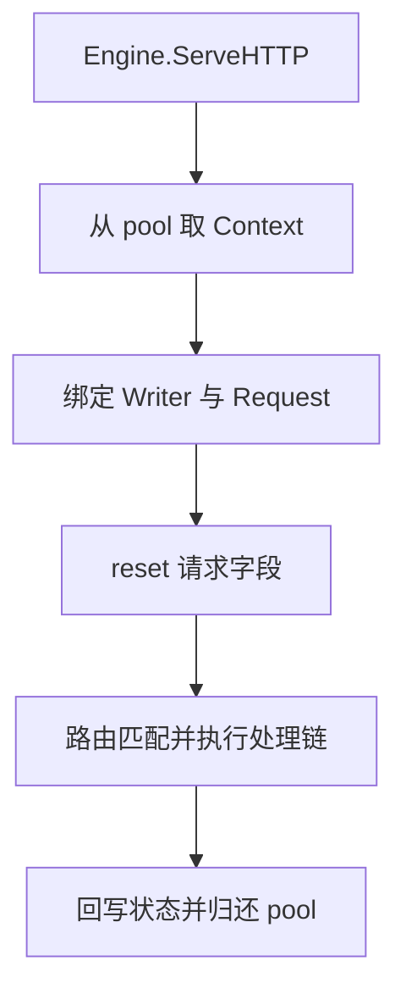

# Gin 源码：Context 池化、Next、Abort 与 Copy 的真实边界

沿着 Engine.ServeHTTP、Context.reset、Next、Abort 和 Copy 读 Gin 1.12.0 源码，把池化复用、嵌套调用、提前返回与异步访问的边界逐一对应到实验。

## 1. 一次请求怎样借出并归还 Context



gin.go 的 ServeHTTP 先确保路由树更新，再从 pool.Get 取对象、重置 writermem、绑定新的 Request、调用 Context.reset，进入 handleHTTPRequest，正常返回后再 pool.Put。

reset 会清理 handlers、index、Keys、错误、缓存与路由状态等字段，部分 Slice 通过长度归零复用容量。不是每个新请求都建立一个全新 Context，因此请求结束后保留原指针可能读到后续请求的数据。

sync.Pool 也不保证每次复用相同实例，Runtime 可以丢弃池元素。不要编写依赖“两次请求必定拿到同一地址”的测试来证明池化行为；应依据所有权约束和固定源码解释。

## 2. handlers 与 index 怎样推进

路由匹配后，handleHTTPRequest 把匹配到的参数、handlers 和 fullPath 放进 Context，再调用 c.Next。Next 增加共享 index 并依次执行尚未运行的 Handler。

外层中间件在 Next 前做准备，Next 内运行后续链，返回后再执行收尾，因此出现嵌套效果。它不是 Go defer 的另一个写法，也不是为每个中间件新开 Goroutine。

```text
outer-before
inner-before
handler
inner-after
outer-after
```

同步日志、响应统计和鉴权通常在同一条请求执行链上；它们若自己发起后台工作，就需要另外的生命周期管理。

## 3. return 与 Abort 控制的是不同层

return 退出当前 Go 函数；Abort 把 Context.index 设置到终止范围，让后续处理链不再调度，但不会退出当前函数。AbortWithStatus/AbortWithStatusJSON 还会写相应状态或正文。

```text
outer-before
denied
after-abort
outer-after
```

实验中 denied 之后调用 Abort，业务 Handler 没有执行，但当前中间件里的 after-abort 与外层 Next 返回后的 outer-after 仍运行。需要立即停止当前函数时，应同时 return。

另一个对照中，中间件只 return、不 Abort，外层的处理链循环仍会继续执行后续 Handler。因此“不调用 Next”或“从鉴权函数 return”本身，都不等于明确终止整个链。

## 4. Copy 是新外壳加有限容器复制

context.go 的 Copy 创建新 Context，保存 Request 与 engine 等引用，复制 fullPath、Params 和 Keys 容器；它把复制体的底层 ResponseWriter 清空，把 handlers 清空并设置不可正常继续调度的 index。

这解释三种不同结果：原 Keys 增删某个键，不会直接改变副本 Keys；原 Params 元素被改，副本仍保留旧参数；但 Keys 的值若是 Map 或指针，内部对象仍共享。

Copy 不是跨线程事务快照，也不是保存完整上传数据的工具。原 Request 和请求 Context 仍共享，响应 Writer 更不能被当成继续写原请求的有效接口。

## 5. 局部同步不代表整个 Context 并发安全

Gin 对 Keys 的 Set/Get 有局部同步，并不等于 Params、Request、Writer、index 和业务对象都能在任意 Goroutine 中并发修改。池化归还后，原 Context 更已经不属于旧调用者。

同理，Copy 时拿到一个字符串可以安全保存，不代表把整个副本永久放入全局 Map 就合理。它仍可能保留 Request 及其关联对象，让本应结束的生命周期被延长。

异步代码尽量只接收必要的不可变字段、独立数据副本或持久任务 ID。需要可取消请求协作时，传 Request.Context，而不是把框架对象当通用控制面。

## 6. fallback 不是取消语义的唯一来源

Gin 1.12.0 的 hasRequestContext 同时检查 engine.ContextWithFallback 与 Request。Deadline、Done、Err 只有满足条件时才回退；Value 则还处理 Gin 专用键和 Keys 中的字符串键。

因此 Gin Context 与标准 Context 的同名方法不能脱离配置解释。业务层直接接收标准 context.Context，使调用链只依赖明确的请求预算，不必知道 Gin 的池、Writer 和路由状态。

Copy 仍保存 engine 与 Request 引用，所以不会自动变成一个取消隔离对象；它也不会为某个请求建立新的超时。

## 7. 用契约实验代替地址猜测

```bash
cd examples/gin/service-lab
go test ./internal/requestflow -run 'TestGinHandlerChain|TestGinCopyBoundaries|TestGinContextFallback|TestGinCopyKeepsRequestCancellation' -v -count=1
```

处理链测试覆盖正常嵌套、Abort 后当前函数继续，以及只 return 仍会继续后续链。Copy 测试在同一 Goroutine 中修改原容器，验证浅复制边界，不故意制造数据竞争。

网络生命周期则用真实回环 HTTP 测试：请求返回后，副本仍观察到原 Request Context 取消。Recorder 更适合测 Handler 契约，不能凭它模拟一次网络请求的完整创建与关闭。

升级 Gin 时，先对照固定版本的字段与方法实现，再重跑这些可观察行为；不要将内部 index 数值当成对应用开放的稳定协议。

## 8. 练习与答案

### 8.1 中间件不调用 Next，为什么后面的 Handler 仍可能执行

因为引擎或外层 Next 的调度循环还会继续推进共享 index。要终止后续链用 Abort；要退出当前函数还需要 return。

### 8.2 Abort 后为什么仍然看到外层收尾日志

Abort 阻止后续 Handler 调度，不会撤销已经进入的调用栈。外层 Next 返回后仍会执行自己的收尾代码。

### 8.3 测试为什么不要求两次请求的 Context 指针相等

sync.Pool 不保证一定缓存或返回同一个对象。正确性应依赖“归还后不再使用”的所有权规则，而不是依赖地址复用的偶然现象。

## 9. 参考资料

- [Gin 1.12.0 gin.go](https://github.com/gin-gonic/gin/blob/v1.12.0/gin.go)
- [Gin 1.12.0 context.go](https://github.com/gin-gonic/gin/blob/v1.12.0/context.go)
- [sync.Pool](https://pkg.go.dev/sync#Pool)
- [处理链与 Copy 实验](https://github.com/newswitch/newswitch.github.io/blob/main/examples/gin/service-lab/internal/requestflow/context_test.go)
