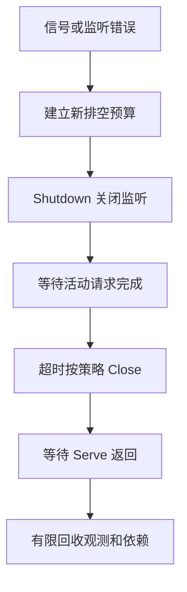

# Gin 配置、健康检查、信号与优雅退出

服务生命周期不仅是启动监听，还包括配置生效、接流条件、取消传播、HTTP 排空和依赖释放。对照 taskd 的真实执行顺序，理解健康检查、信号和退出预算分别保证什么。

## 1. 配置在什么时候读取和校验

service-lab/cmd/taskd 在启动时解析 flag，并读取 LAB_DB_DRIVER、LAB_DB_DSN、LAB_JWT_KEY 和 LAB_OTLP_ENDPOINT 等环境变量。配置来自启动时的进程环境，不会因为外部 Secret 或 ConfigMap 文件改变就自动重新建立连接、轮换密钥或更新 Router。

启动校验应尽早发现非法监听地址、缺少密钥、数据库不可用和观测初始化失败。当前 -demo 使用公开教学密钥，只允许 API 监听数值回环地址；管理端也要求数值回环地址。这不是生产密钥管理方案。

DSN、Token 和完整凭证不要写进错误日志或进程参数。实验支持通过环境变量传敏感配置，但环境变量也需要受控的进程和部署权限，不能当成天然加密存储。

## 2. live、ready 与 startup 各自回答什么

| 检查 | 回答的问题 | 错误绑定的后果 |
| --- | --- | --- |
| liveness | 进程是否仍有能力工作 | 下游短暂抖动触发所有实例重启 |
| readiness | 当前实例是否适合承接新流量 | 未就绪就接流，或退出时继续被选中 |
| startup | 启动阶段是否尚未完成 | 慢初始化不断被错误杀死 |

当前 taskd 的 live 不依赖数据库，ready 在 500 ms 子预算内 Ping DB。它只实现这套示例条件，没有维护独立的 draining 标志；不能声称“收到信号后 ready 已先变为 false”。

```bash
cd examples/gin/service-lab
go test ./internal/app -run 'TestHealth|TestDependencyFailureChangesReadinessNotLiveness' -v -count=1
```

关闭实验数据库后的结果是 live=200、ready=503。它证明依赖可用性与进程存活被分开处理；真实服务是否因某个依赖失败而整体摘流，还要看哪些 API 仍能工作及降级策略。

## 3. 从信号到 Shutdown 的真实顺序



taskd 用 signal.NotifyContext 监听 Interrupt/SIGTERM，同时等 API 或管理监听的失败通知。触发退出后，使用新的 Background 子 Context 给 HTTP 排空 5 秒，而不是使用已经取消的信号 Context。

实际顺序是先调用 Shutdown，再等待 Serve Goroutine 返回；不是“先等 Serve 停止，再想办法 Shutdown”。Shutdown 关闭监听时，Serve 往往很快返回 ErrServerClosed，但活跃请求可能还在排空。

API 与管理 Server 顺序共享同一个 5 秒排空 Context，不是各有独立 5 秒。前一个用掉大部分预算后，后一个只剩余下时间，超时则调用 Close。

## 4. Shutdown、请求取消和后台 Join 要分开

Shutdown 正常路径并不先取消所有活跃请求，它关闭监听和空闲连接，等待活跃请求结束。排空 Context 到期，只会让这次等待返回错误，不会自动终止所有 Handler；Close 兜底可能中断活动连接。

taskd 的信号 Context 没有直接配置成每个请求的 BaseContext，因此不能说信号到来就已经取消全部 Request.Context。示例 API 自己的请求预算为 3 秒，SSE 也服从它，这与 HTTP 排空预算是不同层次。

CLI 中的 WaitGroup 主要等待两个 Serve 函数，不会自动追踪 Handler 私自启动的后台任务。请求内协作应在返回前通过 errgroup Join；进程 Worker 也要有独立的停止领取、取消与完成协议。

## 5. 用已有 HTTP 和 Gin 实验验证边界

```bash
cd examples/go/core-lab
go run ./cmd/mechanism-lab -mode http-server
cd ../../gin/service-lab
go test ./internal/requestflow -run TestGinDeadline -v -count=1
```

HTTP 实验验证正常排空、排空超时仍不直接取消活跃 Handler，以及 Close 后连接取消。Gin 实验进一步显示：同样返回 504，可以仍有一个后台任务，也可以已经 Join 两个子任务。

这些回环实验不依赖 Linux 信号，能检查 API 语义和请求生命周期，但不能证明 Kubernetes 滚动退出已经正确。Windows 上由测试工具终止进程，也不能当作 Linux SIGTERM 优雅退出的证据。

## 6. 依赖最后关，但每种依赖还要有自己的结束条件

活跃请求和 Worker 仍在用 DB 时，不应先关闭 DB 再等它们完成。当前 CLI 在 HTTP 退出流程后，通过 defer 关闭缓存、有限关闭观测导出，最后回收外层数据库资源；观测关闭有独立 2 秒预算。

5 秒 HTTP 等待与 2 秒导出只是两个局部预算，不是“整个进程必定 7 秒退出”的保证。任务是否响应取消、资源 Close 是否阻塞以及调度，都参与实际退出时间。

独立 Worker 被取消时，已领取任务可能尚未完成；持久状态和租约恢复应负责后续重试，不能为了退出好看而把 RUNNING 强行改成成功。退出码也要区分预期取消与真实执行失败。

## 7. 部署层还要处理摘流传播和宽限期

生产常见顺序是先进入 draining 状态并停止业务准入，让 readiness 与流量入口开始摘流，再执行有限 HTTP 排空；存量连接与流式请求仍需要应用协议配合。示例 taskd 没有自动完成这整套平台协调。

应用 /health/ready 的 HTTP 结果与 EndpointSlice 的 ready 字段不是同一个东西。常规 Pod 终止时，控制面会标记 terminating，并将相关端点的 ready 置为 false；这也不意味着网关已有连接立即停止使用，更不代表应用后台任务已经清理。应用自己的 draining 还可用于主动下线和非 Kubernetes 环境。

在常规优雅终止中，preStop 属于终止宽限期的一部分，会消耗 terminationGracePeriodSeconds；不能把它当成宽限期之外额外赠送的时间。负载均衡、Endpoint 更新和连接复用有传播过程，也不能用一个固定 Sleep 证明所有入口已经停止发流量。

在 Linux 隔离环境实际发送 SIGTERM，记录停止接单、活动量归零、SSE 结束、观测导出与进程退出时间。再验证宽限期耗尽和强制关闭的失败路径，确认客户端可以通过幂等标识查明已提交结果。

## 8. 练习与答案

### 8.1 为什么不能先 Wait Serve，再调用 Shutdown

仍在监听的 Serve 通常不会自行返回，先等它可能一直阻塞。应先触发 Shutdown/关闭监听，再分别等待排空结果和 Serve 结束。

### 8.2 收到信号后，taskd 的所有请求是否立即取消

不是。当前信号 Context 没有直接作为所有请求的 BaseContext；HTTP Shutdown、请求自己的预算与自管后台任务是不同层。

### 8.3 preStop 等待 10 秒，再配置 5 秒应用排空，宽限期设 10 秒够吗

不能这样相加预算。preStop 本身消耗宽限期，后续应用排空、导出与资源回收都需要剩余时间，还要计入传播和失败余量并实际验证。

## 9. 参考资料

- [taskd 生命周期实现](https://github.com/newswitch/newswitch.github.io/blob/main/examples/gin/service-lab/cmd/taskd/main.go)
- [http.Server.Shutdown](https://pkg.go.dev/net/http#Server.Shutdown)
- [signal.NotifyContext](https://pkg.go.dev/os/signal#NotifyContext)
- [Kubernetes Pod 终止](https://kubernetes.io/docs/concepts/workloads/pods/pod-lifecycle/#pod-termination)
