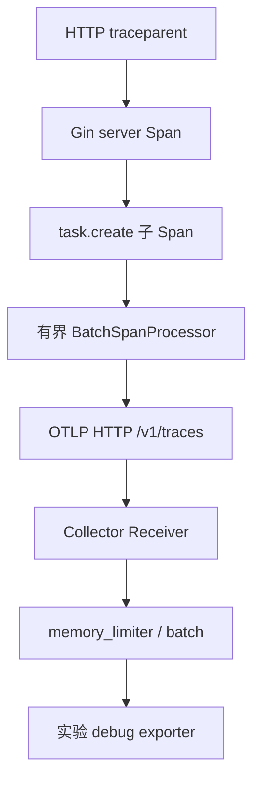

# Gin 日志、Prometheus 与 OTLP：关联请求而不是堆指标

观测体系要同时回答发生了多少、哪里慢以及某次请求经历了什么。日志、指标和链路职责不同，必须建立明确关联与成本边界。

## 1. 本工程的三类信号

请求日志记录 method、路由模板、status、duration_ms 和 trace_id，不记录 Bearer 或完整正文。Prometheus 统计请求量与 Handler 延迟，标签使用模板和状态，未匹配请求统一 unmatched。

OTel middleware 提取 W3C Trace Context，建立 server Span，把新 Context 放回 Request；创建任务时增加 task.create 子 Span。业务内部 SQL 和 Redis 没有自动插桩，不能把父 Span 存在当作所有依赖都有详细链路。

## 2. 导出链路



LAB_OTLP_ENDPOINT 可为接收器基础 URL，代码补上 /v1/traces；若显式提供路径则尊重该路径。HTTP OTLP 与 gRPC OTLP 端口/协议不同，不能只换一个数字就认为兼容。

## 3. 真实协议测试

```bash
cd examples/gin/service-lab
go test ./internal/observe -count=1 -v -timeout=30s
```

本地 receiver 收到真实 HTTP Protobuf，解析 ExportTraceServiceRequest，核对 server/child 的 TraceID 与 ParentSpanID；另测导出 401 不使业务 Handler 变成失败。

这证明本机协议与父子关系，不证明真实 Collector、后端存储和 Grafana 已联通。Compose 的 Collector 仅输出 debug，没有配置持久追踪后端。

## 4. 采样与故障退化

教学代码 AlwaysSample 便于观察，生产应按流量和成本设置采样。发送超时一秒、队列有限、重试关闭，避免观测故障无限拖住业务；代价是可能丢 Span，需要独立监控导出失败与丢弃。

进程退出有限排空，超时不无限等待。不要用用户 ID、task ID、完整 URL 作为指标 label，也不要把 P99 从直方图跨实例简单求平均。

## 5. 练习与答案

### 5.1 tracer 创建成功代表数据已导出吗

不代表，需接收端协议与实际 Span 验证。

### 5.2 一个父 Span 就覆盖所有 SQL 细节吗

不会，依赖需要明确插桩。

### 5.3 每实例 P99 可以简单平均吗

不能，需按正确分布与聚合方式计算。

## 6. 参考资料

- [OTel Go SDK](https://opentelemetry.io/docs/languages/go/)
- [Collector 配置](https://opentelemetry.io/docs/collector/configuration/)
- [Prometheus 实践](https://prometheus.io/docs/practices/instrumentation/)
