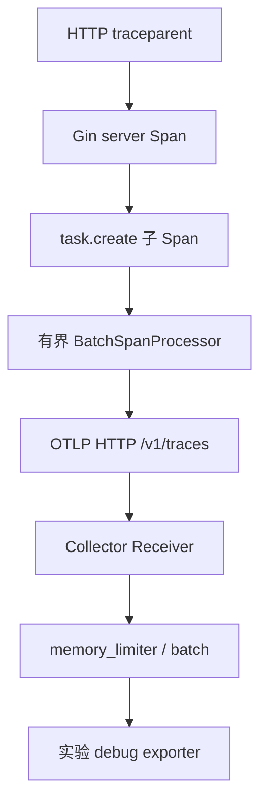

# Gin 日志、Prometheus 与 OTLP：关联请求而不是堆指标

观测体系要同时回答发生了多少、哪里慢以及某次请求经历了什么。日志、指标和链路职责不同，必须建立明确关联与成本边界。

## 1. 本工程的三类信号

请求日志记录 method、路由模板、status、duration_ms 和 trace_id，不记录 Bearer 或完整正文。Prometheus 统计请求量与 Handler 延迟，标签使用模板和状态，未匹配请求统一 unmatched。

OTel middleware 提取 W3C Trace Context，建立 server Span，把新 Context 放回 Request；创建任务时增加 task.create 子 Span。业务内部 SQL 和 Redis 没有自动插桩，不能把父 Span 存在当作所有依赖都有详细链路。

## 2. 导出链路



LAB_OTLP_ENDPOINT 可为接收器基础 URL，代码补上 /v1/traces；若显式提供路径则尊重该路径。HTTP OTLP 与 gRPC OTLP 端口/协议不同，不能只换一个数字就认为兼容。

## 3. 真实协议测试

```bash
cd examples/gin/service-lab
go test ./internal/observe -count=1 -v -timeout=30s
```

本地 receiver 收到真实 HTTP Protobuf，解析 ExportTraceServiceRequest，核对 server/child 的 TraceID 与 ParentSpanID；另测导出 401 不使业务 Handler 变成失败。

这证明本机协议与父子关系，不证明真实 Collector、后端存储和 Grafana 已联通。Compose 的 Collector 仅输出 debug，没有配置持久追踪后端。

## 4. 采样与故障退化

教学代码 AlwaysSample 便于观察，生产应按流量和成本设置采样。发送超时一秒、队列有限、重试关闭，避免观测故障无限拖住业务；代价是可能丢 Span，需要独立监控导出失败与丢弃。

进程退出有限排空，超时不无限等待。不要用用户 ID、task ID、完整 URL 作为指标 label，也不要把 P99 从直方图跨实例简单求平均。

## 5. 一次请求怎样把三类信号关联起来

Middleware 提取 W3C Trace Context，建立 server Span，把新 Context 放回 Request；业务再从它派生 task.create 子 Span。日志输出 TraceID，指标按路由模板与状态聚合，于是可以从异常路由的统计走向一条具体链路。

TraceID 是关联信息，不是授权凭证。上游提供的追踪字段也应按传播规范和可信边界处理，不把任意 baggage 复制进全部日志与指标。

SQL、Redis 与 Kafka 不会仅因存在一个父 Span 就自动有详细耗时。要理解每个客户端的插桩方式、阶段与属性，并避免同时使用两套 instrumentation 产生重复 Span。

## 6. 直方图聚合不能平均各实例的 P99

```promql
histogram_quantile(
  0.99,
  sum by (le, route) (
    rate(lab_http_request_duration_seconds_bucket[5m])
  )
)
```

这是根据本工程指标名给出的查询表达式，不是已运行 Prometheus 的截图。先按相同 bucket 边界聚合计数，再估算分位数；不能把每个 Pod 的 P99 求平均，因为请求量与分布可能不同。

直方图 bucket 影响可观察精度，低流量短窗口也会产生噪声。请求总量、错误率、在途与依赖等待应共同看；只看成功请求的尾延迟会遗漏被拒绝或超时的那部分负载。

## 7. 导出成功、后端可查与业务成功各自确认

TracerProvider 负责 Span 生命周期与采样，BatchSpanProcessor 组织有界队列，OTLP exporter 通过 HTTP 发送，Collector 再处理和导出到后端。任意一层缺配置，都可能出现“应用有 TraceID，但后端查不到”。

当前使用 AlwaysSample 方便本地观察，有限队列与一秒发送超时保护业务，不启用无限重试；代价是观测故障时可能丢 Span。生产采样要考虑父级决策、错误调查与成本，不能只把采样率固定为 100%。

本地 Protobuf receiver 验证实际请求和父子关系，导出 401 测试验证不让业务跟着失败；它不证明真实 Collector、存储后端和查询界面都已接通。退出排空也有时间上限，需要观测丢弃而不是无限等待。

## 8. 练习与答案

### 8.1 tracer 创建成功代表数据已导出吗

不代表，需接收端协议与实际 Span 验证。

### 8.2 一个父 Span 就覆盖所有 SQL 细节吗

不会，依赖需要明确插桩。

### 8.3 每实例 P99 可以简单平均吗

不能，需按正确分布与聚合方式计算。

## 9. 参考资料

- [OTel Go SDK](https://opentelemetry.io/docs/languages/go/)
- [Collector 配置](https://opentelemetry.io/docs/collector/configuration/)
- [Prometheus 实践](https://prometheus.io/docs/practices/instrumentation/)
- [观测实现与协议测试](https://github.com/newswitch/newswitch.github.io/tree/main/examples/gin/service-lab/internal/observe)
