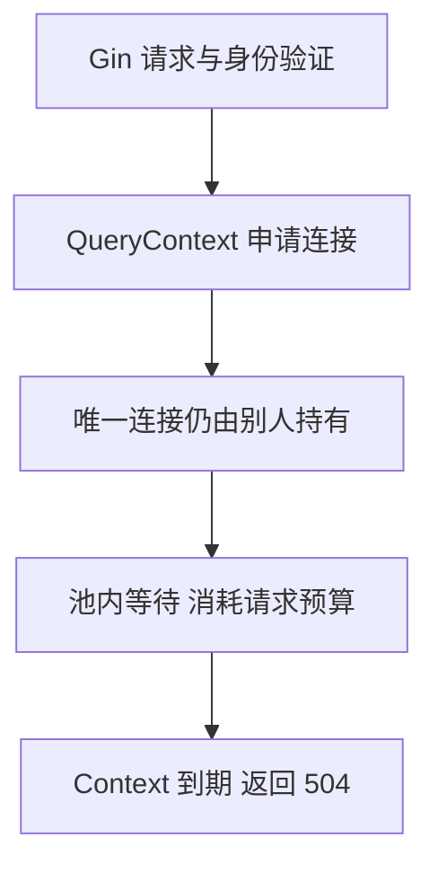

# Gin 请求在 SQL 执行前超时的连接池排查

数据库没有慢 SQL，接口却到点超时，原因可能是请求还没获得连接。本案例故意持有唯一池连接，用等待计数、状态码和释放后的恢复建立完整因果链。

## 1. 先把现象写成可验证问题

设定一个只有一条可用连接的 SQLite 实验池。调用者先借出这条 sql.Conn，不执行慢 SQL，也不归还；随后发起带 50 ms Context 的任务列表请求。

想验证的假设是“请求在客户端池中等待”，不是“数据库执行很慢”。实验不测全机 CPU，也不声称单次请求已经构成 P99；它用于复现一种足以造成尾延迟的机制。

## 2. 一次请求多了一段隐藏等待



sql.DB 是池，不是一条固定连接。QueryContext 需要先取得可用连接，才能让驱动执行 SQL。服务器慢查询只覆盖实际到达数据库的相应工作，无法直接展示这一段客户端等待。

阻塞时 G 可以挂起，所以等待增长不要求 CPU 同时很高。判断依据是资源和计数，不是凭空给 CPU 指定一个百分比。

## 3. 运行确定的复现与修复

```bash
cd examples/gin/service-lab
go test ./internal/app -run TestPoolWaitDiagnosisAndRecovery -count=1 -v -timeout=10s
```

结果摘要：

```text
held-connection: status=504 wait-count-delta=1 in-use=1
after-close: status=200 in-use=0 permits=0
```

测试先使用实际 app.New 路由与有效身份，再让列表请求等待；之后仅关闭先前借出的连接，使用同一 Handler、同一池上限和同一 SQL 重试。没有改变网络、SQL 或加副本。

## 4. 每个指标分别证明什么

status=504 表示当前请求预算耗尽，单看它不能定位池；WaitCount 增量为一、WaitDuration 增加说明池等待确实发生；InUse=1 与最大连接一配合，表明唯一槽位被占用。

释放已知持有者后请求变为 200，且 InUse 回零，构成最小因果对照。permits=0 验证应用准入许可也已回收，避免修复了 DB 等待却留下入口资源泄漏。

WaitCount/WaitDuration 是累计量，要在同一时间窗口看增量；它们不能直接当作任一单请求的精确耗时。

## 5. 把持有者继续追下去

真实系统中常见来源包括显式 Conn 未 Close、Rows 没遍历结束也没关闭、事务长期不结束、锁内执行远端调用，以及合法工作量超过池容量。

因此“池等待”是定位到一层，不一定已经得到最终根因。还需看持有者代码、事务持续时间、活动连接与请求分布。该受控案例的持有者明确是测试主动借出的 Conn。

若事务占住唯一连接，又在同一流程用 DB 而不是 tx 发起另一条查询，也可能让自己等自己。正确事务边界与资源所有权比扩大默认值更关键。

## 6. 为什么先不扩大连接池

把池从一改成二会让第二个请求暂时通过，但未归还的连接仍存在；持续泄漏最终仍会耗尽更大池。若根因是数据库执行能力不足，扩大池还可能增加其争用。

修复首先保证每条成功、失败和取消路径归还资源，缩短不必要持有，再根据全局数据库预算与测量调整池大小。多个副本的总池也要一起计算。

## 7. 回归与外推边界

回归至少检查超时路径许可释放、资源归还后恢复、重复调用不持续增加占用，以及业务响应正确。真实 TCP、网关与客户端预算还需独立测试，Recorder 不覆盖这些层。

这个实验使用 SQLite 来隔离应用池机制。生产 PostgreSQL/MySQL 的锁、驱动取消与网络故障行为仍不同，但“池中等待发生在 SQL 执行前”的分层方法可继续使用。

完整容量规划见 [准入、排队与连接池](./05-容量压测准入排队与连接池.md)，不要用这一条 50 ms 测试给服务填写 QPS 或 P99 容量。

## 8. 练习与答案

### 8.1 慢 SQL 列表为空为什么不能排除这条路径

因为请求可能还在应用连接池中，尚未把 SQL 发送给驱动/数据库。慢查询与池等待观察的是不同阶段。

### 8.2 恢复后 200 为什么还要看 InUse 和 permits

200 只说明一次请求成功，资源计数能进一步验证连接和准入许可没有持续泄漏，避免下一轮再次耗尽。

### 8.3 是否应该统一把所有连接池调大

不应。先区分泄漏、长事务、负载与数据库饱和，再按全局预算和实际能力调整，否则只是移动或放大瓶颈。

## 9. 参考资料

- [完整复现测试](https://github.com/newswitch/newswitch.github.io/blob/main/examples/gin/service-lab/internal/app/pool_diagnosis_test.go)
- [database/sql.DBStats](https://pkg.go.dev/database/sql#DBStats)
- [连接管理](https://go.dev/doc/database/manage-connections)
