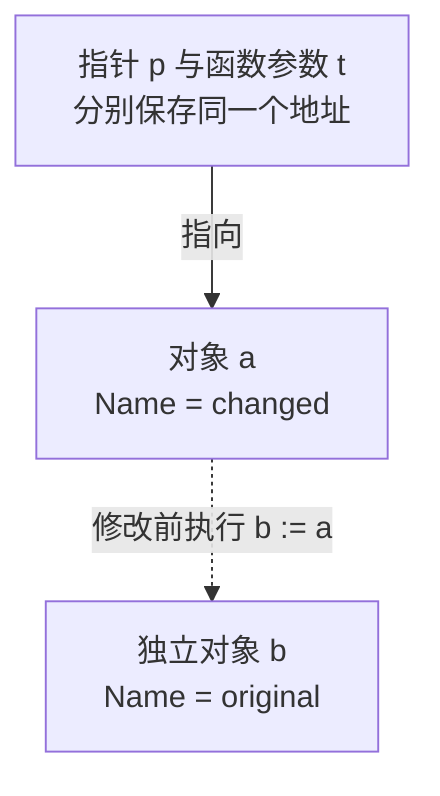

# Go 指针 值复制与共享数据

指针表达对象位置和共享身份，不等于所有对象都应该通过指针传递。能否修改、是否需要共享，以及是否会发生并发访问，才是选择值或指针的依据。

## 1. 对象与变量分开看

取地址得到指针，解引用访问其所指对象。结构体赋值会复制字段；若字段本身含有 Slice、Map、指针等，复制的仍可能是通向共享状态的描述信息。所谓“整个结构体深拷贝”并不由普通赋值自动完成。

Go 的指针不是普通业务中的任意地址运算工具。返回局部变量地址可以安全，存储位置由编译器和 Runtime 管理；这不意味着数据一定分配在栈上。逃逸分析在 Runtime 专题单独观察。

```go
type Task struct { Name string }

func change(t *Task) { t.Name = "changed" }

func example() {
    a := Task{Name: "original"}
    b := a             // 独立结构体值
    p := &a            // p 指向 a
    change(p)          // a.Name 变为 changed
    _ = b              // b.Name 仍是 original
}
```

`*Task` 在类型位置表示指针类型，`&a` 获取地址，`*p` 解引用；访问字段时允许 p.Name 的便利写法。nil 指针没有可访问的 Task。指针参数也按值复制，函数把参数重新指向其他对象，不会自动改写调用方的指针变量。

在 change 中写完字段、尚未返回时，对象关系如下。实线表示此时仍存在的引用，虚线表示修改之前发生过的一次值复制，不表示两个对象持续同步。函数返回后参数 t 的这次调用生命周期结束，调用方的 p 仍指向 a。



这里的 Task 只有 string 字段；如果再加入 Slice 字段，两个结构体中的 Slice 描述符虽然各自独立，仍可能指向同一底层数组。复制深度要逐个字段判断，不能由外壳是否独立推导。

## 2. 别名与独立值实验

```bash
cd examples/go/core-lab
go run ./cmd/lab -case pointers
```

```text
a=shared b=copy
```

完整代码与断言见 [core-lab](https://github.com/newswitch/newswitch.github.io/tree/main/examples/go/core-lab)。

a 和 b 是两个结构体值，改 b.Name 不影响 a；p 指向 a，改 p.Name 则改变 a。把对象关系画成“变量 → 指针 → 对象”比用“传引用”三个字更准确。

## 3. 所有权与资源

需要明确身份、原地修改或避免某些大对象复制时可以用指针；小型不可变值按值传递常更清楚。不要把含 Mutex、Once 等同步状态的对象在使用后随意复制。

nil 检查应放在契约允许 nil 的边界，而不是每层无意义地防御。指针非 nil 也不保证对象已初始化或线程安全；共享配置可以采用不可变快照和同步发布，而不是允许任意请求修改同一实例。

## 4. 返回局部地址为什么不会自动悬空

Go 保证正常引用仍有效的对象不会仅因函数栈帧结束就变成悬空内存。编译器通过逃逸分析与 Runtime 的内存管理安排对象位置，这和“声明在函数里所以一定在栈上”是两回事。

指针并不是手动 free 的许可；GC 管理的是可达性，不能代替文件 Close、事务结束和 Goroutine 退出。对象仍被全局索引、闭包或长切片引用时，也可能一直存活。

判断指针成本要同时考虑对象分配、额外间接访问、GC 扫描和复制成本。先选正确的共享语义，再结合逃逸报告与 benchmark 调整，而不是把每个参数都改成指针。

## 5. 重定向指针与修改对象的区别

```go
func replaceLocal(p *int) {
    other := 2
    p = &other // 只改变本地指针
}

n := 1
p := &n
replaceLocal(p) // *p 仍是 1
```

该片段的调用部分放在函数内。foundation-lab 的 language 模式实际验证 pointer_reassign_local=true。若要让调用方获得新对象，可以 return &other，再由调用方明确赋回。

当参数是 **T 时，修改 *p 可以替换外部指针，但它也增加了间接层与 nil 状态。普通构造、更新接口优先明确返回新值，只有确实需要修改持有槽位时才使用多层指针。

## 6. 复制含同步状态的对象会破坏哪种关系

Mutex、Once 和 WaitGroup 的状态与正在等待它们的执行单元相关。对象开始使用后复制一份，新的锁不再保护旧锁所约束的共享数据；值接收者或把对象装入接口，都可能形成意外复制。

因此这类对象通常通过指针长期持有，go vet 的 copylocks 检查有助于发现部分问题，但不是完整正确性证明。复制含 Slice 的配置又有不同问题：锁即便未复制，底层字节仍可能共享并被修改。

API 需要约定借用时限、能否修改和由谁关闭资源。nil 是某种状态标记，不是完整的生命周期协议；非 nil 指针也可能指向已关闭的客户端。

## 7. 练习与答案

### 7.1 复制结构体后其中的 Map 也独立了吗

没有。字段中的 Map 值仍可能引用同一底层数据，需要按业务决定是否建立独立副本。

### 7.2 返回局部变量地址会像某些语言一样悬空吗

Go 会保证被正常引用对象的生命周期；编译器可能调整分配位置，不能据此推断具体栈/堆位置。

### 7.3 所有参数都用指针会更快吗

不一定，会增加别名、可变性和逃逸的复杂度。应按语义选择，再通过基准与分配证据判断成本。

## 8. 参考资料

- [Go 语言规范](https://go.dev/ref/spec)
- [配套基础实验](https://github.com/newswitch/newswitch.github.io/tree/main/examples/go/core-lab/internal/foundation)
