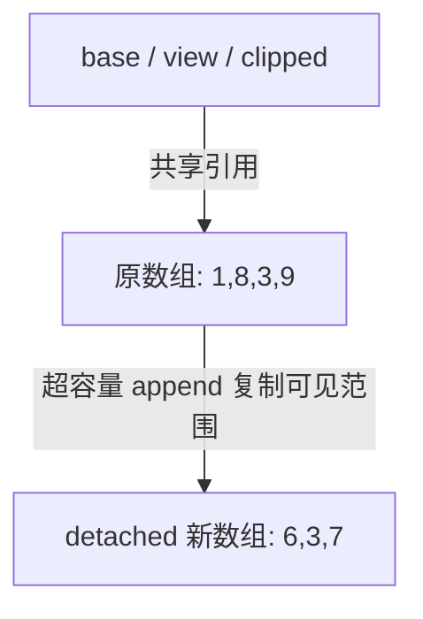

# Go 数组与 Slice：长度、容量、共享和扩容

把 Slice 理解为“可变长数组”容易漏掉最重要的一件事：切片值与元素存储不是同一个对象。参数传递、append、Clone 和 Delete 的差异，都可以沿着“谁还指向同一个底层数组”解释。本章使用 Go 1.27.3；容量增长策略属于实现细节。

## 1. 先区分数组值、切片值与底层数组

数组 `[4]int` 的长度是类型的一部分，赋值和传参会复制元素。切片 `[]int` 则描述底层数组中的一段：从哪里开始、可见多少元素、最多能向后重新切到哪里。

可以把切片值理解为 pointer、len、cap 三项描述信息；这是理解模型，不是要求程序通过 unsafe 依赖某个内存布局。复制切片值不会复制元素，所以函数收到参数后，修改 `s[0]` 可以被调用方看到；函数内仅执行 `s = s[:1]`，却不会修改调用方变量中的 len。

`len` 限制当前索引；`cap` 表示从起点到底层数组末端可用的范围。`make([]int, 3, 8)` 已有三个零值元素，再 append 会接到它们之后；预分配队列通常使用 `make([]int, 0, 8)`。

## 2. 从一次 append 看共享如何发生

```go
base := []int{1, 2, 3, 4}
view := base[1:3]        // len=2, cap=3，可见 [2 3]
view = append(view, 9)   // 复用底层数组，base 变为 [1 2 3 9]
clipped := view[:2:2]    // 只限制 cap
clipped[0] = 8           // base 仍会变为 [1 8 3 9]
detached := append(clipped, 7)
detached[0] = 6          // 新数组；这次不再修改 base
```

第二次 append 的新长度超过 clipped 的 cap，才需要另一个底层数组。完整切片表达式 `s[low:high:max]` 的结果长度是 high-low，容量是 max-low；它没有复制已经可见的元素。

因此 `slices.Clip(s)` 不是隔离修改，也不能靠它释放大数组。它只限制后续 append 在容量范围内继续使用原存储的能力。

## 3. 用关系图追踪描述符，而不是只看变量名



上半段表示共享引用，下半段表示对 clipped 执行超容量 append 后获得新存储；图中数字是示例后续修改完成后的结果。创建新的切片变量只增加描述符；只有明确复制或超容量 append 才会产生独立元素存储。旧数组是否可回收还取决于其他引用，并不由某一个变量是否扩容单独决定。

## 4. append 为什么必须接收返回值

append 可能返回指向旧数组的描述符，也可能指向新数组；两种情况都会产生新长度。正确写法是 `s = append(s, x)`。函数要把追加后的切片交给调用方，通常应返回切片，而不是期待传入的描述符会被原地修改。

不要把“容量小于某个数字就翻倍”当成语言规则。固定版本 `runtime/slice.go` 中的 growslice、nextslicecap 会结合新长度、元素大小、分配器规格等选择容量。只要业务依赖“append 后 cap 必须等于某个值”，就把算法绑到了非契约细节上。

原地复用也不等于不会分配：元素本身、接口装箱、后续逃逸都可能带来分配。成本应通过对应调用路径的 benchmark 与逃逸报告判断。

## 5. Clone 复制多深，copy 如何处理重叠

`slices.Clone` 创建一层元素副本，保留输入的 nil 性。对 `[]int`，复制元素就足以隔离整数修改；对 `[]*Task`，复制的仍是指针；对 `[][]byte`，内层切片仍可能指向相同字节。

明确需要深度隔离时，应按实际数据结构逐层复制，并定义循环引用、共享子对象和不可变对象的策略。“先 JSON 编码再解码”不是通用深拷贝方案，会改变类型与协议语义。

`copy(dst, src)` 复制数量为两者长度的较小值，允许内存重叠。例如 `copy(a[1:], a[:3])` 把 `[1 2 3 4]` 变成 `[1 1 2 3]`；不应自己写一个会覆盖尚未读取元素的前向循环来替代它。

## 6. Delete 清尾不等于缩小底层数组

删除中间元素需要把后面的元素向前移动，然后返回新长度。Go 1.27.3 的 `slices.Delete` 会清零“新长度到旧长度”之间的过时槽位，避免残留指针延长对象生命。

这也说明必须接收返回值，而且旧别名已不再代表原序列。例如原切片长度为 3，删除中间项后，新切片长 2；旧别名仍长 3，但观察到的是“首项、原末项、nil”，不是删除前的三项。

清尾只解除那些槽位的引用，不保证对象立即 GC；其他地方仍可能引用对象。清尾也不会自动缩小数组分配。若小结果长期保留了大数组，复制所需范围才能改变存储生命周期，诊断过程见 [小切片内存排查](../07-diagnostics/06-小切片保留大数组的内存排查.md)。

## 7. 运行实验并逐项核对

```bash
cd examples/go/core-lab
go run ./cmd/value-lab -mode slice
go test ./internal/valueflow -run TestSlices -v -count=1
```

实验输出：

```json
{"shared":[1,8,3,9],"detached":[6,3,7],"clip_still_aliases":true,"nested_clone_is_shallow":true,"delete_clears_tail":true,"old_length":3,"new_length":2,"overlapping_copy":[1,1,2,3]}
```

shared/detached 对照扩容前后的数组；nested_clone_is_shallow 验证内层共享；delete_clears_tail 同时检查移动位置与末端 nil，而不只是检查长度。完整代码位于配套工程的 `internal/valueflow/collections.go`。原来的 `go run ./cmd/lab -case slice` 保留为入门实验。

## 8. 从共享关系推导并发与 API 边界

只读共享与并发修改是两种契约。把切片通过 Channel 传给另一个 Goroutine，只复制切片值；发送方若继续修改共享元素，仍可能产生 Race。限制 cap 不能保护元素，浅复制也不能隔离元素内部的指针。

API 应明确采用借用、转交所有权或复制中的哪一种。借用的调用方必须遵守使用期限；转交后原持有者停止修改；复制则说明复制深度与成本。不要看到共享就全量 Clone，也不要把“局部变量”误认为“局部存储”。

## 9. 练习与答案

### 9.1 把 s 变成 s[:len(s):len(s)]，还能修改原数组吗

能。修改已有元素仍作用于共享数组；它限制的是容量，以及追加超出容量时是否必须获得新存储。若要隔离已有元素，需要按元素引用结构选择浅复制或更深的复制。

### 9.2 删除后旧切片长度还在，继续遍历旧切片是否合理

通常不合理。Delete 原地移动并清零了尾部，旧描述符的 len 不会跟着变化。应接收返回切片，并避免把旧别名当作未修改的快照。

### 9.3 cap 下降是否证明内存已经释放

不能。Clip 可以让 cap 下降而不复制数组；GC 根据可达性工作，RSS 又受到分配器与操作系统影响。先检查存储引用和 heap profile，再判断是否需要复制。

## 10. 参考资料

- [Slice 表达式规范](https://go.dev/ref/spec#Slice_expressions)
- [Go 1.27.3 slices 源码](https://github.com/golang/go/blob/go1.27.3/src/slices/slices.go)
- [Go 1.27.3 扩容实现](https://github.com/golang/go/blob/go1.27.3/src/runtime/slice.go)
- [配套实验工程](https://github.com/newswitch/newswitch.github.io/tree/main/examples/go/core-lab/internal/valueflow)
