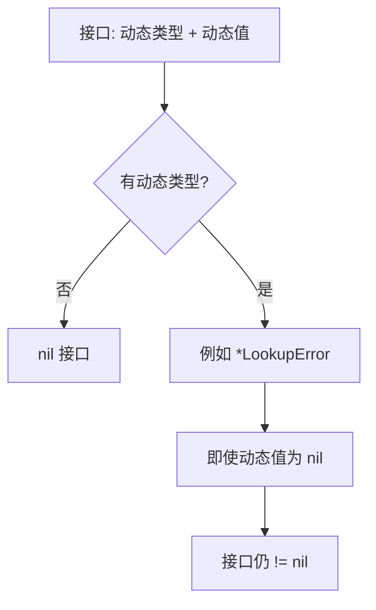

# Go 接口、方法集与 typed nil：从替换到运行时判断

接口不是“装着任意东西的指针”，而是带有动态类型信息的行为边界。理解方法集、动态类型与动态值之后，才能解释指针方法可以直接调用却无法赋给接口、nil 错误为何仍非 nil，以及类型断言成功后为何还要检查目标值。源码基线为 Go 1.27.3。

## 1. 接口表达调用方需要的最小行为

例如读取任务的调用方只需要 `Load(ctx, id)`，就可以在使用位置定义相应小接口。具体类型的方法集满足要求即隐式实现，不需要 implements；不要为了每个结构体都机械生成同名大接口。

接口方法签名相同，只表示能够这样调用，不保证线程安全、幂等、不会阻塞或资源会自动关闭。数据库、文件与远程调用的时限和所有权仍需单独定义。

接口变量的零值为 nil。赋值后可以把它理解为“动态类型 + 动态值”；运行时可能使用类型描述、方法表等完成分派，但这种模型不意味着任意接口都只存放一个对象指针，也不保证接口赋值必然堆分配。

## 2. 方法调用便利语法不等于接口实现

```go
type Counter struct { N int }
func (c Counter) Snapshot() int { return c.N }
func (c *Counter) Inc() { c.N++ }

type Incrementer interface { Inc() }
var _ Incrementer = (*Counter)(nil)
// var _ Incrementer = Counter{} // 不满足方法集

c := Counter{}
c.Inc() // c 可寻址，调用时可自动取地址
```

T 的方法集包含值接收者方法；*T 的方法集还包含指针接收者方法。可寻址变量调用 `c.Inc()` 的便利转换，不会把 Inc 加进 T 的方法集，所以把 Counter 值赋给 Incrementer 仍不成立。

接口中保存的具体值不能一概当作可寻址变量处理。接收者是否需要修改状态、类型是否包含 Mutex、复制是否昂贵，都是选择指针接收者的依据；不能只凭“指针看起来更快”决定。

## 3. typed nil 为什么不等于 nil



`var p *LookupError = nil; var err error = p` 中，err 的动态类型仍存在，所以 err 不等于 nil。判断接口是否 nil 不是只看它指向的数据是否为空。

调用 `err.Error()` 会进入该类型的方法。若指针接收者显式处理 nil，就能返回文本；若方法解引用 nil，就会出错。因此 typed nil 不是“任何方法都不能调用”，而是必须按具体实现判断。使用值接收者方法时还可能涉及隐式解引用，不能从一个安全的 nil 接收者示例推广到全部方法。

## 4. error 返回、errors.As 与依赖校验

成功路径应该直接 `return nil`，而不是先声明一个 nil 的具体错误指针，再通过 error 返回。后者会创建非 nil 接口，让调用方进入错误分支。

`errors.As(err, &target)` 成功，只说明错误链中存在可赋给目标的错误类型；如果遇到的就是 typed nil，target 也可以是 nil。实验会同时得到 as_matched=true、as_target_nil=true，不能无条件继续解引用 target。

依赖注入时同样不能仅凭 `dependency == nil` 检出全部 typed nil。优先通过清楚的构造函数与具体依赖装配保证有效状态；不要给所有接口递归反射判空。明确不接受 nil 实现、返回初始化错误，比在每次调用中猜测对象状态更可靠。

## 5. 方法值保存的是哪个接收者

`saved := c.Snapshot` 使用值接收者，会在取得方法值时保存接收者副本。之后再修改 c，saved() 仍读取当时的值。

`inc := c.Inc` 使用指针接收者，会保存相应指针。之后 inc() 修改的是那个指针指向的 Counter。这对闭包、回调、异步任务尤其重要：把方法存进回调并不意味着每次都会重新查找当前同名变量。

接口赋值也类似：把 Counter 值放进 snapshotter 会复制该值；放入 *Counter 则共享对象。共享指针之后的并发访问仍需同步，接口分派本身不提供锁。

## 6. 类型断言、比较与运行时调用

`x, ok := v.(T)` 根据动态类型判断能否取出 T，不根据字段长得是否相似。省略 ok 的断言在不匹配时会产生 panic；类型 switch 适合有限类型协议，不能代替有明确字段的业务 DTO。

两个接口能否相等比较，还取决于动态值是否可比较。接口中保存 Slice 并不会让 Slice 变得可比较。Map 的 any 键也有同样边界，详见 [Map](./02-Map语义哈希与SwissTable.md)。

在固定版本源码中，可沿 `runtime/iface.go` 的 itab 相关路径理解非空接口的方法匹配；再结合编译器去虚化、内联与逃逸报告看调用点。源码模型用于解释，性能结论仍应由实际调用点的 benchmark 支持，不应写成“接口永远比具体类型慢一次固定开销”。

## 7. 运行方法集与错误接口实验

```bash
cd examples/go/core-lab
go run ./cmd/value-lab -mode interface
go test ./internal/valueflow -run TestInterfaces -v -count=1
```

```json
{"pointer_nil":true,"interface_nil":false,"as_matched":true,"as_target_nil":true,"nil_receiver_text":"nil receiver","value_implements":false,"pointer_implements":true,"captured_value":0,"current_value":1}
```

value_implements/pointer_implements 使用两值断言观察方法集；captured_value=0 与 current_value=1 对照保存方法值与后续状态。实验没有依靠内存地址或 unsafe 猜测接口内容。源码位于 `internal/valueflow/collections.go`。

## 8. 练习与答案

### 8.1 能调用 c.Inc，为什么 Counter 仍不满足 Incrementer

调用中的自动取地址只适用于相应可寻址表达式，不改变 Counter 的方法集。Incrementer 要求 Inc 时，应提供 *Counter，或者重新设计接收者。

### 8.2 errors.As 返回 true 后能直接使用目标指针吗

仍需符合错误类型的有效值约定。错误链可能装着该类型的 nil 指针，匹配类型成功不保证目标非 nil；成功路径更应避免返回这种接口。

### 8.3 接口调用是否必然发生一次堆分配

不是。动态分派、装箱、逃逸和堆分配是不同问题；具体调用可能去虚化、内联或在栈上完成。应结合调用点报告与分配测试判断。

## 9. 参考资料

- [方法集规范](https://go.dev/ref/spec#Method_sets)
- [Go FAQ：nil error](https://go.dev/doc/faq#nil_error)
- [Go 1.27.3 接口运行时](https://github.com/golang/go/blob/go1.27.3/src/runtime/iface.go)
- [errors.As](https://pkg.go.dev/errors#As)
- [配套实验](https://github.com/newswitch/newswitch.github.io/tree/main/examples/go/core-lab/internal/valueflow)
