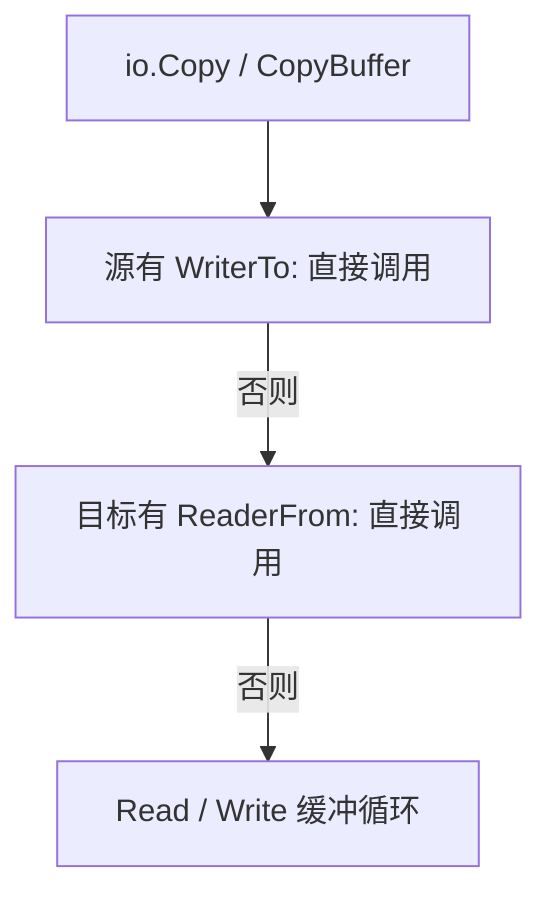

# Go Reader、Writer 与流式 I/O：短读、复制和大小限制

Reader 与 Writer 的价值在于统一“数据怎样流动”，不是把文件和网络伪装成永不失败的字节数组。正确 I/O 要同时回答：本次有多少有效数据、错误发生在何处、谁关闭资源，以及大小、时间与并发是否受控。本章沿 Go 1.27.3 的 io 与 net/http 实现展开。

## 1. Read 的两项返回值描述两件事

`Read(p)` 返回 n 和 err。n 表示本次得到的有效字节数，err 描述读取状态；允许同一次调用返回 n>0 和 io.EOF，也允许先返回最后的数据、下次调用才返回 EOF。

因此处理顺序应该是先消费 `p[:n]`，再解释 err。若先判断 err 并直接退出，就可能丢掉最后一批数据。一次 Read 也不承诺填满 p，网络到达一个短片段就返回是正常情况，不等于连接坏了。

Reader 不能在返回后偷偷保留并使用调用方的 p；Writer 同样不应保留传入切片供返回后使用。若异步保存数据，必须复制或通过其他明确的所有权协议交接，不能只因为接口参数是 []byte 就认为可以长期持有。

## 2. 什么时候需要 ReadFull，什么时候需要 Copy

固定长度协议字段适合 `io.ReadFull(r, buf)`：完整填满才成功；完全没有数据时可得到 EOF，读到一部分就结束通常得到 ErrUnexpectedEOF。它不会替你限制整个协议包的长度，长度字段仍需先校验再分配。

连续搬运数据直到结束通常使用 `io.Copy(dst, src)`。它把读到的数据写出，正常 EOF 不当成错误；返回的是实际累计写入量。若业务还需要摘要、格式验证或持久化确认，应叠加相应步骤，不能把 Copy 返回 nil 当成全部业务完成。

Writer 的短写如果没有提供非 nil 错误，违反常规 Writer 契约；io.Copy 的通用循环会把它转换为 io.ErrShortWrite。测试应模拟这条路径，而不只使用永不失败的 bytes.Buffer。

## 3. io.Copy 不一定运行你想象中的缓冲循环



固定版本 `io.copyBuffer` 先检查源的 WriterTo，再检查目标的 ReaderFrom；二者都不满足才使用缓冲循环。CopyBuffer 传入的缓冲区在这些快速路径中不会被用到，因此“传了 64 KiB，所有复制都按 64 KiB 系统调用”并不成立。

包一层只暴露 Read 的 Reader 可以隐藏 WriterTo，改变所选路径；类似地，包装 Writer 时也可能隐藏 ReaderFrom、Flush 等能力。这会影响优化和功能，但不应为了触发某条路径就随意丢弃底层错误或资源控制。

WriterTo/ReaderFrom 是接口优化入口，不是零拷贝保证。是否使用 sendfile、splice 或普通读写，还与具体类型、平台、TLS、包装层有关，需要追踪具体实现或系统调用。

## 4. LimitReader 的 EOF 为什么不能代表原输入没超限

`io.LimitReader(r, 3)` 只让调用方看到最多三个字节；三个字节用尽后，它会表现为 EOF，不会报告“原始输入其实还有更多”。

因此把六字节正文 abcdef 经 LimitReader(3) ReadAll，结果是 abc 和 nil 错误。如果要校验普通流总长，可读取上限加一个字节再判断；但仍需为慢输入设置执行预算，不能只控制内存。

HTTP 入站正文可以用 `http.MaxBytesReader`。读过指定边界时得到 `*http.MaxBytesError`，可通过 errors.As 分类为 413。它并不会替应用自动输出一份完整错误 JSON；只有发生读取且触碰边界才有检测结果。Content-Length 也不能替代实际读取边界。

## 5. JSON、压缩与上限应该放在哪一层

流式解码器通常一次只消费一个值，甚至会预读部分后续数据。若接口规定“整个正文只能有一个对象”，第一次解码成功还需再次解码并要求 EOF，否则后续值或超长空白可能没被检查。

压缩输入存在压缩前与解压后两种大小。限制网络传输字节不代表限制解压结果；解压后 Reader 仍需字节和时间预算。文件行处理也有单行大小、整文件大小和记录数三种约束，不能只用一个缓冲区参数涵盖全部风险。

本章实验只是有限内存流；生产 HTTP 的读取超时还应结合 Server ReadHeaderTimeout、正文读取策略与实际代理链，不能认为 MaxBytesReader 同时限制了时间。

## 6. 缓冲、Flush、Close 与持久化是不同确认层

bufio.Writer 减少到底层 Writer 的调用，但必须检查 Flush 错误；未 Flush 就 Close 底层文件，数据可能仍留在用户态。压缩 Writer 还可能在 Close 时写出格式尾部，不能一概忽略 Close 返回值。

Flush 通常只表示当前层缓冲已向下游提交，不等于文件已 fsync，更不等于数据库事务或远端业务已提交。HTTP Flush 会推动响应提交，不代表客户端已经读取并应用了全部数据。

谁创建资源谁默认负责关闭；如果转交所有权，应在 API 契约里说明。Reader 接口不包含 Close，包一层 LimitReader 也不会自动为你关闭原文件。遇到失败路径时同时保留主要错误与有意义的关闭错误，避免日志只剩“关闭失败”而丢掉真正读取失败。

## 7. 运行边界与快速路径实验

```bash
cd examples/go/core-lab
go run ./cmd/value-lab -mode io
go test ./internal/valueflow -run TestIO -v -count=1
```

```json
{"data_with_eof":"abc","copy_error_nil":true,"short_write_detected":true,"source_writer_to_first":true,"wrapped_uses_reader_from":true,"limit_body":"abc","limit_error_nil":true,"max_bytes_body":"abcd","max_bytes_detected":true}
```

data_with_eof 验证末尾数据不丢；source_writer_to_first 验证两个优化接口同时存在时优先使用源；wrapped_uses_reader_from 验证隐藏源方法后的分支；最后四项区分截断视图与超限错误。完整代码在 `internal/valueflow/io_json.go`，不依赖磁盘满、外部网络或真实设备故障。

## 8. 流式不等于系统资源恒定

流式复制可以避免“先读完整文件再发出”的单请求大缓冲，但并发连接数、每连接缓冲、解码对象、TLS 状态与慢客户端会叠加。需要分别限制单次大小、持续时长、并发数与队列容量。

定位慢复制时，先区分源读阻塞、目标写阻塞、CPU 编解码与池等待。只看到 Goroutine 停在 io.Copy，不能直接判定“磁盘慢”；沿真实动态类型、调用栈和系统指标找到当前阻塞层。

## 9. 练习与答案

### 9.1 Read 同时返回 n>0 和 EOF，是否应丢弃本次数据

不能。先处理 p[:n]，再结束；否则最后一批字节可能丢失。需要固定长度时使用 ReadFull，并分别处理完全没数据与部分数据的结束。

### 9.2 CopyBuffer 传了缓冲区，为什么仍没使用它

源的 WriterTo 或目标的 ReaderFrom 优先于通用循环，CopyBuffer 的缓冲区在这些路径中可能不参与。必须检查动态类型与所走分支，而不是按函数名称猜测系统调用。

### 9.3 LimitReader 读取上限后返回 nil，能证明输入合法吗

不能，它只截断可见范围。要验证长度需额外读一个字节或使用具有明确超限错误的包装；HTTP 中还需把错误映射到一致的响应契约，并控制时间。

## 10. 参考资料

- [Go 1.27.3 io 接口与复制实现](https://github.com/golang/go/blob/go1.27.3/src/io/io.go)
- [Go 1.27.3 MaxBytesReader](https://github.com/golang/go/blob/go1.27.3/src/net/http/request.go)
- [bufio.Writer](https://pkg.go.dev/bufio#Writer)
- [配套实验](https://github.com/newswitch/newswitch.github.io/tree/main/examples/go/core-lab/internal/valueflow)
