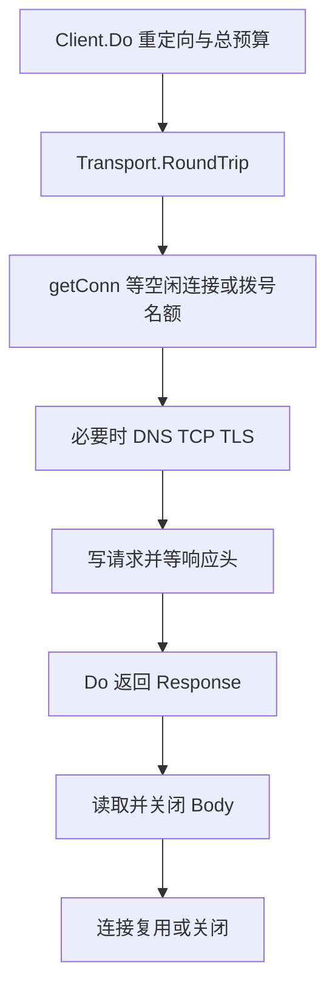

# Go HTTP 客户端：连接复用、阶段超时、正文关闭与重试

一次 HTTP 调用可能在等连接、建连接、写请求、等响应头或读取正文。沿着 Client 与 Transport 的分工读懂调用链，再用 httptrace 验证连接复用、池等待和超时边界。

## 1. Client 管策略，Transport 管一次交换

Client.Do 不只是发送几个字节：Client 管理重定向、Cookie 和整体超时，Transport 实现 RoundTripper，负责连接获取、协议交换与复用。收到 404、429、500 通常不是 Do 的传输错误，调用方仍需检查状态码并关闭正文。

Client 和 Transport 都应长期复用，并发请求共享它们；不要每个请求创建一套连接池，也不要在开始并发使用后随意修改 Transport 字段。需要自定义配置时，可以在启动阶段 Clone 默认 Transport 再调整。

以下源码路径与实验固定 Go 1.27.3，重点是 HTTP/1.1。HTTP/2、HTTP/3 会走不同协议实现，不能把一个 HTTP/1.1 连接只服务一个未结束响应的行为，直接套到多路复用协议。

## 2. 沿一次请求找到等待发生在哪里



源码入口依次查看 net/http/client.go 的 Client.do、send，以及 transport.go 的 roundTrip、getConn、queueForIdleConn、queueForDial。HTTP/1.1 的 persistConn 通过 writeLoop 和 readLoop 协作，向调用者返回响应头之后，还要等待正文结束或被关闭，才能决定连接后续用途。

因此 Do 返回成功不代表整个调用已经完成：正文读取仍可能超时、被取消或返回截断错误。反过来，Do 返回 deadline exceeded 时，请求也可能还没拿到连接，服务端根本没收到它。

## 3. 连接池参数分别约束什么

| 参数 | 主要约束 | 常见误读 |
| --- | --- | --- |
| MaxIdleConns | 整体保留的空闲连接 | 不是活跃请求总数 |
| MaxIdleConnsPerHost | 每个连接池键保留的空闲连接 | 不是每个域名的并发准入 |
| MaxConnsPerHost | 对应池的拨号中、活跃及空闲连接总数 | 调大不代表下游承载能力变大 |
| IdleConnTimeout | 空闲连接保留多久 | 不会结束一直活跃的慢正文 |
| DisableKeepAlives | 不复用连接 | 不等于禁止 TCP keepalive 探活 |

连接池键与协议、目标及代理配置相关，不是简单按业务服务名分组。HTTP/2 还能在一个连接上承载多个流，所以限制连接数不等于限制所有版本的请求并发。服务级准入仍需要自己的有界并发策略。

池等待期间同样保留 Goroutine、请求对象和上游预算。限制连接数却不限制排队人数，可能把下游过载变成客户端内存增长。

## 4. 超时要覆盖整条预算，而不是只等响应头

| 配置 | 关注阶段 |
| --- | --- |
| Request.Context | 这个请求的连接获取、传输及正文生命周期 |
| Client.Timeout | 整次调用预算，包括重定向和返回响应后的正文读取 |
| Dialer.Timeout | 建立网络连接的时间，不包含全部 HTTP 工作 |
| TLSHandshakeTimeout | TLS 握手 |
| ResponseHeaderTimeout | 请求写完后等响应头，不包含响应正文 |
| ExpectContinueTimeout | 使用 Expect: 100-continue 时的等待 |

整体预算与阶段预算谁先到期，谁先终止相应操作。Client.Timeout=0 不是“使用一个合适默认总超时”，而是未设置这个总时限；不要把它用于没有其他预算限制的普通依赖调用。

重试也应消耗同一个总预算。若第一次已经花费 900 ms，总预算只有 1 s，不应再给第二次重新发放 1 s。流式响应可以不用固定短总超时，但必须另外设计取消、空闲检测和最大生命周期。

## 5. 读到 EOF、Close 与版本相关的有限排空

Response.Body 必须关闭。需要复用连接时，正常路径应在大小和时间预算内消费正文至 EOF，再 Close；只读取头部后把 Body 长期留着，会占住 HTTP/1.1 交换。

但“没读完就 Close，一定不能复用”也过于绝对。Go 1.27.3 的 HTTP/1.1 readLoop 在提前关闭时，会按条件调用 maybeDrainBody，尝试有限排空。该版本内部上限为 256 KiB 和 50 ms；已知 Content-Length 大于上限时不会进入这条尽力路径。这是实现细节，不是应用可以依赖的复用契约。

对不可信或无限正文，不要为了保住连接无界 io.Copy 到 EOF。可以用 LimitReader 限制为业务上限+1，检查是否超限；超限后关闭并放弃这次正文。未知长度、压缩膨胀、分块正文和读取超时都要考虑，有限预算优先于连接复用率。

关闭正文也不等于关闭 Transport 的所有连接。CloseIdleConnections 用于释放空闲连接，不会中断所有活跃调用。

## 6. 实际复现没有发到服务端的超时

```bash
cd examples/go/core-lab
go run ./cmd/mechanism-lab -mode http-client
go test ./internal/mechanism -run TestHTTPClientPool -v -count=3
```

为隔离机制，实验使用无代理明文 HTTP/1.1、随机回环端口、512 KiB 固定正文和 MaxConnsPerHost=1。关键输出整理如下，字段来自同一次实验：

| 观察点 | 结果 | 原因 |
| --- | --- | --- |
| 第一次请求 GotConn.Reused | false | 首次建连接 |
| 读完并关闭后第二次请求 | true | 使用原连接 |
| 持有第二次正文时，再发一个 40 ms 请求 | pool_deadline=true | 连接名额未释放 |
| 超时请求的 GetConn | 已触发 | 已进入获取连接阶段 |
| 超时请求的 GotConn | 没有触发 | 尚未取得连接 |
| 此时服务端累计请求数 | 2 | 第三个请求没有进入 Handler |
| 关闭未读的 512 KiB 正文后再次请求 | reused=false | 大于该版本尽力排空范围 |
| 再次正常读完，下一次请求 | reused=true | 连接可复用 |

40 ms 是故意设置的实验预算，不是推荐的生产配置。测试同时检查服务端计数和 httptrace，避免把“没有响应”直接归因为服务端慢。连接拿不到时增加服务端副本未必有效，先查谁持有正文和准入队列。

## 7. 重试和重定向不能只看 err

Transport 仅在符合条件的网络失败场景自动重试，例如已使用连接上的可重放幂等请求；它不是遇到所有错误都重试，也不会自动把所有 503 重试好。Client 还有独立的重定向行为。

自己实现重试时要区分业务是否已经提交、正文能否重建、幂等键是否真的被服务端持久去重，以及上游预算和退避。超时表示结果未知，不等于写操作没有发生；添加 Idempotency-Key 头本身不会让业务自动幂等。

外部 URL 还要控制每一次重定向后的目标、DNS 解析结果、代理与出网权限，不能只检查最初 URL。日志记录目标分类与各阶段耗时，不记录认证头、完整敏感查询或正文。

## 8. 练习与答案

### 8.1 服务端没有日志，为什么客户端仍然超时

可能在本地等待连接池或拨号名额。结合 GetConn/GotConn、DNS/Connect/TLS 事件和服务端请求计数，才能判断请求是否已发送。

### 8.2 只设置 ResponseHeaderTimeout，能限制大正文下载吗

不能，它约束请求写完后等待响应头的阶段。正文仍需要整体 Context/Client 超时或流式空闲与生命周期控制。

### 8.3 Go 1.27.3 提前 Close 后有时还能复用，能省掉读取和关闭规范吗

不能。有限排空只在特定 HTTP/1.1 条件下尽力发生，可能因大小、时限、取消或协议状态失败。正常路径应有限读取至 EOF 并关闭，异常路径优先守住预算。

## 9. 参考资料

- [Client 与 Transport API](https://pkg.go.dev/net/http)
- [httptrace 事件](https://pkg.go.dev/net/http/httptrace)
- [Go 1.27.3 client.go](https://github.com/golang/go/blob/go1.27.3/src/net/http/client.go)
- [Go 1.27.3 transport.go](https://github.com/golang/go/blob/go1.27.3/src/net/http/transport.go)
