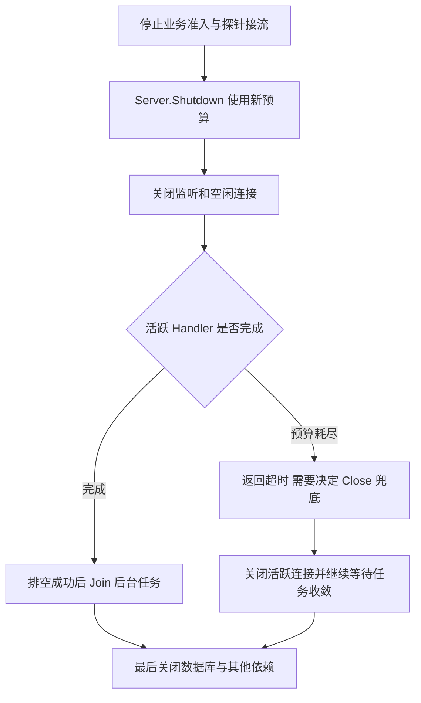

# Go HTTP 服务端：Handler、路由、超时和优雅退出

HTTP 服务端要同时管理连接、请求、Handler 和后台任务。沿着 Accept 到路由的调用链，区分网络 Deadline、业务取消和 Shutdown，才能解释为什么监听已停止但程序还不能退出。

## 1. 连接、请求与 Handler 不是一回事

Server 负责监听和连接生命周期，Handler 接收一次请求并生成响应，ServeMux 负责按路由选择 Handler。Gin 最终也实现 ServeHTTP，接入 net/http.Server，而不是自己替换所有 TCP 逻辑。

HTTP/1.1 常见路径是 Serve 接受连接后启动 conn.serve，在该连接中解析请求并调用 Handler；一个长连接可以依次承载多个请求。不能据此说所有 HTTP 协议都是“一条连接同一时刻只能一个请求”：HTTP/2 等协议有自己的多路复用与请求执行路径。

数据库、异步 Worker 和消息客户端不归 Server 自动管理。Handler 返回，只说明这次处理调用结束，不代表它偷偷启动的 Goroutine 也已结束。

## 2. 从 Accept 到 ServeHTTP 的源码入口

Go 1.27.3 重点阅读 net/http/server.go：

| 入口 | 关注什么 |
| --- | --- |
| Server.Serve | 接受连接、退出监听以及启动连接处理 |
| conn.serve | HTTP/1.1 连接的请求处理循环与状态变化 |
| conn.readRequest | 读取请求、处理头部与关联 Request Context |
| serverHandler.ServeHTTP | 找到 Server.Handler，未设置时使用默认 Mux |
| ServeMux.ServeHTTP | 路由匹配与 PathValue |
| response.finishRequest | 完成响应、处理正文与连接后续状态 |

连接状态 New、Active、Idle、Closed/Hijacked 是观测连接生命周期的线索，不等于业务事务状态。不能在 ConnState 变成 Idle 时就断言所有外部副作用都已完成。Handler 中应先完成需要承诺的工作，再返回明确响应。

## 3. 路由匹配与响应边界

```go
mux := http.NewServeMux()
mux.HandleFunc("GET /tasks/{id}", func(w http.ResponseWriter, r *http.Request) {
    w.Header().Set("Content-Type", "text/plain; charset=utf-8")
    io.WriteString(w, r.PathValue("id"))
})
```

当前 ServeMux 支持带方法的路径模式与通配符，GET 模式也匹配 HEAD。PathValue 取的是路由参数，不是任意查询参数。它与 Gin 的 /tasks/:id 语法不同，不要把配置互相复制。冲突模式注册可能 panic，应在启动测试阶段发现。

Header 要在 WriteHeader/首次 Write 之前设置。首次 Write 可能隐式发出 200，之后再修改状态不能当作可靠错误响应；流式输出已经开始后也不能假装回到一个全新 JSON 错误。

处理上传时限制请求正文大小，并处理读取与 Close；Handler 返回后不应继续使用 ResponseWriter。异步任务若必须在请求结束后继续，应转为受控后台队列并独立管理预算，而不是持有整个 Request。

## 4. 网络超时不会强行终止 Go 函数

| 字段或机制 | 约束范围 | 不等价于 |
| --- | --- | --- |
| ReadHeaderTimeout | 读取请求头的时间 | 整个业务处理时间 |
| ReadTimeout | 读取请求的时间，包括正文 | SQL/下游调用的独立预算 |
| WriteTimeout | 网络响应写入相关 Deadline | 强制杀死慢 Handler |
| IdleTimeout | 长连接等待下一请求的空闲时间 | 活跃 SSE 的应用空闲检测 |
| Request.Context | 传递取消与请求作用域 | 所有库都会响应取消 |

这些字段最终依赖连接和协议实现的 Deadline；尤其 TLS 和不同 HTTP 协议的处理阶段不同，不能简单把它们加起来当总超时。ReadTimeout 太短可能让合理的大文件上传失败，WriteTimeout 太短可能中断流式响应。

HTTP/1.x 的请求 Context 通常在客户端连接断开或 ServeHTTP 返回等情况下取消，但观察断开的时刻受读写与协议状态影响。业务代码仍需把 Context 传到数据库和依赖请求。CPU 死循环或忽略 Context 的阻塞调用，不会因为某个超时字段而被安全终止。

## 5. Shutdown 如何停止接单并等待排空



Shutdown 关闭监听、关闭空闲连接并等待活跃连接变为空闲。Go 1.27.3 的实现通过 inShutdown、closeListenersLocked 和 closeIdleConns 等组织这个过程。它不是先给所有 Handler 发取消。

开始 Shutdown 后，Serve/ListenAndServe 很快返回 ErrServerClosed；**Serve 返回不等于 Shutdown 已经等待完毕**。主函数必须等待 Shutdown 的结果，否则进程可能在请求排空前结束。

Shutdown 的 Context 到期，只会让等待返回错误，不会自动 Close 所有活跃连接，也不会直接取消仍在执行的 Handler。需要按业务策略调用 Close 兜底，并继续 Join 自己的任务。若上层信号 Context 已经取消，要为排空创建新的有限 Context，不能直接把已取消的 Context 传进去。

## 6. 用真实回环请求验证关闭语义

```bash
cd examples/go/core-lab
go run ./cmd/mechanism-lab -mode http-server
go test ./internal/mechanism -run TestHTTPServerDrain -v -count=3
```

```json
{"graceful_completed":true,"deadline_returned":true,"deadline_canceled_handler":false,"close_canceled_handler":true}
```

第一组请求在 Handler 内等待。实验确认监听已关闭后，检查 Shutdown 仍在等待，且请求 Context 没有取消；主动放行 Handler，客户端读到 finished，再等 Shutdown 成功。

第二组保持 Handler 活跃，让 40 ms 的 Shutdown 预算到期。Shutdown 返回 DeadlineExceeded，但 Handler Context 仍未取消；显式 Close 活跃连接后，Handler 观察到取消并退出。两个场景都等待客户端、Serve 和关闭任务收敛。

这验证的是 net/http API 的真实回环行为，不依赖 Linux 信号。进程收到 SIGTERM、容器终止宽限期、负载均衡摘流延迟还需部署环境测试，不能由 Windows 本地测试替代。

## 7. 长连接与后台任务需要自己的退出协议

Shutdown 不会自动接管被 Hijack 的连接，例如部分 WebSocket 场景。RegisterOnShutdown 可以发起协议级退出，但回调是异步启动的，Shutdown 不等待回调自身完成；仍需要自己的 Join。

SSE 没有固定结束点时，应在服务退出协议中发送结束或触发取消，避免它永久阻止排空。关闭数据库应晚于依赖它的 Handler 和 Worker，而不是信号一到就先 db.Close。

回归至少覆盖：活跃请求成功排空、排空预算耗尽、客户端断开、流式连接退出和后台任务 Join。健康检查、业务准入和进程退出是三个不同控制点，只有一起处理才能减少滚动发布时的请求中断。

## 8. 练习与答案

### 8.1 Serve 返回 ErrServerClosed 后，main 能立即退出吗

不能把它当作排空完成。Shutdown 一开始就会关闭监听，使 Serve 返回；main 还要等待 Shutdown 和自管后台任务结束。

### 8.2 Shutdown 的 Context 到期，Handler 会自动收到取消吗

不会仅因这个预算到期而自动取消活跃 Handler。实验显示它仍在运行；需按策略 Close 活跃连接或另外传递应用退出信号，并等待任务收敛。

### 8.3 长时间 SSE 可以统一用短 WriteTimeout 解决吗

不能。它可能中断正常流式写入，却不能替代业务空闲检测、服务退出通知和生命周期管理。

## 9. 参考资料

- [http.Server API](https://pkg.go.dev/net/http#Server)
- [ServeMux 路由模式](https://pkg.go.dev/net/http#ServeMux)
- [Go 1.27.3 server.go](https://github.com/golang/go/blob/go1.27.3/src/net/http/server.go)
