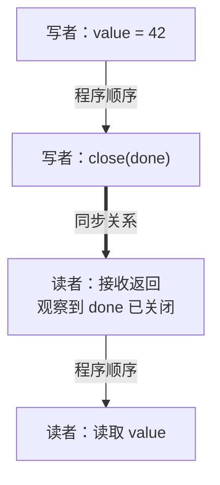

# Go 内存模型：happens-before、发布、数据竞争与原子操作

并发正确性需要说明谁写入、谁读取，以及两者之间由什么同步。理解 happens-before 后，才能分清数据竞争、过期快照和业务不一致，不再用 Sleep 或运行次数证明正确性。

## 1. 先把并发问题分成三类

**数据竞争（data race）**关注内存访问：两个 Goroutine 对同一位置的访问没有由 happens-before 排序，至少一个是写入，且相关访问不是全部通过同步原语完成。例如普通 Map 一边写一边读。

**原子但不一致**关注业务状态：每个字段使用 atomic，访问本身没有数据竞争，读者仍可能拿到“旧字段 A + 新字段 B”。**生命周期错误**则关注任务是否退出、资源是否释放，代码即使没有 Race，也可能永远等不到结果。

Go 对没有数据竞争的程序提供顺序一致性保证，可以把行为理解成 Goroutine 指令的某种交错；这不代表交错一定符合业务约束。原子转账拆成两步，仍然可能让读者看到中间状态。

## 2. 从程序顺序组合出发布关系

```go
var value int
done := make(chan struct{})
go func() {
    value = 42
    close(done)
}()
<-done
fmt.Println(value)
```

这里有一条完整的证明链：写入 value 在 close 之前；关闭 Channel 在观察到“已关闭且无剩余值”的接收之前；接收又在打印之前。把这些边连接起来，写入 happens-before 读取。



粗箭头是跨 Goroutine 的同步边，普通箭头是各自内部顺序。靠这三段关系的传递性，才得到写入先于读取；图中箭头不是数据搬运或 CPU 缓存刷新步骤。

这不是“close 把所有内存刷新一次”的用法规则。关键是这次写入与这次读取之间存在可组合的同步关系。若发送方在 close 后继续修改 value，后续写入就不受这条关系保护。

Go 1.27.3 中可以在 runtime/chan.go 的 closechan 和 chanrecv 找到关闭、唤醒与接收路径，但应用正确性应依据内存模型，不依赖内部字段布局。

## 3. 不同原语分别建立什么关系

| 同步动作 | 能用来推导的关系 | 不能顺便推导的事 |
| --- | --- | --- |
| Channel 发送与对应接收 | 发送之前的写入，对接收之后的代码可见 | 发送者之后不再改共享对象 |
| 关闭 Channel 与观察到关闭的接收 | 关闭之前的写入，可以发布给接收者 | 收到某个缓冲值就等于观察到关闭 |
| 同一 Mutex 的 Unlock 与后续 Lock | 前一个临界区的修改，对后续临界区可见 | 换一把锁也有相同保护 |
| WaitGroup 中任务完成与被解除的 Wait 返回 | 完成前的结果可在 Wait 后读取 | 多个任务可以同时修改同一个普通字段 |
| atomic 的 Store/Load 等原子操作 | 按原子操作规定建立同步和顺序 | 两个地址自动合并成事务 |

无缓冲 Channel 还有双向交接关系：接收发生在对应发送完成之前。容量为 C 的缓冲 Channel，则有第 k 次接收先于第 k+C 次发送完成的规则。**缓冲发送成功只说明队列接受了数据，不说明消费者已经完成处理。**

使用有缓冲的任务队列时，处理完成需要结果、确认信号或 WaitGroup；不能以“所有任务都发进去了”作为退出条件。

## 4. 实际看到没有 Race 的中间状态

```bash
cd examples/go/core-lab
go run ./cmd/mechanism-lab -mode locks
go test ./internal/mechanism -run 'TestChannels|TestLockInvariants' -v -count=1
```

locks 输出中的关键字段是：

```json
{"mixed_atomic_total":99,"final_atomic_total":100,"mutex_invariant":true,"snapshot_consistent":true,"input_isolated":true}
```

实验初始左右余额均为 50。写者用 atomic 从左边扣 1，发出同步通知，等待读者读取后才给右边加 1。读者得到 49+50=99；写者完成后又是 100。通知 Channel 固定交错，因此不需要靠压力或 Sleep “碰运气”。

这不是故意制造数据竞争，而是证明原子操作不能替代多字段协议。对照组用同一把 Mutex 完成两个字段的更新，读取合计也持同一把锁；另一个对照组一次发布不可变配置快照。完整代码在 [mechanism 实验](https://github.com/newswitch/newswitch.github.io/tree/main/examples/go/core-lab/internal/mechanism)。

## 5. 所有权比到处增加同步更容易解释

若一个任务独占一份可变数据，处理完成后通过 Channel 转交给下一个任务，所有权协议会非常清楚。但 Channel 只复制元素值；元素若是 Slice、Map 或指针，底层对象仍可能共享。

可选做法包括发送后不再修改、发送前复制，或者双方始终用同一把锁。不是“使用过 Channel 的对象就线程安全”，而是具体访问之间有明确的互斥或转移关系。

不要用一个 atomic ready 标志发布之后仍随时修改的普通 Map。即使第一次初始化已经安全发布，后续并发修改仍需要新的同步；不可变快照必须真的不再改变。

## 6. Race 检测与验证边界

```bash
go test -race ./... -count=1 -timeout=60s
```

Race detector 只观察这次执行覆盖的路径，不能证明业务事务正确，也不能证明没有死锁。需要支持的平台与 C 工具链；普通 go test 通过不能替代它。

排查时先标出共享对象与修改点，再画出同步边；最后用测试覆盖取消、关闭、失败和重试。若解释依赖“这里一般已经跑完了”，说明协议还没有建立。

## 7. 练习与答案

### 7.1 atomic 余额的读取为什么会得到 99

两次更新作用于不同原子地址，读者可以位于两次更新之间。每次操作都合法，不代表中间余额满足总额不变。把转账与读取放在同一临界区，或一次发布完整状态，才能保护这个不变量。

### 7.2 收到缓冲 Channel 中的一个值，就能读取 close 前的所有共享写入吗

不能仅凭这一点推导。这个接收对应的是该值的发送；它未必观察到 Channel 已关闭。若要依赖关闭发布，使用独立关闭通知，或一直接收到 ok=false，再按协议读取结果。

### 7.3 Race 检测没有报警，还要分析什么

还要分析跨字段一致性、重复执行、死锁、取消和任务 Join；也要确认测试实际覆盖了相关并发路径。

## 8. 参考资料

- [Go 内存模型](https://go.dev/ref/mem)
- [固定版本 Channel 实现](https://github.com/golang/go/blob/go1.27.3/src/runtime/chan.go)
- [Race detector](https://go.dev/doc/articles/race_detector)
