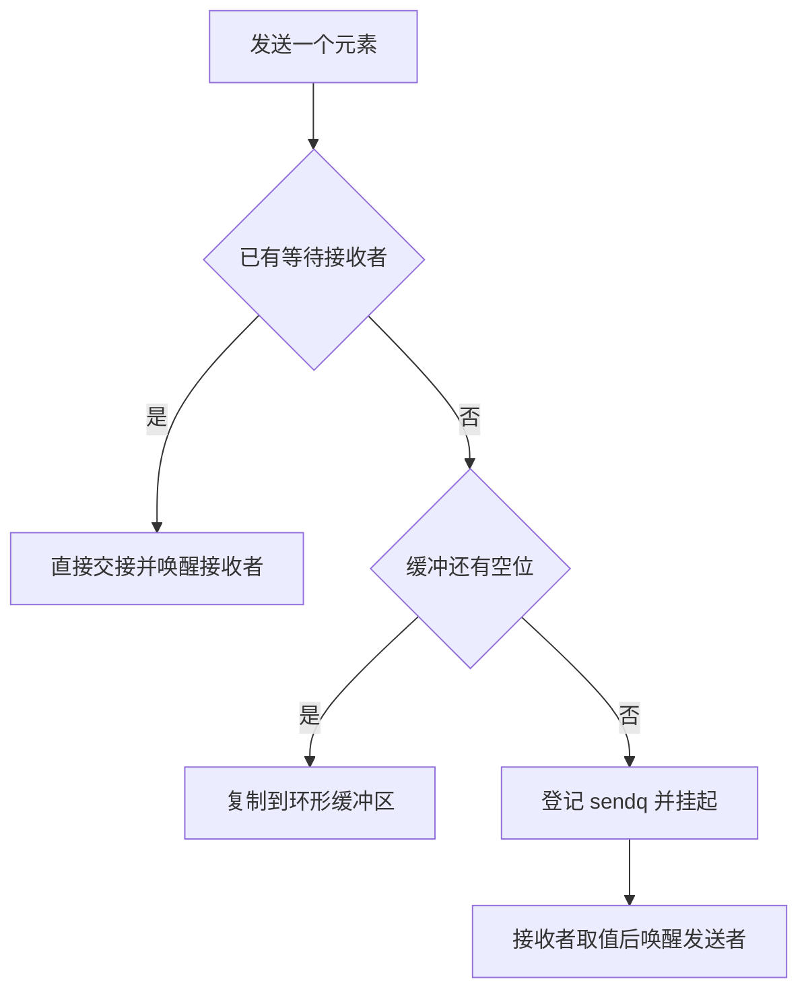

# Go Channel 与 select：缓冲、关闭、取消和所有权

Channel 同时包含数据传递、等待队列和同步语义。沿着一次发送到接收的路径理解缓冲、阻塞、关闭与 select，才能正确设计队列容量和取消协议。

## 1. 先区分数据队列与任务完成

无缓冲 Channel 要等发送与接收配对；缓冲 Channel 在有空位时可以先接受元素，满时再等待。容量改变的是等待位置，不会增加下游的实际处理能力。

如果每秒产生 200 个任务、下游只能处理 100 个，无限加缓冲只会把失败推迟，并增加排队延迟。容量应来自允许的等待量、元素保留内存与取消策略，而不是只看吞吐。

len(ch) 只是瞬时队列长度，不包含已经被消费者取走但尚未完成的任务，也不能用“len 小于 cap”保证紧接着发送不会阻塞。并发观察与操作之间可能插入其他发送者。

## 2. hchan 怎样组织数据与等待者

Go 1.27.3 的 runtime/chan.go 使用 hchan 保存通道状态。读源码先抓住以下字段即可：

| 字段 | 作用 |
| --- | --- |
| buf、dataqsiz、qcount | 环形缓冲区、容量、当前元素数 |
| sendx、recvx | 下一次写入和读取的位置，越过末尾后绕回 |
| sendq、recvq | 等待发送、等待接收的 Goroutine 对应的等待记录 |
| closed | 关闭状态 |
| lock | 保护通道内部状态，不保护元素引用的所有业务数据 |

等待记录叫 sudog，不等同于新建线程。发送者阻塞时，运行时把它登记到等待队列并 park；后续接收让等待条件满足，再把它转为可运行。唤醒不等于此刻立即占到 CPU。

## 3. 沿着 chansend 与 chanrecv 读一次交接



chansend 在锁内检查关闭、等待接收者和缓冲容量。存在等待接收者时可以直接交接，不必先绕一遍缓冲区；没有接收者但有空位时，复制元素并推进 sendx。

chanrecv 则检查已经关闭且缓冲为空、等待发送者、现有缓冲值等情况。缓冲已满且有阻塞发送者时，接收可以取出队头，再把等待发送者的元素放到空出的槽位，保持队列顺序。

这些分支解释了为什么“有缓冲就永远只操作数组”“Channel 没有锁”“每次收发都切线程”都不准确。语义保证不要求每个分支都发生线程切换。

## 4. 复制元素不等于深复制对象

```bash
cd examples/go/core-lab
go run ./cmd/mechanism-lab -mode channel
```

```json
{"buffered_value":7,"buffered_ok":true,"drained_ok":false,"aliased_value":2,"cloned_value":2,"nil_disabled":true,"sender_joined":true,"published":42}
```

实验把 []int{1} 发送到缓冲 Channel 后，在同一 Goroutine 中把原数组改为 2，然后才接收，得到 2。发送复制的是 Slice 描述信息，接收者仍引用同一底层数组。第二次发送 slices.Clone 的结果，原数组随后改为 3，接收值仍是 2。

这里刻意串行修改，没有制造 Race。在真实并发中，发送后继续修改共享数组，则既可能造成意外内容，也可能形成数据竞争。Map、指针以及内部包含引用的结构体同样需要所有权约束；slices.Clone 也只复制一层元素，不会递归复制元素里的 Map。

## 5. close 是状态变化，不是清空或取消所有任务

close 后仍可以收到缓冲区剩余值，ok=true；排空后持续收到零值，ok=false。向已关闭 Channel 发送、再次关闭或关闭 nil Channel 都会 panic；从 nil Channel 收发会一直等待。

closechan 会唤醒等待者，但发送等待者被唤醒后会发现通道已关闭并 panic，因此“先 close 让生产者自己停止”并不安全。通常由唯一发送方关闭，多个发送方则由协调者在全部发送者退出后关闭。

接收方停止消费并不会自动通知发送方。必须同时设计 Context 取消、停止信号和 Join；内部 Channel 也不是持久队列，进程重启后不能靠它恢复任务。

## 6. select 的选择、关闭循环与取消边界

select 先求值各 case 的通道表达式和发送值；发送值的求值即使最终没选中该 case 也可能发生，因此不要把昂贵或有副作用的工作藏在发送表达式里。

多个 case 同时可执行时不是按文本顺序选第一个。Go 1.27.3 的 runtime/select.go 会打乱轮询顺序，按稳定的通道顺序加内部锁；不能把它当业务优先级队列，也不能承诺每个 case 每隔固定次数获得执行。

关闭的接收 Channel 会持续就绪。在循环里发现 ok=false 后，应退出或把该通道变量设为 nil，使对应 case 失效；否则可能空转。default 只代表“当前没有可立即执行的通信”，反复 default 也可能耗尽 CPU。

```go
select {
case out <- value:
case <-ctx.Done():
    return ctx.Err()
}
```

若 out 可发送且 ctx 已取消，两个分支都就绪，仍可能发送一个值。取消不是严格的事务撤销；需要“停止接单后绝不提交”的语义时，增加准入状态、锁或提交阶段校验。实验中的未配对发送没有接收者，取消是唯一可执行分支，因此能够确定退出。

## 7. 怎样验证容量和退出

```bash
go test ./internal/mechanism -run TestChannels -v -count=1
go test ./internal/demos -run TestPipeline -v -count=1
go run ./cmd/profile -mode block -dir out -duration 100ms
```

TestChannels 检查缓冲排空、别名、nil 分支和取消退出；SquareAll 的测试使用 1000 个任务与固定 Worker，验证结果不丢失并在返回前收敛。基础三条任务实验保留作入门，不拿小容量恰好装得下的结果证明通用流水线正确。

线上同时观察队列长度、发送等待时间、任务年龄和 Goroutine 数。Block profile 中的 chansend 说明等待位置，不自动证明 Channel 实现慢；先判断下游是否停了、消费者是否已取消。

## 8. 练习与答案

### 8.1 把 Channel 容量翻倍，为什么 P99 反而变大

下游处理能力不变时，更多任务可以在队列中等待，排队年龄增加。应限制准入、设置整体预算并分析下游瓶颈，而不是仅扩大队列。

### 8.2 接收方 close 后，发送方会自动收到正常退出通知吗

不会。正在等待发送的 Goroutine 可能被唤醒并因向已关闭 Channel 发送而 panic。停止生产使用独立取消信号，等待发送者退出后再关闭数据 Channel。

### 8.3 取消后 select 为什么还可能发送一次

数据发送和取消接收同时就绪，select 不保证优先选取消。若业务要求严格禁止提交，必须在提交协议里重新判断，而不是只依赖 select 顺序。

## 9. 参考资料

- [Channel 规范](https://go.dev/ref/spec#Channel_types)
- [Select 规范](https://go.dev/ref/spec#Select_statements)
- [Go 1.27.3 chan.go](https://github.com/golang/go/blob/go1.27.3/src/runtime/chan.go)
- [Go 1.27.3 select.go](https://github.com/golang/go/blob/go1.27.3/src/runtime/select.go)
