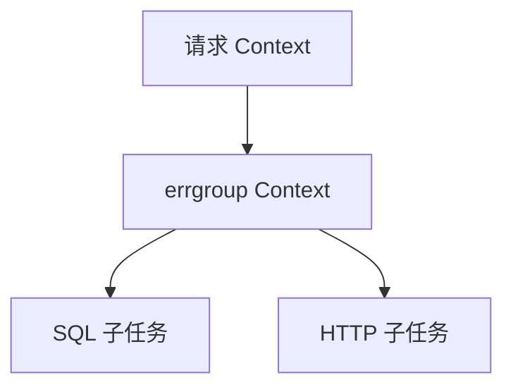

# Go Context、取消预算与 errgroup：让子任务一起收敛

Context 是取消与预算协议，不是终止任务的按钮。结合 Go 1.27.3 与 x/sync v0.23.0 源码，区分取消传播、错误原因、并发准入和等待收敛。

## 1. 四个方法各自负责什么

Deadline 表示最晚结束时间，Done 提供关闭通知，Err 给出 Canceled 或 DeadlineExceeded 等通用原因，Value 传递少量请求范围元数据。实现 Context 接口不等于某个函数已经正确响应它。

Context 通常是函数的第一个参数，由调用者向下传递，不应随意藏进可复用服务对象。Value 适合请求 ID、跟踪信息等横切数据，不是数据库、任意可选参数或完整凭证的容器；自定义键使用独立类型避免冲突。



取消父级会向后代传播；取消某个子级不会反向取消父级或任意兄弟。错误是否应当取消兄弟，由 errgroup 这样的协作协议决定，不是 Context 自动理解了业务依赖。

## 2. 取消树与定时器在源码中怎样连接

Go 1.27.3 的 context/context.go 中，cancelCtx 保存父引用、延迟建立的 done、子节点集合、通用错误和具体 cause。propagateCancel 对标准取消链可以登记子节点，不需要为每一个 WithCancel 都新建一个监听 Goroutine；特殊父实现可能走 AfterFunc 或监听回退路径。

cancel 首次设置状态、关闭通知并取消子节点，再按需要从父节点移除。调用者应在操作结束后调用 cancel，即使正常成功，也不要把清理一直拖到父请求结束。它可能释放定时器和父子关联，但不等于直接释放所有应用对象。

WithDeadline/WithTimeout 不会延长父预算。若父级只剩 80 ms，子级再请求 2 s，实际仍受父级限制；当前实现还能复用更早的父截止时间语义，不能把每次派生都想成一个全新的独立闹钟。

## 3. Err、Cause 与首次取消

```bash
cd examples/go/core-lab
go run ./cmd/lifecycle-lab -mode context
go test ./internal/lifecycle -run TestContextOwnership -v -count=1
```

```json
{"child_leaves_parent_active":true,"sibling_receives_cause":true,"first_child_cause_preserved":true,"deadline_not_extended":true,"detached_done_nil":true,"detached_value":"request-42"}
```

实验先取消一个子分支，父级与兄弟仍可工作；再用“service draining”原因取消父级，兄弟 Err 为 Canceled，Cause 保留该原因。先被取消的子分支保留自己的首次原因，不会被父级后来的原因改写。

WithTimeoutCause 可以记录定时到期的业务原因；如果提前手工调用它返回的 cancel，不能假定 Cause 一定是预设的超时原因，实际由首先发生的取消决定。日志应分别记录错误类别与适当脱敏的业务原因，不要把所有失败都归成 deadline。

## 4. errgroup 的错误与等待不是同一条规则

本实验固定 golang.org/x/sync v0.23.0，真实依赖写入 core-lab 的 go.mod 与 go.sum。errgroup.go 中，Go 登记任务并启动函数，首个非 nil 返回错误通过 errOnce 保存并取消派生 Context；Wait 等待全部函数返回，再执行组取消并返回保存的错误。

因此失败会尽早发出取消，但 Wait 不会因为一个任务失败就立即返回。如果另一个任务不退出，Wait 仍会等待。errgroup 不自动终止函数，也不恢复它们的 panic。

```bash
go run ./cmd/lifecycle-lab -mode group
```

```json
{"first_error":true,"cause_preserved":true,"joined":2,"success_wait_error_nil":true,"success_context_canceled":true,"canceled_parent_wait_error_nil":true}
```

有两点特别容易漏掉：成功 Wait 返回后，派生 Context 也已取消，不能拿它继续做下一阶段工作；如果父级已取消，但所有函数都返回 nil，Wait 仍可能返回 nil，因为它收集的是函数错误，并不自动返回 parent.Err。任务应明确决定如何把取消作为自己的返回结果。

## 5. SetLimit 会阻塞提交者，取消不会自动让出名额

SetLimit 应在启动任务前配置。Go 方法先向组内许可 Channel 发送 token，取得名额之后才登记并启动函数；这个许可等待没有独立的 Context 分支。

所以一个活动函数卡住时，调用 Go 的提交者也可能卡住；取消组 Context 不会自动让那个函数退出或释放许可。随后名额释放，Go 还可能启动一个已经取消后的函数，函数自身仍要检查 Context。

```bash
go test ./internal/lifecycle -run TestErrgroupLimitDoesNotCancelAdmission -v -count=1
```

实验用 limit=1 的受控任务占住名额，TryGo 返回 false；父级取消后提交仍不能完成，只有主动放行旧任务才取得名额，新函数再观察到取消。零上限会阻止启动，负上限表示不限；活动期间不能修改上限。

需要可取消准入时，可在外层用带 Context 的有限许可协议，或采用固定 Worker 和有界 jobs。不要用一个 Goroutine 包住每次阻塞 Go 调用，这会把无界排队藏到外部。

## 6. WithoutCancel 与 AfterFunc 都需要新的所有权

WithoutCancel 保留向父级查询 Value 的能力，但不继承 Deadline，Done 为 nil，Err 和 Cause 为 nil。它既没有复制所有值，也没有把任务移交给进程监督者；如果必须脱离请求，至少建立新的有限预算，并说明进程退出时谁负责取消和等待。

AfterFunc 在取消后异步启动回调。返回的 stop 函数不等待回调结束；false 可能是回调已开始，也可能已经停止过，不能直接解释成“清理完成”。

```bash
go test ./internal/lifecycle -run TestAfterFuncStopIsNotJoin -v -count=1
```

实验让回调先进入受控等待，stop 返回 false，但 done 仍未关闭；拥有者放行并等待 done 后才算完成。回调涉及连接 Deadline、状态写入或资源释放时，也必须避免和主流程并发操作失去顺序。

## 7. 把排队、重试和提交放进同一个预算

一个请求的预算要覆盖排队、连接池、拨号、SQL、正文读取与合理重试。重试派生自同一个父 Context，不能每轮都从 Background 重新获得完整预算。

取消只是一种协作通知。远端可能已执行，事务可能已提交，消费者也可能刚通过一次取消检查；需要严格禁止提交时，还要有业务状态校验、幂等键或 fencing，不能依赖 select 的分支顺序。

关闭和回归应分别验证：取消原因正确传播、等待者确实返回、所有自己创建的任务已经 Join，以及提交结果能够重新确认。

## 8. 练习与答案

### 8.1 errgroup.Wait 成功后，为什么不能继续用组 Context 请求下游

WithContext 的派生 Context 在 Wait 返回时也会取消，即使没有任务错误。后续阶段应使用仍有效的父 Context 或新阶段的受控子预算。

### 8.2 父 Context 已取消，Wait 是否一定返回 context.Canceled

不一定。Wait 返回组内首个非 nil 函数错误；所有函数忽略取消并返回 nil 时，Wait 也可以返回 nil。

### 8.3 SetLimit 能自动让等待名额的 Go 调用响应取消吗

不能，固定版本的 Go 先等待许可 token，这一步没有 Context 分支。需要有限、可取消的外层准入，且已运行函数必须主动退出才能释放名额。

## 9. 参考资料

- [context API](https://pkg.go.dev/context)
- [Go 1.27.3 context.go](https://github.com/golang/go/blob/go1.27.3/src/context/context.go)
- [x/sync v0.23.0 errgroup](https://pkg.go.dev/golang.org/x/sync@v0.23.0/errgroup)
- [errgroup v0.23.0 源码](https://github.com/golang/sync/blob/v0.23.0/errgroup/errgroup.go)
