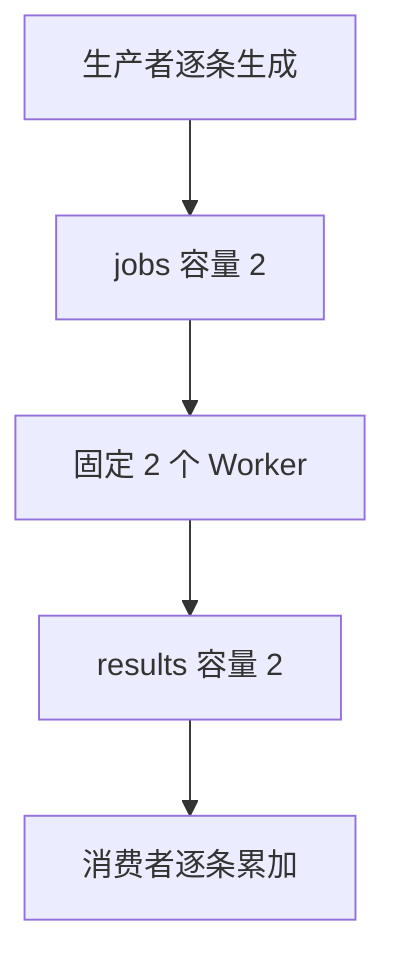

# Go Worker Pool、背压与有界流水线：避免队列替代内存泄漏

固定 Worker 只约束正在执行的函数，不约束输入、输出、排队者或依赖占用。沿着生产、执行、消费与关闭路径，构造可取消、有界且能验证退出的流水线。

## 1. 先给每一种工作量单独设边界

| 对象 | 要限制什么 | 只限制 Worker 的遗漏 |
| --- | --- | --- |
| 服务入口 | 被接受的在途请求 | 调用者仍可无限增加 |
| jobs 队列 | 尚未执行的任务 | 大输入切片或外部等待者可能常驻 |
| Worker | 同时处理的任务 | 不能保证每个任务的内存和耗时 |
| results 队列 | 已处理但尚未消费的结果 | 慢消费者可能让结果堆积 |
| 下游资源 | 连接、事务、HTTP 并发 | 所有 Worker 可能一起等待同一依赖 |

背压（backpressure）是让下游承载不足反馈到上游，最终有限等待、拒绝或转入持久队列。若上游在阻塞时改为不断起 Goroutine，就绕过了背压。

## 2. 旧 SquareAll 为什么还不是恒定内存流

core-lab/internal/demos/pipeline.go 的 SquareAll 有固定 Worker、有限 jobs 和可取消结果发送，可以正确完成有限批次。但它接收完整 input []int，并把全部结果 append 到 output，因此总数据内存仍随输入数量增长。

它适合讲解批次协作，不适合据此宣称“只要两个 Worker，就能以恒定内存处理任意大数据”。要建立流式边界，输入也要逐条产生，输出也要逐条消费，而不是只把中间 Channel 换小。

本节进一步使用 internal/lifecycle/pipeline.go 的 Run：按计数生成整数，固定 Worker 处理，消费者只累计结果，不保留整个输入或输出列表。实验最多接受 10000 个整数、64 个 Worker 和 64 容量队列，避免教学命令意外制造无界负载。

## 3. 顺着数据流和关闭责任阅读实现



生产者是 jobs 的唯一发送方，退出时负责 close(jobs)。Worker 只接收 jobs，不能各自关闭共享结果通道；由协调者等待所有 Worker 的 Done 后关闭 results。调用方同时消费 results，最后等待整个 group 和协调者结束。

若先 Wait 再读取无缓冲 results，Worker 会等消费者，调用者会等 Worker，形成环形等待。扩大结果缓冲到本次任务总数，可能让小测试“碰巧成功”，却不是修复关闭协议。

生产者发送、Worker 等待 jobs、Worker 发送 results 都要能观察取消；处理函数自身也必须响应 Context。只在最外层加一个取消 select，不能打断里面忽略取消的阻塞调用。

## 4. 消费者失败也必须能停止上游

生产或处理失败由 errgroup 记录首个错误并取消其他任务。消费者在调用方执行，若它失败，Run 主动取消内部 Context，停止调用消费者，并继续排空结果直到发送方结束，然后 Join。

这里区分“停止继续处理结果”和“立刻离开函数”。直接 return 会把发送者遗留在后台；继续排空或让发送者取消退出，都是为了解除等待关系。实验将消费者错误优先返回，处理失败则保留可用 errors.Is 判断的错误链。

这不是跨阶段事务：取消与发送同时就绪时仍可能多交接一个元素，消费者调用也可能已经开始。结果已写入外部系统时，需要幂等或提交协议，不会被流水线取消自动撤销。

## 5. 实际输出与资源范围

```bash
cd examples/go/core-lab
go run ./cmd/lifecycle-lab -mode pipeline
```

```json
{"produced":1000,"processed":1000,"consumed":1000,"peak_active":2,"active_at_return":0,"joined":true,"sum":332833500,"workers":2,"queue_capacity":2}
```

输入为 0 到 999 的平方，消费者只保留一个 int64 累计量。测试控制最初两个处理函数同时进入，再放行，确认活动峰值为 2；返回时活动量为 0，且全部任务已经 Join。结果顺序不保证，累加不依赖顺序。

就整数数据通道而言，驻留项主要受 Worker 数、jobs 容量与 results 容量约束，而不随总条数累积。这个边界不包含回调自己建立的缓存、大对象、外部队列和全局引用；固定 Worker 也不能限制一个回调分配多少内存。

Run 的回调必须返回且不能依赖 errgroup 恢复 panic。它是有限教学流水线，不提供任务持久化或任意业务工作流。

## 6. 容量与等待时间怎样估算

假设下游稳定完成 100 项/秒，允许的平均排队预算是 200 ms，数量级上大约只能容纳 20 项平均等待工作。实际容量还受突发、耗时方差、优先级和拒绝策略影响，这个算式不是精确的队列配置结论。

如果到达率持续为 200 项/秒，处理能力只有 100 项/秒，队列就会不断增长，不能继续用稳定系统公式解释它。有限队列只是让过载更早、可控地暴露；要么减少准入，要么提高真实处理能力或转移负载。

并发和缓冲也不同：增加 Worker 可能提高依赖并发，增加队列只允许更多工作等待。CPU 空闲时还要查是否被 DB、网络或锁卡住，不能只按核心数选并发。

## 7. 成功、失败和取消都要回归

```bash
go test ./internal/lifecycle -run 'TestStreamingPipeline|TestPipelineFailurePaths|TestRepeatedCancellationJoinsOwnedTasks' -v -count=1 -timeout=30s
```

回归覆盖 1000 项、处理函数失败、消费者失败、处理中途取消、零缓冲、零输入和非法上限。取消循环重复 20 次，每次都检查本函数的活动计数归零与 Join，而不是仅确认父调用返回了错误。

进一步接入真实 I/O 时，还要测试依赖关闭、连接池等待和慢消费者。需要跨重启保留任务时，使用持久任务、租约和幂等处理；内存流水线的成功关闭不能代替数据库中的可靠交付。

## 8. 练习与答案

### 8.1 SquareAll 已经有有限 Channel，为什么总内存仍可增长

它仍持有完整输入切片并累计全部输出。中间队列有界不等于端到端数据有界；流式输入、流式消费和回调保留也要一起检查。

### 8.2 消费者失败后为什么还不能马上 return

发送者可能仍阻塞在结果通道。应先取消内部任务，解除发送等待并 Join，确保错误返回不会把自己的后台任务遗留出去。

### 8.3 把队列从 20 改成 200 能把处理能力提高十倍吗

不能。它允许更多工作等待，可能增加内存和尾延迟；真实处理能力受 Worker 工作与下游资源限制。

## 9. 参考资料

- [Go pipelines](https://go.dev/blog/pipelines)
- [errgroup v0.23.0](https://pkg.go.dev/golang.org/x/sync@v0.23.0/errgroup)
- [流式实验实现](https://github.com/newswitch/newswitch.github.io/blob/main/examples/go/core-lab/internal/lifecycle/pipeline.go)
