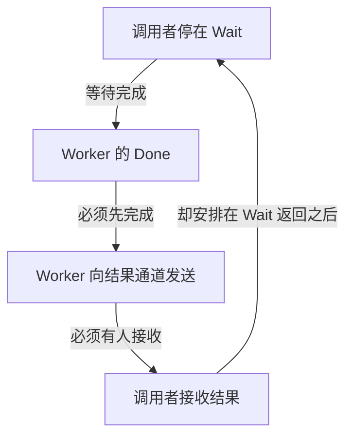

# Go Goroutine 泄漏、死锁与退出诊断：先找等谁再找为什么

Goroutine 泄漏常表现为低 CPU、高等待和资源不收敛。用有限的孤立发送实验，把取消后仍阻塞的堆栈、错误的结果协议和可验证的退出修复连接起来。

## 1. 先区分等待、泄漏与死锁

正常空闲连接、Worker 等待下一项任务，都可能长期出现在 Goroutine profile 中。判断泄漏不能只看“阻塞很久”，而要看它是否还有合理拥有者、是否存在退出条件，以及负载结束后资源能否回收。

泄漏是任务已失去有效用途或拥有者，却没有退出路径并持续保留资源。死锁关注相互等待导致无法推进，可能只发生在一部分请求中。Runtime 的 all goroutines asleep 检测不覆盖所有局部等待；HTTP 服务仍有监听、定时器和其他任务时，一批请求永久阻塞也未必触发它。

CPU 低不能排除问题。等待发送、锁或连接时，Goroutine 不需要持续执行，却仍可能引用缓冲、请求对象、事务和连接。

## 2. 建立等待图，而不是先猜哪个库坏了

| 堆栈或状态 | 先问谁能解除等待 | 需要交叉确认 |
| --- | --- | --- |
| chan send | 消费者是否仍读取，取消分支是否存在 | 结果通道、消费者退出与生产者 Join |
| chan receive | 是否还有发送方，谁负责关闭 | 关闭所有权、预期结果数量 |
| Mutex/WaitGroup | 持锁或未完成的任务在等什么 | Mutex/Block profile 与任务所有者 |
| database/sql 等待连接 | 谁持有唯一或全部连接 | DBStats 增量、Rows/事务是否释放 |
| network poll | 正常空闲还是无预算的依赖等待 | 活动请求、Deadline 和连接状态 |

把“调用者等 Worker、Worker 等结果通道、结果通道等调用者”写出来，就能看到为什么先 Wait 再读结果会死锁。堆栈给出等待位置，不自动给出根因或应当扩容哪一层。

下面假设结果通道无缓冲，Worker 只有发送成功后才能执行 Done，而调用者准备在 Wait 返回后才接收：



箭头表示“依赖谁才能继续”，不是实际执行顺序。等待环说明协议无法推进；应让接收与生产并行，并在正确位置 Join，而不是只增加 Sleep 或把通道容量调大。

## 3. 有限复现取消后仍卡住的发送者

```bash
cd examples/go/core-lab
go run ./cmd/lifecycle-lab -mode leak -dir out/lifecycle
```

```json
{"blocked_after_cancel":8,"blocked_after_drain":0,"cancellation_aware_joined":8,"profile":"out/lifecycle/abandoned-send.txt"}
```

Windows 的路径分隔符可能不同。实验启动 8 个发送者，它们有父 Context 参数，但故意缺少取消分支，向无人接收的无缓冲 Channel 发送。父级取消后，仍能在 profile 中找到 8 个相同函数的 chan send 等待。

拥有者随后接收 8 个结果并等待全部退出，相关阻塞栈归零；对照版本在发送与 ctx.Done 之间选择，能在无消费者时取消并 Join。实验不会留下永久卡住的 Goroutine，连 profile 写入失败的退出路径也会先解除并等待这些发送者。

这个结果证明“传入 Context 不代表实现会响应取消”，不代表真实服务恰好泄漏了 8 个任务。

## 4. 读懂一组关键堆栈

生成的 goroutine 文本包含以下结构，编号、参数地址和行号以实际文件为准：

```text
goroutine ... [chan send]:
newswitch.dev/go-core-lab/internal/lifecycle.abandonedSender(...)
    .../internal/lifecycle/leak.go:...
created by newswitch.dev/go-core-lab/internal/lifecycle.Leak in goroutine ...
    .../internal/lifecycle/leak.go:...
```

第一行表示等待状态，当前函数说明正在执行哪次发送，created by 帮助追溯创建者。这里是结构示意，完整 profile 由命令生成。

debug=2 风格适合看每个 Goroutine 和状态；其他 profile 展示可以按相同栈聚合。不要只统计一个 chan send 字符串就认定都是同一业务问题，实验按自有函数名和状态共同归类。

生产 profile 可能含内部地址、路径和业务标识，应受控采集与保存，管理端也不能直接暴露到公网。

## 5. 从重复请求到资源收敛的证据链

取请求高峰、取消后、负载回落后的多个样本，按同一业务栈比较数量，再关联活动任务、队列年龄、连接占用与堆引用。总 Goroutine 数会受连接复用、运行时和 SDK 后台工作影响，不适合作为唯一判据。

泄漏常见路径包括：调用者提前返回后无人读结果；代码只检查一次取消，之后卡在不可取消操作；为每个等待名额创建新 Goroutine；后台任务继续持有整个 gin.Context；关闭方无法证明发送已结束却直接 close 数据通道。

内存保留是否明显还取决于这些栈引用什么。修复数量不收敛后，还应看 heap/inuse 与外部资源是否下降，不能凭一张 CPU 火焰图证明泄漏已消失。

## 6. 修复等待协议，而不是让问题晚一点出现

典型发送点应允许取消：

```go
select {
case results <- value:
case <-ctx.Done():
    return ctx.Err()
}
```

但增加这一段还不够：处理函数、依赖 I/O、队列提交和关闭顺序也要能收敛；拥有者必须在返回前 Join。若多个分支同时就绪，取消并没有严格优先级，提交语义仍需业务协议保护。

一次性结果用容量 1 的 Channel 可能解决迟到发送阻塞，但它不能限制创建数量，也不能中断忽略取消的计算。把缓冲扩大、周期重启或提高并发上限，都不能替代完整生命周期修复。

## 7. 回归覆盖成功与失败退出

```bash
go test ./internal/lifecycle -run 'TestAbandonedSendIsRecovered|TestPipelineFailurePaths|TestRepeatedCancellationJoinsOwnedTasks' -v -count=1 -timeout=30s
go run ./cmd/profile -mode goroutine -dir out -duration 100ms
go tool pprof -top out/goroutine.pprof
```

测试检查自己拥有的完成信号、活动数与错误链；重复取消 20 次也必须每次 Join。结果关闭后仍要确认协调者退出，不能只让收结果的循环结束。

Race 检测可另行发现实际执行路径中的数据竞争，但不会证明没有所有权泄漏、死锁或重复提交。Linux 进程信号、真实连接中断和生产负载恢复，应在相应隔离环境继续验证。

## 8. 练习与答案

### 8.1 父级 Context 已取消，profile 为什么仍有 chan send

发送代码没有监听取消，或已经进入另一段不可取消等待。Context 不会替它主动退出，必须修复阻塞点并等待任务收敛。

### 8.2 负载降低后总 Goroutine 数没有回到原值，就是泄漏吗

不一定。可能是正常保留的连接和 SDK 任务。要按业务栈、拥有者与退出条件归类，并观察它是否继续增长及是否保留不应存在的资源。

### 8.3 把无缓冲结果通道改成容量 1 就完全修复了吗

只可能解除一个特定的迟到发送。仍要检查启动数量、处理取消、依赖释放和 Join；无限任务创建仍可耗尽资源。

## 9. 参考资料

- [Go diagnostics](https://go.dev/doc/diagnostics)
- [runtime/pprof](https://pkg.go.dev/runtime/pprof)
- [有限阻塞与恢复实验](https://github.com/newswitch/newswitch.github.io/blob/main/examples/go/core-lab/internal/lifecycle/leak.go)
- [Go pipelines](https://go.dev/blog/pipelines)
