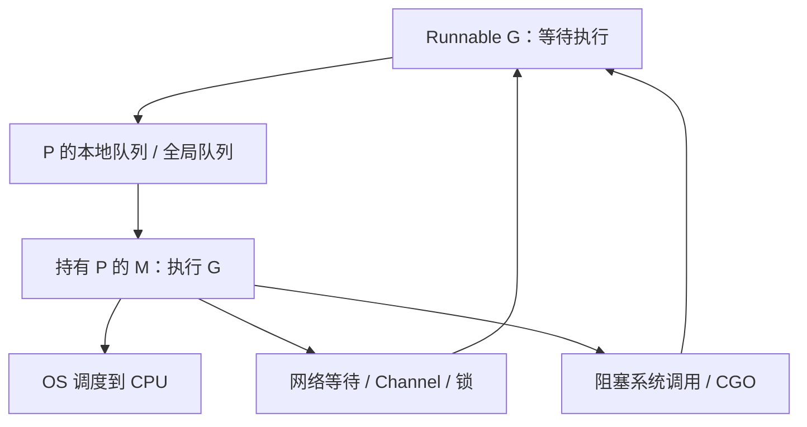

# Go Runtime 的 G、M、P：调度、netpoll、系统调用与 CPU 配额

理解 G、M、P 是为了区分任务、线程和执行资源，而不是背一张结构图。请求慢时，要判断它正在运行、等待 CPU，还是等待网络和锁。

## 1. 三个实体与一条执行路径

G 保存 Goroutine 的执行状态与栈；M 对应 OS 线程；P 持有执行 Go 代码所需的调度与分配资源。GOMAXPROCS 主要约束同时执行 Go 代码的 P 数，不是 Goroutine 总数，也不限制进程只创建这么多线程。

## 2. 调度关系图



可运行 G 会从队列获得执行机会；netpoll 等机制在 I/O 就绪时让等待的 G 再次可运行。阻塞系统调用可能使 M 暂离执行 Go 代码的路径，Runtime 可以让其他 M 继续使用 P。具体队列、抢占和窃取算法以固定版本源码为准。

## 3. 受控实验

```bash
cd examples/go/core-lab
go run ./cmd/lab -case scheduler
```

```text
gomaxprocs=2 goroutines-at-least-one=true
```

完整实现和断言见 [core-lab](https://github.com/newswitch/newswitch.github.io/tree/main/examples/go/core-lab)。

实验仅临时设置两个 P，退出前恢复原值，不宣称创建了两个线程，也不宣称证明了实际多核利用率。读 `runtime/runtime2.go` 的 g/m/p，再读 proc.go 的调度路径，比只看名词准确。

## 4. 容器与性能判断

当前 Go 的默认 GOMAXPROCS 已能结合部分平台的容器 CPU 约束与运行环境调整，不应照搬“总按宿主机核数”这一旧结论。显式环境变量和运行时设置会影响默认行为，升级时应对照对应版本文档。

CPU quota 2 核不等于永不被节流。观察容器 throttling、可运行队列、GC 与业务 CPU；大量 netpoll 等待可能正常，长时间 runnable 排队则应结合 CPU 预算分析。

## 5. 练习与答案

### 5.1 GOMAXPROCS=2 等于进程只有两个线程吗

不是，M 数还受系统调用、CGO 和 Runtime 需求影响。

### 5.2 Goroutine 等待网络一定占用一个独立线程吗

对支持 netpoll 的网络路径通常不必一对一占用线程。

### 5.3 所有 waiting 栈都是性能问题吗

不是，要看等待是否符合任务生命周期和延迟预算。

## 6. 参考资料

- [固定版本 Runtime 类型](https://github.com/golang/go/blob/go1.27.3/src/runtime/runtime2.go)
- [runtime](https://pkg.go.dev/runtime)
