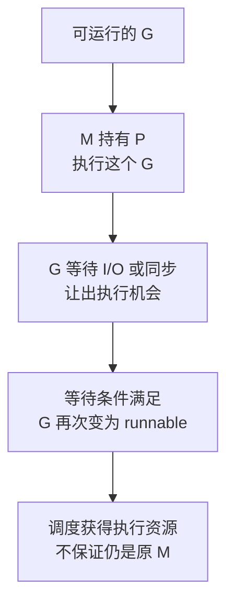
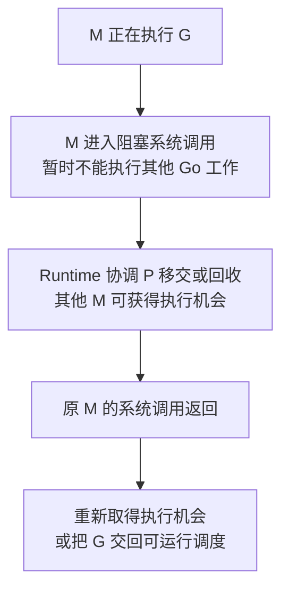

# Go Runtime 的 G、M、P：调度、netpoll、系统调用与 CPU 配额

一次请求可能运行、等待连接、阻塞在 Channel，然后再次获得 CPU。G、M、P 模型要能解释这些状态转换，而不仅是记住三个名称。下面沿执行路径阅读 Go 1.27.3 源码，并用 trace 区分执行、等待和唤醒。

## 1. 先区分任务 线程和执行资源

G 是 Goroutine 的运行时描述，包含栈与执行状态；M 对应 OS 线程；P 保存执行 Go 代码所需的调度和部分分配资源。M 持有 P 才能正常执行用户 Go 代码，最终是否占到物理 CPU，由 OS 调度及 CPU 配额决定。

GOMAXPROCS 主要约束同时执行 Go 代码的 P 数，不是进程线程数，更不是全部在途请求数。两个 P 可以管理很多等待 I/O 的 G；阻塞系统调用、CGO 和 Runtime 工作也可能使 M 数超过 P 数。

因此“一个 Goroutine 对应一个线程”和“一个 P 永远绑定一个 CPU 核”都不是这里的正确模型。NUMA、CPU 亲和性和容器 quota 属于更下层的资源约束。

## 2. 创建后不一定立刻执行

go 语句先在调用者中求值函数与参数，再建立新的 G。沿 proc.go 的 newproc1 及相关入队路径阅读，可以看到新 G 如何进入可运行状态，而不是直接获得独占线程。

调度器从本地/全局队列以及其他来源寻找可运行工作，findRunnable、stealWork 与 execute 分别帮助理解寻找任务、窃取工作和恢复执行。队列不是严格业务 FIFO；运行时的公平性、局部性和唤醒策略不能当作接口响应顺序保证。

两个请求先后进入 Handler，不代表数据库提交或响应必定保持同一顺序。若业务需要顺序，必须在业务协议中定义。

## 3. 等待时 G 和 M 分别发生什么

先把 G 的等待与再次执行分开：



这是一段 G 的生命周期，不是把 P 绑定到固定 CPU 的硬件连线图。真正的阻塞系统调用还会影响承载它的 M，与这条可挂起 G 的路径分开理解：



这不是每次系统调用必经的固定时序：短调用可能在 P 被回收前就返回，CGO 等还有各自路径。两张图强调的是“G 等待”和“M 随系统调用阻塞”不能合并为同一种资源占用。

Channel 或锁等待会把当前 G 挂起，让执行资源继续处理其他 G。满足条件后，ready 等路径将等待者变为 runnable；runnable 只说明有资格运行，不表示已经在 CPU 上执行。

受 netpoll 支持的网络等待通常不需要每个连接独占一个阻塞线程。内核事件通知后，Runtime 找出相应等待者并安排后续调度。Linux 与 Windows 的底层轮询/完成机制不同，不能用 epoll 解释所有平台。

真正的阻塞系统调用则可能带着 M 离开执行 Go 代码的路径。Runtime 会协调 P 的移交/回收；系统调用返回后还需取得执行机会。不能把 time.Sleep 简单说成“线程一直睡在内核里”，它通常涉及 Runtime 的定时与调度。

## 4. 抢占解决什么 又不保证什么

长时间运行的 G 不能无限占住所有执行机会。Runtime 的调度、监控与抢占配合提供切换机会；具体进入点、异步抢占支持与不可抢占区应按平台和版本源码理解。

抢占不是实时操作系统的硬截止保证。一个两毫秒 Timer 可以已经到期，但对应 G 尚未被调度；CPU 节流、执行队列和系统负载都会增加观察到的延迟。

不要把关闭某种抢占开关当作一般性能优化。那会改变运行路径和公平性，应先通过 trace 证明瓶颈。

## 5. 在一个 P 上观察 CPU 与等待任务

```bash
cd examples/go/core-lab
go run ./cmd/runtime-lab -mode scheduler -dir out/scheduler
```

一次 Windows/amd64、Go 1.27.3 运行输出：

```json
{
  "gomaxprocs": 1,
  "cpu_workers": 2,
  "timer_observed": true,
  "timer_delay_ms": 10,
  "channel_and_network_joined": true,
  "trace": "out/scheduler/scheduler.trace"
}
```

实验临时设置一个 P，同时安排两个有限 CPU 计算、一个 Channel 等待者、一个本机 TCP 读取者及两毫秒 Timer。CPU 工作结束后，创建者释放 Channel 并发送一个字节，然后等待全部子任务结束。

10 ms 是这次观察值，不是固定时间片。实验能展示任务混合、计时延后和完整退出，不能仅凭这行 JSON 证明每次切换都是异步抢占。具体切换原因要读 trace。

## 6. 把运行结果与源码对应

使用 `go tool trace -http=127.0.0.1:6061 out/scheduler/scheduler.trace` 查看时间线，用完退出该命令。查找业务 Region：cpu.work、channel.wait、net.read、timer.wakeup，观察 G 的运行区间及两次运行之间的状态。

阅读顺序可以是：proc.go 的 schedule/findRunnable/execute → ready → entersyscall/exitsyscall → sysmon/retake，再对照 netpoll.go。先把 G 状态变化画清楚，再进入队列字段，不必先背全部结构体。

trace 中等待区域覆盖的是一个业务范围，不等于其中每一纳秒都是相同 Runtime 状态。例如 net.read Region 既包含发起调用，也包含真正等待和恢复后的工作。

## 7. 容器里 CPU 不高为什么仍可能慢

先统一统计口径：宿主机总 CPU、容器用量、quota、可运行队列与 throttling 不是同一个指标。宿主机有空闲核，不代表该容器仍有可用配额。

若 G 主要处于 runnable，结合 CPU 配额和 GC/业务竞争分析；若主要 waiting，查具体锁、Channel、DB 池或网络。把 GOMAXPROCS 调大不能释放未归还的数据库连接，也不能增加远端数据库容量。

当前工具链的默认 P 策略可考虑部分容器约束，但显式配置会改变行为。对固定环境先记录实际值与限制，再做同负载比较。

## 8. 练习与答案

### 8.1 Timer 到期十毫秒才被观察到 能证明时间片就是十毫秒吗

不能。该时长混合了到期前等待、就绪后的排队及系统噪声。只有结合 trace 中的调度事件，才能判断本次延迟来自哪个阶段，仍不能把一次测量变成语言保证。

### 8.2 G 在网络读取时等待 是否说明 M 也一直被该连接占住

对受 netpoll 支持的路径，通常不是一连接一线程。G 可以挂起，执行资源处理其他工作；但具体系统调用、CGO 或不支持异步等待的路径应单独分析。

### 8.3 CPU 低时增加 P 为什么不一定有效

请求可能卡在连接池、锁或下游，瓶颈不在可用计算核。先判断 runnable 与 waiting，再决定优化 CPU 调度还是资源等待。

## 9. 参考资料

- [Go 1.27.3 proc.go](https://github.com/golang/go/blob/go1.27.3/src/runtime/proc.go)
- [Go 1.27.3 netpoll.go](https://github.com/golang/go/blob/go1.27.3/src/runtime/netpoll.go)
- [runtime/trace](https://pkg.go.dev/runtime/trace)
