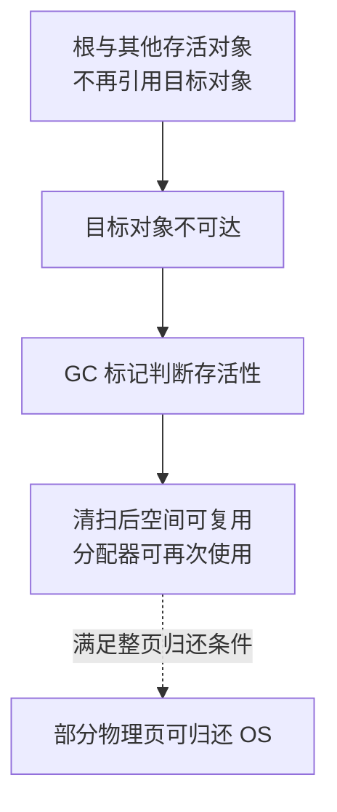

# Go 内存分配与 GC：可达性、写屏障、清扫和 Green Tea

解释 GC 需要同时看对象从哪里分配、谁还引用它、扫描如何与业务并发，以及回收空间何时可用。理解这些关系后，才能区分分配压力、对象保留和操作系统内存。

## 1. 分配路径不等于每次向 OS 申请

编译器可能消除对象，或把适合生命周期的值放在栈上；需要动态管理的对象通常进入堆。小对象按大小类别使用相应缓存和 span 路径，大对象另有处理。

可以按 mcache、mcentral、mheap 逐层理解资源组织，但不能把它们画成“每个对象都完整经过三次锁操作”的流水线。快路径与补充资源的慢路径不同，具体布局也随版本演进。

对象是否含指针影响扫描成本。相同字节数的字节缓冲与复杂指针图，不必具有相同 GC 工作量。

## 2. 可达性决定保留 而不是业务是否需要

GC 从栈、全局等根追踪对象关系。全局 Map 引用闭包，闭包引用请求，请求引用大缓冲，那么缓冲即使业务上已过期，仍可能可达。

把局部变量写成 nil 只有在确实切断保留路径时才有用；另一处别名、Slice 或后台 G 仍可保留对象。反过来，不可达对象也不一定在下一条语句执行前立即被回收。

连接、文件和事务还涉及 Go 堆之外的资源，必须显式 Close/结束。GC 管内存，不承担业务协议的释放时限。

## 3. 一个回收周期中的阶段

可以先用阶段模型建立理解：启动与标记准备 → 并发标记 → 标记收尾 → 清扫。部分阶段切换需要暂停或协调；并发标记期间业务继续分配和修改对象关系。

标记负责判断存活，清扫负责把不再使用的对象空间变为可复用。scavenger 等机制进一步影响物理页归还。不可达、可复用与 RSS 下降是三个不同观察层次。



实线概括对象回收的逻辑关系，不表示每一步立即发生。虚线强调归还 OS 还需要额外条件；因此 heap 中对象已回收，不等于 RSS 会同步下降。图也没有把写屏障或 scavenger 画成每个对象逐一经过的队列。

源码定位从 mgc.go 的 gcStart、gcMarkDone 等入口开始，再进入当前构建使用的扫描/清扫实现，不要只对照旧版本教程中的函数名。

## 4. 写屏障为什么存在

当扫描与业务并发时，指针关系可能在扫描途中改变。若扫描器已经经过某处，而业务把尚未被正确追踪的对象关系移动过去，简单的一次遍历可能遗漏仍需保留的对象。

写屏障让特定指针修改参与 GC 协议。它不是“所有赋值都加互斥锁”，也不是程序员可以用来替代 Mutex 的数据竞争保护。用户并发同步与 GC 正确性是不同问题。

固定版本的 mbarrier.go 解释了屏障协议，编译器和 Runtime 共同实现相关路径。先理解要维护的不变量，再看具体颜色和缓冲结构。

## 5. GC assist 与业务延迟

GC 与业务共享 CPU。若分配速度超过标记推进能力，部分分配路径会承担 assist 工作，因此请求可能在分配时支付回收成本，而不是只有独立 GC 线程忙。

这解释了为什么“小对象临时创建很多、最终 heap 看起来不大”仍可能拖慢服务。仅降低 live heap 不能替代降低无意义分配率；反复调用 runtime.GC 也不适合作为常规请求处理步骤。

## 6. 用相同分配量比较 GOGC

```bash
cd examples/go/core-lab
go run ./cmd/runtime-lab -mode gc -gogc 20 -total-mib 32
go run ./cmd/runtime-lab -mode gc -gogc 100 -total-mib 32
```

实验在独立进程中反复生成 512 KiB 缓冲，只保留最新一个。一次本机结果摘要：

```text
GOGC=20  allocated_bytes=33554464  gc_cycles=33  kept_bytes=524288
GOGC=100 allocated_bytes=33554576  gc_cycles=11  kept_bytes=524288
```

两次累计分配都约 32 MiB，最终保留都为 512 KiB，但周期数不同。为稳定观察，结尾显式 GC 被计入 gc_cycles，完整 JSON 用 includes_final_forced_gc 标明。

这证明该受控工作量下回收节奏改变，不证明某个服务吞吐或 P99 已改善。比较性能还必须测 GC CPU、分配速率、峰值内存和请求延迟。

## 7. Green Tea 的位置与版本边界

Go 1.27.3 的默认构建基线开启 GreenTeaGC。它改变部分标记工作的组织方式，不能据名字推断为“所有对象都移动”“自动分代”或“不再需要屏障”。

学习时把可达性和并发一致性当作主线，再对照固定 tag 的构建配置和扫描实现。概念模型可以复用，内部字段、批处理方式与分配优化不能跨版本机械套用。

## 8. 把指标组合起来判断

alloc_space/TotalAlloc 增长快但 live heap 稳定：优先找重复解析、编码和临时对象；live heap 随请求持续上涨：找缓存、队列、Goroutine 与别名保留；RSS 独立上涨：继续检查 Runtime 保留页、映射和非 Go 分配。

具体可重复案例见 [小切片保留大数组的内存排查](../07-diagnostics/06-小切片保留大数组的内存排查.md)。同样显示 64 个字节的数据，可能因底层数组引用而保留 8 MiB。

## 9. 练习与答案

### 9.1 为什么 GC 后内存仍可能很大

可能仍有可达对象，也可能空间已在堆内可复用但尚未归还 OS。先比较 live heap、Runtime 管理内存和 RSS，不能仅凭一个值认定泄漏。

### 9.2 写屏障能代替业务锁吗

不能。写屏障服务于 GC 的对象追踪协议，不保证多个 Goroutine 的业务访问无 Race，也不提供多字段事务。

### 9.3 GOGC 提高后周期减少 能直接说性能更好吗

不能。还需测 CPU、峰值、尾延迟与 OOM 风险；周期减少可能以更高空间为代价，瓶颈也可能根本不在 GC。

## 10. 参考资料

- [Go 1.27.3 GC](https://github.com/golang/go/blob/go1.27.3/src/runtime/mgc.go)
- [写屏障源码](https://github.com/golang/go/blob/go1.27.3/src/runtime/mbarrier.go)
- [构建实验基线](https://github.com/golang/go/blob/go1.27.3/src/internal/buildcfg/exp.go)
- [runtime.MemStats](https://pkg.go.dev/runtime#MemStats)
