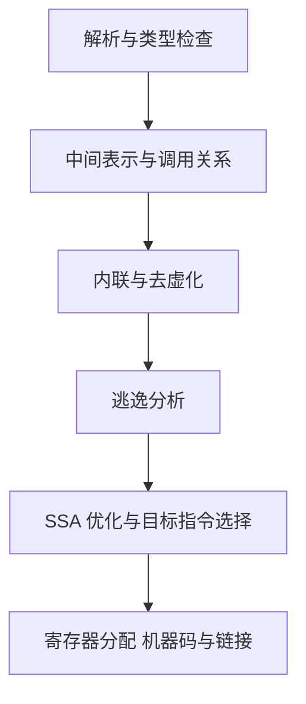

# Go 编译器：SSA、内联、去虚化与边界检查

编译优化需要三类证据：报告说明做了什么，生成代码说明实际留下什么，实验说明成本怎样变化。用内联与边界检查对照串起 SSA、逃逸分析、去虚化和 PGO。

## 1. 从源码到机器码，优化不是最后才发生



这是学习用主线，不是每个内部 pass 的完整清单。Go 1.27.3 的 cmd/compile/internal/gc/main.go 可以看到内联与去虚化交织处理，再进行逃逸分析，随后进入 SSA 与代码生成。

这个顺序解释了“函数返回指针，但调用点零分配”：内联先扩大可见范围，逃逸分析之后可能发现对象不必保存。不能把每项优化理解成完全互不影响的开关。

go run 也需要编译；go build 的缓存复用不是程序运行速度。衡量服务处理耗时不要把第一次下载依赖和编译一起计入。

## 2. SSA 怎样帮助理解重复计算与检查

SSA 是静态单赋值形式：中间值在表示中只定义一次，分支合并处使用相应的合并表示。优化器更容易跟踪“这个长度检查支配了哪些访问”“这个值在循环中是否保持不变”。

读 SSA 不需要先背所有节点名。先选一个小热点函数，观察控制流、循环、内存访问与 panic 分支，确认某条冗余检查是否仍存在，再对应汇编。

内联可以消除函数调用边界，也可能增大代码体积。接口去虚化则在能确定接收者类型的地方使用更直接的调用；不确定的插件边界仍需要动态分派。泛型调用也不能简单等同于“所有类型都完全复制一份最优机器码”。

## 3. 用内联对照联系逃逸与分配

```bash
cd examples/go/core-lab
go test ./internal/mechanism -run TestAllocationEvidence -v -count=1
go test ./internal/mechanism -run '^$' -bench 'Benchmark(Inline|Opaque|Published|Borrowed)' -benchmem -count=3
```

InlineRecord 与显式禁止内联的 OpaqueRecord 都构造同一种 64 字节 Record。固定 Go 1.27.3 下，立即读字段的内联调用为 0 allocs/op，非内联返回为 1 alloc/op；把内联结果写入全局后仍是 1，借用局部指针读取为 0。

不能据此说“内联总能消除分配”，真正决定因素是优化后对象是否仍需跨边界保留。实验的纳秒数取决于 CPU、频率与运行负载；这里只用分配与报告对应机制，不拿极小循环结果承诺端到端收益。完整解释见 [逃逸分析](./02-栈增长逃逸分析与对象生命周期.md)。

## 4. 两种循环怎样影响边界检查

mechanism/allocation.go 中保留两个非内联函数。PrefixUnchecked 按外部 n 循环访问 values[i]；PrefixBounded 先确认 0≤n≤len(values)，再将切片收窄为 values[:n]，用 range 遍历。

```go
if n < 0 || n > len(values) {
    panic("invalid prefix length")
}
values = values[:n]
for _, value := range values {
    sum += value
}
```

两个函数在合法输入上的计算结果相同。前者对非法输入的失败时机和后者不同，因此这里的对照范围明确限定为合法输入；生产 API 应自己定义错误策略，而不是仅为优化改变契约。

range 的索引范围来自同一切片，编译器能够证明访问安全；前者的 n 来自外部，不能不加证明就相信它小于切片长度。不要为了“消检查”改成 unsafe 地址访问。

## 5. 先读诊断，再看留下来的机器码

```bash
go test ./internal/mechanism -run '^$' -gcflags='newswitch.dev/go-core-lab/internal/mechanism=-m=2 -d=ssa/check_bce/debug=1'
go test -c ./internal/mechanism -o out/mechanism.test
go tool objdump -s 'mechanism.PrefixUnchecked' out/mechanism.test
go tool objdump -s 'mechanism.PrefixBounded' out/mechanism.test
```

Windows 可把二进制后缀改为 .exe。Go 1.27.3 的检查报告在 PrefixUnchecked 的 values[i] 处输出 Found IsInBounds；PrefixBounded 的循环内不再输出这条索引检查。Found 表示此处还有相应检查，不是“编译器已经成功消除了它”。

本实验的 Go 1.27.3、amd64 反汇编中，前者的索引失败分支调用 runtime.panicBounds；后者没有这条循环内失败路径，但保留了前置校验的 runtime.gopanic。旧版本可能使用 panicIndex 等不同入口，不要只按旧符号名搜索，也不要直接比较两个二进制文件大小就推断检查差异。

观察 SSA 时可指定 GOSSAFUNC=PrefixBounded，并将 GOSSADIR 设为 out/ssa 后构建目标包。该步骤导出本地 HTML，适合结合源代码读控制流；先建立输出目录，避免把生成物当文章源码提交。编译器诊断标志属于版本相关工具，升级后先核对帮助和输出。

## 6. 去虚化与 PGO 需要代表性调用关系

静态去虚化依赖编译器能否确定实际接收者；PGO 还可以利用 CPU profile 中常见调用目标等信息辅助优化。优化必须保留正确语义，对不能据此确定的情况仍需要正确处理。

```bash
go run ./cmd/profile -mode cpu -dir out -duration 1s
go build -pgo=off -o out/profile-baseline ./cmd/profile
go build -pgo=out/cpu.pprof -o out/profile-pgo ./cmd/profile
```

这里采集和构建的都是 cmd/profile，展示同一程序的显式对照方式，不代表配套微型实验一定从 PGO 获益。服务使用的 profile 应来自相同程序、有代表性的工作负载，并记录采样时段、版本与输入；不要把只含某个小循环的 profile 当真实服务流量分布。

还要注意默认构建可能拾取 default.pgo。基准组明确 -pgo=off，优化组明确文件，才能解释差异。比较时固定工具链、构建标签、CPU 架构与依赖，不把 -N -l 的调试构建当基准。

## 7. 从单函数改善走向服务收益

优化一个占 CPU 样本 1% 的函数，不可能凭空改善服务吞吐 50%，除非它同时影响了其他瓶颈。单函数 Benchmark 要报告 ns/op、B/op 和 allocs/op；服务实验还要保持同样请求、并发、限流与结果语义，观察延迟、吞吐、GC 和错误率。

先用 CPU/Heap profile 确认热点，再缩小到编译报告和机器码。完成优化后保留语义回归、正常优化构建和代表性压测，防止把“代码更短”“汇编更少”“关闭某个安全检查”误当成可交付结果。

## 8. 练习与答案

### 8.1 Found IsInBounds 表示检查已消除吗

不是，它标记当前位置仍存在相应的边界检查。需要对照另一种循环和生成代码，不能把诊断名称读反。

### 8.2 为什么禁止内联会改变分配数

内联改变了编译器可见的对象使用范围。边界保留时返回对象需要更长寿命，边界消失后可能只剩一个字段值；是否分配还取决于实际调用点是否保存对象。

### 8.3 PGO 对照为什么明确使用 -pgo=off

因为默认构建可能使用 default.pgo，导致所谓基准组也已经优化。显式控制 profile 才能形成可解释的对照，并且 profile 本身还要代表真实工作负载。

## 9. 参考资料

- [Go 编译器内部说明](https://github.com/golang/go/blob/go1.27.3/src/cmd/compile/README.md)
- [编译主流程](https://github.com/golang/go/blob/go1.27.3/src/cmd/compile/internal/gc/main.go)
- [SSA 实现](https://github.com/golang/go/tree/go1.27.3/src/cmd/compile/internal/ssa)
- [PGO 文档](https://go.dev/doc/pgo)
