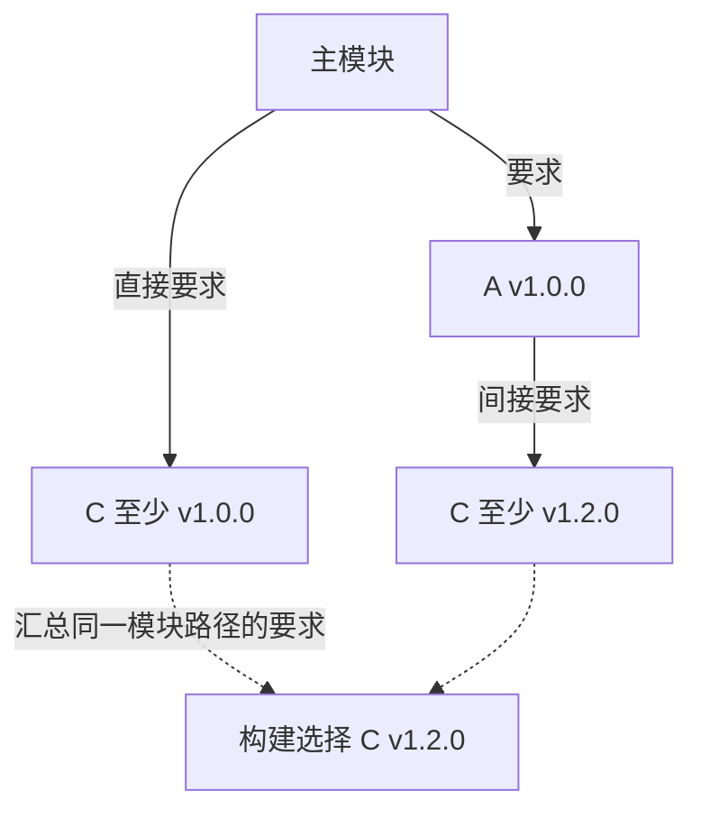

# Go Module、MVS、Workspace 与 Vendor：依赖如何被选中

go.mod 不只是依赖列表，它还影响语言版本与工具链选择。理解 MVS、替换和校验，才能解释本机成功、CI 失败及版本为何没有按想象升级。

## 1. 模块图与 MVS

Module 由模块路径和版本标识，包是目录级编译单位。require 声明依赖版本，构建会根据模块图选取同一模块所需版本中的较高者；MVS 不是每次自动拉取所有依赖的最新发布版。

语义导入版本要求主版本 v2 及以上通常体现在模块路径中。go.mod 的 go 指令表达最低 Go 与语言语义要求，toolchain 是工具链选择建议，不能当作第三方依赖版本。

## 2. 可检查的依赖证据

```bash
cd examples/gin/service-lab
go env GOVERSION GOTOOLCHAIN GOPROXY GOSUMDB
go list -m all
go mod graph
go mod why -m github.com/gin-gonic/gin
go mod verify
```

go.sum 保存下载内容的校验信息，不是另一种 package-lock：最终选版仍由模块图决定。不要为解决网络问题关闭 GOSUMDB 或随意删除 go.sum；先确认代理、TLS 和访问策略。

## 3. Workspace 与 replace

go.work 可在本机同时开发多个模块，但 CI 未必自动使用同一个工作区。模块发布前应在 GOWORK=off 的隔离环境验证，避免依赖本地 replace 才能成功。

replace 可指向固定 fork 或本地目录，必须记录原因与退出条件；本地绝对路径不应混入可共享发布配置。exclude 也不是安全升级的自动替代方案。

## 4. Vendor 与升级

go mod vendor 固化被选中的依赖源码，构建时需明确 vendor 模式。它不豁免漏洞扫描、许可证和来源审查；生成目录应可从版本化 go.mod/go.sum 重建。

升级先看最低 Go 与行为变更，运行单元、契约、Race、外部联调和性能回归。本系列用 Go 1.27.3 与 Gin 1.12.0；仅 Gin 的最低版本要求并不能代表所有 SQLite、Kafka、OTel 依赖的要求。

## 5. 用一张依赖图推导 MVS 的结果

下面是选版规则推演，不是本仓库实际依赖列表：

| 依赖边 | 声明要求 |
| --- | --- |
| 主模块 → A | v1.0.0 |
| 主模块 → C | v1.0.0 |
| A v1.0.0 → C | v1.2.0 |



两个 C 节点代表两条版本要求，不是构建中并存的两份 C。虚线是选版推导，不是源码 import 或运行时调用。

构建列表中 C 选择 v1.2.0，以满足图中更高的最低要求；即便仓库还有 C v1.9.0，也不会因为它存在就自动选中。MVS 的“最小”是满足已加载依赖要求的最小版本选择，不是总挑每条边的最小数字。

同一模块路径通常在一次构建中选一个版本；v2 模块路径与 v1 可以是两个不同身份。版本选择还受主模块的 replace/exclude、图裁剪与工作区影响，不能只看 go.mod 第一行 require 就断定最终内容。

## 6. replace 改变内容来源，不凭空引入依赖

replace 可以把某个模块版本替换为本地目录或另一个固定版本，但通常还需要对应依赖通过 require 或依赖图被选中。替换模块身份与替换源的 go.mod 声明要保持符合工具链要求。

只替换本地目录时，源码可能完全未提交，也没有正常发布版本的下载校验记录；这正是“本机通过、CI 缺文件”的常见来源。工作区也会把本地模块作为主模块加入，改变实际参与构建的内容。

发布前检查 go env GOWORK，必要时在当前进程设置 GOWORK=off 运行测试；不要随意修改全局设置。go work sync 会把选定依赖信息同步回模块文件，执行前要知道它会产生改动。

## 7. go.sum、缓存校验与来源可信度分层看

go.sum 记录模块内容及其 go.mod 的校验值，可能包含不再参与当前构建的历史条目。go mod verify 检查下载缓存内容是否符合记录，不等于证明依赖代码没有漏洞，也不等于源仓库账号绝不可能被冒用。

公共校验与私有模块访问有不同配置。企业代理、凭证与证书问题应分别解决，不以删除校验记录或全局 GOSUMDB=off 掩盖差异。

vendor 固化的是生成时被选择、被需要的源码集合；modules.txt 与 go.mod 的一致性也要检查。vendor 是可重复输入的一部分，不免除更新、许可证与代码审查。

## 8. 升级时先确认选版，再确认行为

```bash
go list -m -json all
go mod graph
go mod why -m golang.org/x/sync
go mod verify
go test ./... -count=1
```

命令应在对应模块内运行。先从 list 看被选中的版本与 Replace 字段，再沿 graph 找提高最低要求的边，用 why 看为何需要该模块。tidy 或升级后检查 go.mod/go.sum diff，再执行契约与外部联调。

只通过编译不能证明 JSON 行为、网络超时、SQL 驱动取消与性能未改变。本系列固定工具链和依赖，是为了让源码与实验一致，不是主张长期不更新依赖。

## 9. 练习与答案

### 9.1 go.sum 是精确选版锁文件吗

不是，校验内容与版本选择是不同职责。

### 9.2 go.work 让本地测试通过就够了吗

不够，要验证脱离工作区和本地替换后仍可构建。

### 9.3 关闭校验能作为常规网络修复吗

不能，应修复网络或代理而非取消完整性保护。

## 10. 参考资料

- [Module reference](https://go.dev/ref/mod)
- [Workspaces](https://go.dev/doc/tutorial/workspaces)
- [Go 构建与测试命令](https://pkg.go.dev/cmd/go)
- [基础与属性实验](https://github.com/newswitch/newswitch.github.io/tree/main/examples/go/core-lab/internal/foundation)
