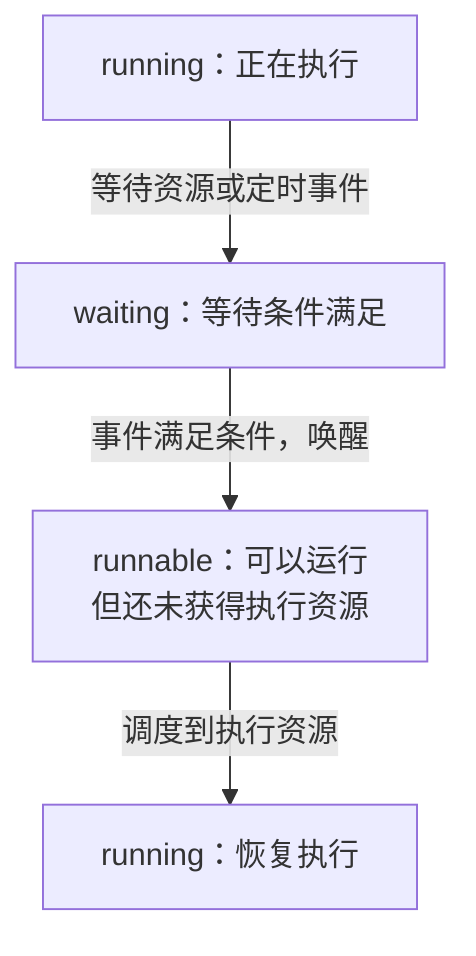

# Go Execution Trace：从聚合热点走向调度时间线

pprof 汇总成本，execution trace 记录 Runtime 事件的时间关系。用同一受控实验对照运行、等待、唤醒和排队，才能解释“计时器已到期，任务为什么还没开始执行”。

## 1. 先选择需要回答的时间问题

CPU profile 适合找计算热点，不能完整表达哪个 G 何时被唤醒；goroutine 快照表达当前状态，但可能错过短暂排队。trace 补充事件时间线，而不是替代所有指标。

先圈定一次业务操作和时间窗口，再看它的运行区间、等待类型与可运行延迟。没有业务关联时，很容易把后台 GC 或其他请求的活动误当作当前请求。

## 2. 带业务 Region 的调度实验

```bash
cd examples/go/core-lab
go run ./cmd/runtime-lab -mode scheduler -dir out/scheduler
```

这个命令在一个 P 上安排两个有限 CPU 任务、Channel 等待、本机网络读取与 Timer，写 trace 后全部退出。业务标记为 scheduler.lab Task，以及 cpu.work、channel.wait、net.read、timer.wakeup Region。

Region 是业务代码范围，其中可能先运行再等待再恢复，不能把整个 Region 都当成一种 Runtime 状态。Task/Region 可以帮助关联，但不会自动传播到另一台服务。

## 3. 按四步阅读一次等待

第一步找到目标 Region 和对应 G；第二步看它何时从 running 变成 waiting，以及等待原因；第三步找唤醒/变为 runnable 的事件；第四步看 runnable 到真正 running 之间还有多少延迟。

Channel 等待可以由关闭/发送满足条件，网络等待可以由 I/O 就绪唤醒，Timer 到期也只是产生后续执行机会。CPU 配额和可运行工作较多时，唤醒后仍可能排队。



这是一段典型等待路径，不是全部调度状态机；例如 running 也可能因抢占直接回到 runnable。waiting 区间应查依赖或等待条件，runnable 区间应查调度与 CPU 预算，不能把两段都算成网络耗时。

不要只看空白就断言网络断了。空白可能是当前 G 等待，也可能是在观察没有覆盖它的 CPU 行。

## 4. 生成离线聚合视角

```bash
go tool trace -d=parsed out/scheduler/scheduler.trace
# 以下二进制重定向示例使用 POSIX shell
go tool trace -pprof=sched out/scheduler/scheduler.trace > out/scheduler/sched.pprof
go tool pprof -top out/scheduler/sched.pprof
```

Go 1.27.3 的调试模式包含 parsed 等名称，不机械照搬旧版 -d=1。sched 聚合帮助寻找可运行后等调度的栈；net、sync、syscall 等输出按各自语义使用，不把所有文件视为 CPU profile。

PowerShell 的原生命令二进制重定向随版本有差异，避免经文本编码改写 profile；仓库验证脚本使用 Node Buffer 写出转换结果。

## 5. 交互查看和指标交叉验证

需要交互时运行 `go tool trace -http=127.0.0.1:6061 out/scheduler/scheduler.trace`，用完停止。结合 GOMAXPROCS、容器 quota/throttling、CPU、GC、池等待和请求 Trace，避免只凭一段局部事件归因。

若 runnable 排队占主导，查 CPU 预算、过量并发与执行成本；若 waiting 主导，查对应资源所有者。GOMAXPROCS 不是解决所有 waiting 的开关。

## 6. 实验能证明的因果与边界

本次可以确认所有受控等待者能被释放、CPU 工作有限、Timer 被观察到，并在 trace 中检查相应执行关系。Timer 的十毫秒示例不是 Runtime 固定时间片或实时保证。

要验证抢占机制，必须查看具体切换事件和平台支持，不能仅从两个 G 都完成就推断发生过哪一种抢占。版本、构建和系统负载都要记录。

## 7. 把 trace 用于回归

先保存可复现工作量和原始构建，再实施一项修复，比较请求关键阶段及相关聚合指标。采样会带来成本，不把带 trace 的耗时与无采样基准直接当作同条件结果。

标记名称低基数且不含用户正文、Token 和秘密。生产窗口需受控，文件权限和留存也属于运维数据保护范围。

## 8. 练习与答案

### 8.1 runnable 与 running 的差别为什么重要

前者只是已经具备运行条件，后者才实际获得执行资源。唤醒后的排队可以贡献尾延迟，若不分开就可能把 CPU 等待归为网络时间。

### 8.2 一个 net.read Region 是否全部都在等待内核

不一定。Region 是业务范围，包含发起、阻塞、恢复等阶段，需要查看其中具体 Runtime 事件。

### 8.3 怎样避免把 trace 的采样开销误认为性能退化

固定采样配置，并在同条件下比较；性能基准和诊断采样分开记录，再用机制证据解释差异。

## 9. 参考资料

- [runtime/trace](https://pkg.go.dev/runtime/trace)
- [cmd/trace](https://pkg.go.dev/cmd/trace)
- [带 Region 的实验](https://github.com/newswitch/newswitch.github.io/tree/main/examples/go/core-lab/internal/runtimeprobe)
