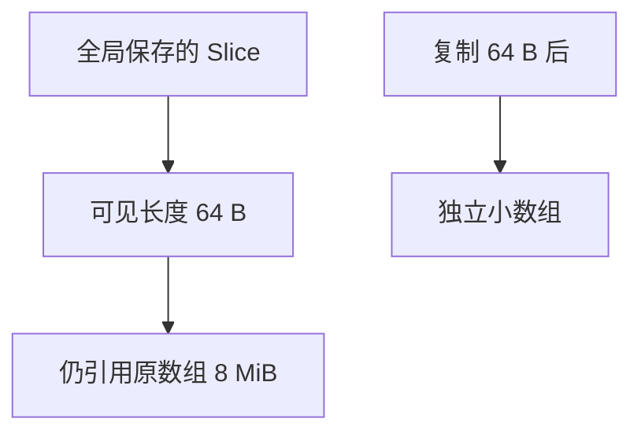

# Go 小切片保留大数组的内存排查

对象看起来只有 64 字节，进程却可能为它保留一个 8 MiB 数组。这个案例从现象、对照实验、profile 和修复回归出发，说明如何定位可达但已经不再需要的大内存。

## 1. 先定义可验证的现象

假设程序读取大缓冲，只保存开头一小段作为元数据。请求处理已结束，保存的 Slice 长度为 64，heap 却没有按预期回落。需要验证的是底层数组是否仍被引用，而不是先假设 GC 不工作。

本案例是受控实验：独立命令最多分配一个 8 MiB 大缓冲并保存一个小视图；不会无限增长，也不通过打满机器复现问题。

## 2. 可见长度与底层引用



Slice 描述符保存底层数组位置。`large[:64]` 缩短可见范围，却没有复制独立数据；即使完整切片表达式把 cap 限制为 64，原数组仍可能因指针引用而保留。

先画保留路径：全局 kept → Slice 数据指针 → 原数组。GC 按可达性工作，并不知道“业务以后只会看这 64 字节”。

## 3. 复现基线与修复对照

```bash
cd examples/go/core-lab
go run ./cmd/runtime-lab -mode view -dir out/view
go run ./cmd/runtime-lab -mode clone -dir out/clone
```

Go 1.27.3、Windows/amd64 的一次结果节选：

```text
mode=view  visible_bytes=64  heap_added_bytes=8388608
mode=clone visible_bytes=64  heap_added_bytes=64
```

两次输入均为 8 MiB，输出数据均为 64 字节。区别仅在是否对视图调用 bytes.Clone；helper 返回后再强制 GC，避免仍在执行的局部变量干扰保留关系。记录的是相对 HeapAlloc，不是 RSS。

## 4. profile 指向分配点 不自动给出保留者

```bash
go tool pprof -top -sample_index=inuse_space out/view/retained.pprof
go tool pprof -top -sample_index=inuse_space out/clone/retained.pprof
```

一次 view 样本中 bytes.Repeat 所在调用链保留约 8 MiB；clone 中该大数组分配链已不再占用主要 inuse_space。小对象可能未被抽样到，不能把 profile 没显示 64 字节理解为没有分配。

profile 通常指出对象在哪里分配。究竟是谁保留它，还要回到代码检查全局 Map、队列、闭包、Slice 和活跃 G 的引用。把 bytes.Repeat 替换成另一个分配函数并不会自动消除别名。

## 5. 为什么扩大内存或频繁 GC 不是根治

只要保留路径存在，GC 就应保留这个对象。提高内存限制只能推迟耗尽，频繁 runtime.GC 不能改变业务引用关系；改 cap 也不是复制。

修复可以是复制需要长期保存的小范围，或调整数据所有权，让大缓冲与结果拥有匹配的生命周期。复制有成本，应只用于需要独立保留的部分，而不是所有切片操作都 Clone。

## 6. 释放与回归标准

命令在采集 profile 后把全局引用置 nil，再 GC，输出 heap_delta_after_release。一次运行回落到约 14 KiB 的基线差异，包含 profile 等实验开销，不要求精确为零。

测试 TestRetentionAndRelease 比较 view 与 clone 的保留差异，并检查释放后大部分空间可被回收。真实服务还要在相同流量下看 live heap、分配率、GC CPU 与峰值，确认复制没有引入另一处瓶颈。

## 7. 怎样推广到真实故障

如果缓冲来自 HTTP、文件解析或消息消费，逐段检查结果是否保存了输入子切片。类似问题也可能出现在闭包捕获整个请求、缓存指针切片和池化超大 Buffer 中。

若 heap 没有对应的大对象但 RSS 增长，转向非 Go 分配、映射、栈和物理页归还。不同证据指向不同层，不能把所有内存增长归为 Slice。

## 8. 练习与答案

### 8.1 把 cap 改为 64 能释放原数组吗

通常不能。它限制重新切片与 append 可复用范围，不改变数据指针仍指向原数组这一事实。

### 8.2 profile 指出 bytes.Repeat 是否已经找到全部根因

只找到了重要分配来源，仍需追踪保留关系。根因是长期小视图与大数组生命周期不匹配。

### 8.3 Clone 后 profile 不显示小数组 是否说明零分配

不能。heap profile 具有采样性质，应同时检查分配测量与代码行为。

## 9. 参考资料

- [Slice 规范](https://go.dev/ref/spec#Slice_types)
- [bytes.Clone](https://pkg.go.dev/bytes#Clone)
- [可运行实验](https://github.com/newswitch/newswitch.github.io/tree/main/examples/go/core-lab/internal/runtimeprobe)
