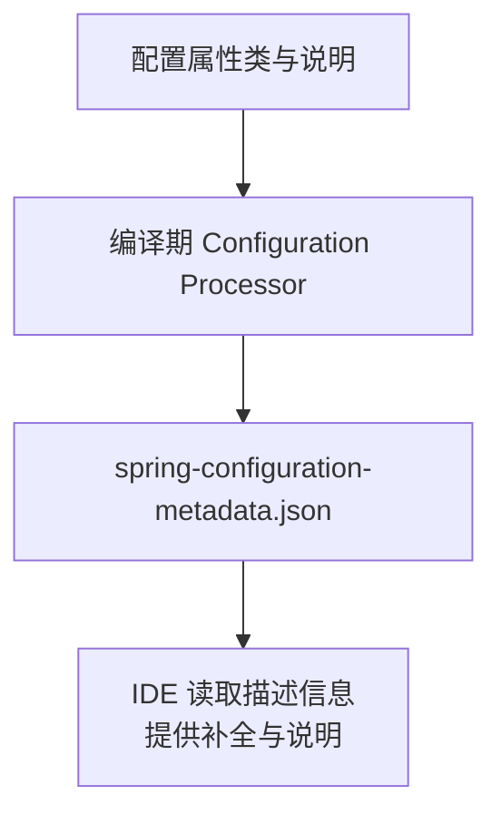
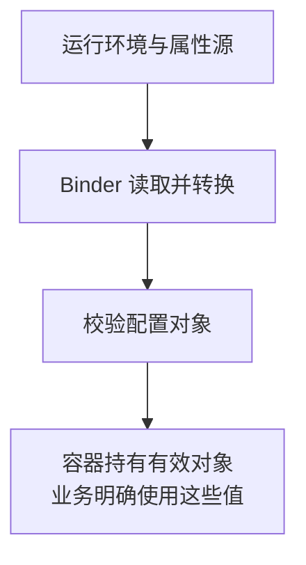

# Configuration Processor：配置元数据与运行期绑定的区别

输入 application.properties 时出现属性提示，是开发工具知道了可配置项；应用启动后字段获得值，是运行期完成了配置绑定。两者可以使用同一个 Java 类型作为信息来源，但不由同一个机制执行。

本篇使用 [foundation-lab](https://github.com/newswitch/newswitch.github.io/tree/main/examples/java-components/foundation-lab)，基线为 Boot 4.1.1 与 JDK 25。前置是配置来源、Java record 和注解处理器。

## 1. 一条属性有四个独立问题

以 lab.timeout 为例：

| 问题 | 主要负责者 |
| --- | --- |
| 编辑器是否知道名称、类型、说明与默认值 | 配置元数据与 IDE 支持 |
| 字符串 2s 是否转换为 Duration | 运行期 Binder 与转换体系 |
| 配置值是否满足业务约束 | 校验声明、验证器与业务规则 |
| 配置对象是否进入应用容器 | EnableConfigurationProperties、扫描或显式注册 |

Configuration Processor 不会单独完成后面三项。类上存在 ConfigurationProperties，也不表示任意工程已经将它注册为可注入 Bean。

## 2. 编译期与运行期分别走什么路径





第一张图中的 JSON 不是第二张图执行绑定的必需输入。元数据可以过时、缺失或描述不完整，运行期仍按实际类型和环境工作；反过来提示正确也不能证明配置来源、转换或注册成功。

## 3. 用 record 定义一组配置

工程中的类型节选如下，完整导入与类级 Javadoc 见源码：

```java
@ConfigurationProperties("lab")
@Validated
public record LabProperties(
        @NotBlank @DefaultValue("hello") String greeting,
        @DefaultValue("PT2S") Duration timeout) {}
```

主应用通过 `@EnableConfigurationProperties(LabProperties.class)` 注册它。未提供相应属性时使用声明的默认值；提供空白 greeting 会触发 NotBlank，而不是因为元数据里的 description 写了“必填”就自动校验。

timeout 在这个工程只是用于演示 Duration 转换。声明一个叫 timeout 的属性，并不会自动替 HTTP Client 或数据库设置超时；必须由相关配置代码把它交给实际客户端。

record 的属性说明可以通过类级 `@param` Javadoc 提供。元数据怎样发现类型、构造参数和说明，见 [官方处理器说明](https://docs.spring.io/spring-boot/specification/configuration-metadata/annotation-processor.html)。

## 4. 处理器应放在哪条构建路径

本例只把处理器加入 maven-compiler-plugin 的 annotationProcessorPaths：

```xml
<path>
  <groupId>org.springframework.boot</groupId>
  <artifactId>spring-boot-configuration-processor</artifactId>
  <version>4.1.1</version>
</path>
```

完整 POM 还列出 Lombok、MapStruct 与桥接项。属性类型使用 record 而非依赖 Lombok 的 getter，减少本例对处理先后关系的耦合；如果属性类本身使用 Lombok，需要按当前官方要求配置相应处理顺序，不能认为在任意位置加两个依赖就够了。

处理器版本与 Boot 基线对齐。它生成资源，不是运行期客户端，最终应用 JAR 不需要把该处理器当服务加载。IDE 的增量构建也要真正执行处理，而不是仅在界面中显示“启用注解”。

## 5. 观察生成文件的内容

```bash
mvn clean verify
```

随后检查：

```text
target/classes/META-INF/spring-configuration-metadata.json
```

本例生成的属性节选：

```json
{
  "name": "lab.timeout",
  "type": "java.time.Duration",
  "description": "example duration; does not configure an HTTP timeout",
  "sourceType": "lab.components.LabProperties",
  "defaultValue": "PT2S"
}
```

字段含义是名称、Java 类型、帮助说明、来源类型和本例可识别的默认值。defaultValue 是描述信息，不是强制写入 Environment 的指令；动态计算和复杂集合的默认值也未必能自动提取。

无法自动描述的提示可由 additional-spring-configuration-metadata.json 补充。它仍应随类型和测试一起维护，不要把密码、Token 或真实内网地址写成提示默认值。改了类型却留下旧元数据，可能误导调用方。

## 6. 缺少元数据时，绑定为什么仍能成功

配套验证把已编译 classes 复制到临时目录，只排除上述 JSON，再从该目录启动实际应用并传入：

```text
--lab.greeting=without-metadata
```

GET /api/tasks/t1 仍返回 title=without-metadata。这验证了运行期绑定不靠该描述文件；不是建议手工删除发布物中的元数据。普通工作流仍应保留正确描述，方便 IDE 与组件消费者。

另一个验证把 greeting 显式设为空，应用启动失败。这个失败来自运行期绑定和校验，不是 JSON 元数据中的帮助文字。默认值、值缺失和显式空值应分别测试。

## 7. 不要与自动配置发现混在一起

```text
spring-configuration-metadata.json
    描述属性，服务于工具与使用者

META-INF/spring/org.springframework.boot.autoconfigure.AutoConfiguration.imports
    列出自动配置候选
```

写对其中一个不能替代另一个。Starter 的自动配置还需要符合类、属性和现有 Bean 等条件；具体见 [自定义 Starter](../../../spring-boot/01-startup-configuration/06-自定义Starter扩展点与测试.md)。

排查时分清：属性没提示，查生成资源与 IDE 索引；属性不生效，查最终 PropertySource、注册、转换与实际使用点；Bean 没创建，再查条件报告与候选发现。

## 8. 练习与答案

### 8.1 元数据把 timeout 写成 2 秒，HTTP 请求就会在 2 秒自动结束吗

不会。元数据是描述；即使 Binder 得到 Duration，业务仍要把它传给实际网络调用，并区分连接、读取和总体预算。本例的 timeout 不配置 HTTP 行为。

### 8.2 IDE 提示正常但启动提示没有 LabProperties Bean，先查什么

先查类型是否通过 EnableConfigurationProperties、相应扫描或显式方式注册。元数据可来自已编译类或依赖，不证明本上下文创建了对象。

### 8.3 为什么“无元数据绑定成功”与“有元数据仍校验失败”可以同时成立

因为运行期 Binder 与校验器不靠描述文件决定所有行为。元数据帮助开发工具理解配置；实际输入仍可能非法，必须在运行期验证。

## 9. 参考资料

- [配置元数据规范](https://docs.spring.io/spring-boot/specification/configuration-metadata/index.html)
- [配置来源、绑定与校验](../../../spring-boot/01-startup-configuration/05-配置优先级属性绑定校验与多环境.md)
- [元数据实验与测试](https://github.com/newswitch/newswitch.github.io/tree/main/examples/java-components/foundation-lab)
