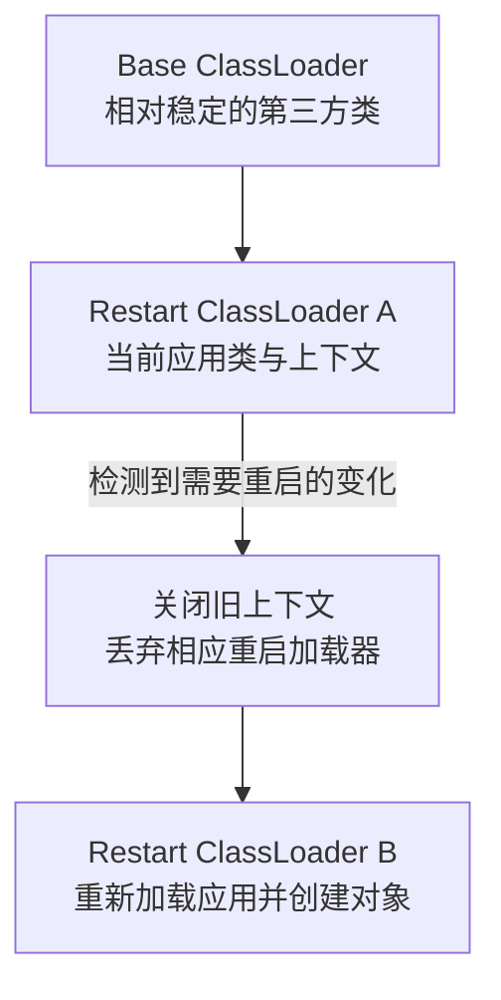

# DevTools：重启、类加载器与开发运行边界

改完源码后应用没有更新，不一定是 DevTools 失效。它主要监测 Classpath 中的变化；源码保存、编译输出改变、触发重启和浏览器刷新是不同动作。先找到变化停在哪个阶段，再决定修改配置。

本篇使用 [foundation-lab](https://github.com/newswitch/newswitch.github.io/tree/main/examples/java-components/foundation-lab) 的 Boot 4.1.1、JDK 25。本地演示只监听 127.0.0.1，测试会结束自有进程，不开启远程开发入口。

## 1. DevTools 是开发辅助，不是部署系统

DevTools 可以提供开发期属性默认值、ClassPath 变化检测和应用重启等能力。它不负责数据库安装、生产滚动更新或业务状态迁移；也不能让一个未保存的内存任务自动跨重启恢复。

重启应用上下文和 JVM HotSwap 不是同一技术。前者重新创建相应应用对象，后者涉及已有类定义的替换能力及限制。看到进程 PID 没变，不能据此认为所有 Bean 都还是同一个对象。

Boot 4.1 已弃用 DevTools 的 LiveReload 功能，不把旧教程中的浏览器扩展与自动刷新当作本篇主线。示例显式关闭 LiveReload；REST API 的重启验证不依赖它。[开发工具文档](https://docs.spring.io/spring-boot/reference/using/devtools.html)

## 2. 双类加载器怎样缩短重启路径



图首个箭头从父到子表示加载器层级，不表示类查找的委派方向；后续箭头表示重启过程，不表示父加载器里的每个类都被销毁。实际归属还受启动方式、开放工程、include/exclude 配置等影响，不能机械认为“所有业务 JAR 都必定放在同一边”。

稳定库不必每次重新走完整冷启动路径，但数据库连接、Web 服务器和业务对象可能重新创建。初始化操作要幂等，关闭回调要回收自有执行器与连接；不参与容器生命周期的静态线程可能继续引用旧类。

类身份不仅有全限定名称，还与定义它的类加载器有关。缓存把 A 加载器定义的对象交给 B 加载器定义的同名类型，可能出现看似“X 不能转换为 X”的问题。基础见 [ClassLoader 与类身份](../../../java/04-jvm/02-类加载链接初始化与ClassLoader.md)。

## 3. 先让依赖存在，再选择运行配置

完整 POM 只在 Maven 的 dev Profile 中引入：

```xml
<dependency>
  <groupId>org.springframework.boot</groupId>
  <artifactId>spring-boot-devtools</artifactId>
  <scope>runtime</scope>
  <optional>true</optional>
</dependency>
```

runtime 让该开发工具不成为普通源码所需的 API；optional 控制被其他 Maven 工程依赖时的传递语义，不等于任意打包方式都一定排除。Boot 重打包默认排除 DevTools，本例还验证最终 JAR 没有对应库。

Maven 的 `-Pdev` 和 Spring 的 dev Profile 是两套机制：前者改变构建依赖，后者选择运行配置与 Bean。只设置 `spring.profiles.active=dev` 不会让 Maven 下载一个根本未引入的组件。

## 4. 从可见的 Classpath 运行

先进入配套工程，准备开发期依赖：

```bash
mvn -Pdev clean verify dependency:copy-dependencies -DincludeScope=runtime
```

然后启动。下面为 POSIX shell，Windows 的 classpath 分隔符换成分号并把整个 classpath 用引号包住：

```bash
java -cp "target/classes:target/dependency/*" lab.components.ComponentsApplication \
  --spring.profiles.active=dev,docs
```

访问只在 dev Profile 存在的演示接口：

```bash
curl http://127.0.0.1:8086/internal/dev-info
```

返回字段含义如下，不固定 PID、随机 instance 或端口：

```json
{
  "pid": 12345,
  "instance": "每次创建该 Bean 时生成的标识",
  "appLoader": "org.springframework.boot.devtools.restart.classloader.RestartClassLoader",
  "libraryLoader": "jdk.internal.loader.ClassLoaders$AppClassLoader"
}
```

这是字段结构示意，具体值以运行结果为准。观察重启前后 PID 相同而 instance 改变，才说明进程没换但相应对象重建；仅看到一条 Starting 日志还不足以判断全部资源已回收。

## 5. 为什么保存源码没有触发更新

```text
修改源码
→ 编译写入 target/classes
→ 监测器发现相关 Classpath 变化
→ 触发文件允许检查
→ 关闭并重建上下文
→ 新请求进入新对象
```

本例 `application-dev.properties` 中设置：

```properties
spring.devtools.restart.trigger-file=.reloadtrigger
spring.devtools.livereload.enabled=false
```

修改 Java 代码后先执行 `mvn -Pdev compile`；只改 application.properties 等资源时，也要使更改进入运行中的输出目录。然后修改 `src/main/resources/.reloadtrigger`，再次执行同一编译命令复制资源，让输出目录中的标记发生变化。

触发文件用于允许一次变化检查，不应理解成每次触碰标记就必定有业务类需要重新加载。排障检查实际输出文件、Profile、触发文件位置和监测排除项，而不只看编辑器里的文件时间。

## 6. 两种关闭重启的方式并不完全相同

把下面属性放进 application.properties，可以停止通常的变化监测，但不等于从最初就没有建立重启加载器：

```properties
spring.devtools.restart.enabled=false
```

需要在 JVM 启动前禁用重启支持时，把系统属性放在主类之前：

```bash
java -Dspring.devtools.restart.enabled=false \
  -cp "target/classes:target/dependency/*" lab.components.ComponentsApplication
```

这个对照有助于判断类型转换问题是否与重启类加载器有关；不代表所有 ClassCastException 都由 DevTools 导致。关闭后问题消失，再检查具体类型的加载来源、缓存和反序列化路径。

## 7. 重启之后要检查什么

| 现象 | 需要继续确认 |
| --- | --- |
| 端口短暂不可用后恢复 | 新上下文是否真正就绪，而非只输出启动标记 |
| 端口一直被占用 | 旧服务器、自建线程或第三方客户端是否正确关闭 |
| 同名类型转换失败 | 两端定义加载器、线程上下文加载器与缓存对象归属 |
| 内存随重启次数上升 | 旧加载器是否被线程、静态索引或外部注册表继续引用 |
| 开发行为与 JAR 不同 | 实际依赖、打包排除、启动命令与运行 Profile |

普通可执行 JAR 默认不携带 DevTools，不能靠打开一个开发 Profile 就假装仍走相同重启路径。开发入口不应暴露到公网，也不应在生产强制开启远程 DevTools。

配套验证脚本在临时工程中更改输出资源和触发文件，轮询新的 Bean 标识，并确认 PID 不变；另启动最终 JAR，检查 API 正常而开发接口不存在。这个有限实验不替代长期多次重启后的堆、线程和文件句柄回归。

## 8. 练习与答案

### 8.1 浏览器看到旧响应，是不是一定要清 Maven 缓存

不是。先确认源码是否编译到实际 Classpath、应用是否检测变化、触发文件是否更新，以及请求是否进入正确进程。清缓存不能修复运行旧输出目录的问题。

### 8.2 重启前后 PID 相同，是否说明数据库连接池对象没有改变

不能。上下文可以在同一 JVM 中关闭并重建，连接池实例也可能重建。需要检查对应对象生命周期、关闭日志与实际连接，而不是只看 PID。

### 8.3 Maven -Pdev 是否自动启用了 Spring 的 dev Profile

不会自动等同。示例分别通过 Maven Profile 加依赖，通过 spring.profiles.active 选择运行配置；两者名称相同只是工程约定。

## 9. 参考资料

- [Spring Boot DevTools](https://docs.spring.io/spring-boot/reference/using/devtools.html)
- [Spring 对象生命周期](../../../spring/01-container/04-Bean生命周期Scope与线程安全.md)
- [组件实验与验证命令](https://github.com/newswitch/newswitch.github.io/tree/main/examples/java-components/foundation-lab)
