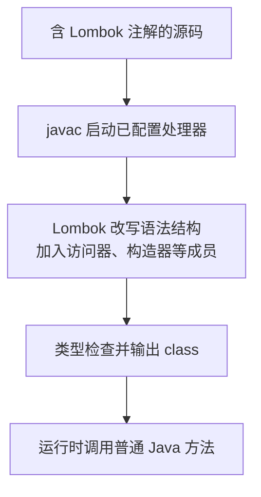

# Lombok：成员生成、构建配置与使用边界

源码里没有 getName，业务代码却可以调用它，不是 JVM 在运行时替你补出方法。Lombok 参与编译，把部分成员加入编译器处理的结构，最后写入正常的 class 文件。理解这条路径，才能排查“IDE 不报错，Maven 却编不过”和“升级 JDK 后处理器崩溃”。

前置是 Java 类、构造器、访问器与 Maven。配套工程为 [foundation-lab](https://github.com/newswitch/newswitch.github.io/tree/main/examples/java-components/foundation-lab)，固定 JDK 25、Lombok 1.18.48、Boot 4.1.1；完整 POM 与测试在工程中。

## 1. Lombok 替代哪一部分工作

| 注解 | 生成或改变什么 | 不自动保证什么 |
| --- | --- | --- |
| `@Getter`、`@Setter` | 访问器 | 字段校验、线程安全与权限 |
| `@RequiredArgsConstructor` | 所需字段的构造器 | 所有业务参数都合法 |
| `@Builder` | Builder 类型与构建调用 | 必填字段已填写、对象深度不可变 |
| `@ToString` | 对象的文字表示 | 自动隐藏秘密或避免关联加载 |
| `@EqualsAndHashCode` | 相等和哈希实现 | 生成规则正好符合业务身份 |
| `@Data` | 多种访问器、比较、文字表示与所需构造器的组合 | 适合所有实体或所有 DTO |

减少重复代码是它的主要价值。对于小型不可变数据，record 或手写构造器可能已经足够；存在复杂不变量时，明确代码比隐藏规则更重要。record 本身也不意味着其中引用的集合不可修改。

## 2. 从源码到方法的执行路径



在 javac 路径中，Lombok 的处理入口再交给相应 handler。它与 MapStruct 常见的“生成一个可见的实现源文件”不同：不能因为 target/generated-sources 下没有 WorkItem.java，就认定 Lombok 没运行。delombok 可提供展开视图，但不是正常构建每次必须执行的前置步骤。[执行路径](https://projectlombok.org/contributing/lombok-execution-path)

这里的生成发生在构建期，不是 Spring Bean 后置处理，也不是每次请求通过反射补方法。替换源码或注解之后，必须重新编译相应类。

## 3. 编译依赖与处理器路径分别配置

在完整工程中有两个位置。下列为关键片段，不是独立 POM：

```xml
<dependency>
  <groupId>org.projectlombok</groupId>
  <artifactId>lombok</artifactId>
  <version>1.18.48</version>
  <scope>provided</scope>
</dependency>
```

```xml
<annotationProcessorPaths>
  <path>
    <groupId>org.projectlombok</groupId>
    <artifactId>lombok</artifactId>
    <version>1.18.48</version>
  </path>
</annotationProcessorPaths>
```

第一处使编译器能够解析注解类型；第二处让处理器参与编译。JDK 23 起需要显式启用相应注解处理，JDK 25 不能沿用“把 JAR 放进依赖就一定自动执行”的假设。[官方 Maven 配置](https://projectlombok.org/setup/maven)

provided 是依赖作用域，不是任何打包工具都排除这个 JAR 的保证。示例额外在 Boot 重打包插件中排除 Lombok，并检查最终 BOOT-INF/lib。普通应用生成的访问器不需要运行时 Lombok 引擎；使用特殊功能时仍应核对实际字节码和依赖。

## 4. 沿一个对象观察 Builder 与日志

配套 WorkItem 是普通演示对象，不是 JPA Entity：

```java
@Data
@Builder
@NoArgsConstructor
@AllArgsConstructor
@ToString(onlyExplicitlyIncluded = true)
public class WorkItem {
    @ToString.Include
    private String id;
    private String name;
    private String tenant;
    private String internalNote;
    @Builder.Default
    private String status = "NEW";
}
```

构建 `WorkItem.builder().id("t1").name("first").build()` 后，getName 返回 first，getStatus 返回 NEW。`@Builder.Default` 在此保存未显式赋值时的默认语义；仅给字段写初始化表达式，不能想当然地推导所有 Builder 路径都保留它。显式设置 null 又不是“未设置”。[Builder 的默认值规则](https://projectlombok.org/features/Builder)

onlyExplicitlyIncluded 让本例 toString 只显示 id，避免 internalNote 顺便进入日志。但它不影响 JSON 序列化、数据库映射或 equals。公开 HTTP 响应使用另一个 TaskView；不能把隐藏 toString 当成完整数据脱敏。[ToString 规则](https://projectlombok.org/features/ToString)

`@Data` 仍是可变对象模型。若作为哈希键的字段发生变化，集合查找可能失效；若比较包含大集合或关联对象，也会增加成本。JPA 实体的标识、代理、懒加载和生命周期需另外建模，不能无条件套用 @Data。

## 5. 构造器生成不等于依赖注入

TaskController 的两个 final 字段由 `@RequiredArgsConstructor` 生成构造器，Spring 再选择并调用这个构造器提供依赖：

```text
Lombok：生成构造器
Spring：在运行期找到候选对象并完成装配
业务调用：使用已保存的 mapper / properties 引用
```

final 的未初始化字段会参与相应所需构造器，但 final 引用不自动拒绝 null。Lombok 的 `@NonNull` 可以为相应参数加入检查，复杂业务约束仍应自己实现；强制无参构造还可能留下未满足不变量的零值。[构造器规则](https://projectlombok.org/features/constructor)

容器找不到 TaskMapper 时，应查 MapStruct 是否生成实现和 Spring 是否扫描到它，不是让 Lombok 再生成一次构造器。

## 6. 看编译结果，不只看编辑器颜色

在配套工程目录执行：

```bash
mvn clean verify
javap -classpath target/classes lab.components.WorkItem
```

关注 javap 中的成员，例如以下节选，不要求整段输出逐字一致：

```text
public static lab.components.WorkItem$WorkItemBuilder builder();
public java.lang.String getName();
public void setName(java.lang.String);
public java.lang.String getStatus();
```

ComponentsTest 断言访问器、Builder 默认值与 toString 边界。再检查 WorkItem.class、生成映射实现和可执行 JAR，才能区分“编辑器理解了注解”与“实际构建产物正确”。delombok 用于审阅展开代码，不覆盖手写源文件，也不取代编译测试。

本基线 javac 可能输出 Lombok 使用终端弃用 Unsafe API 的警告。警告与构建失败要分开看；它提示需要跟踪处理器和 JDK 的兼容演进，不应用全局屏蔽或任意开放模块来掩盖错误。

## 7. 常见故障的收敛路径

| 现象 | 优先核对 |
| --- | --- |
| IDE 红线、Maven 成功 | IDE 的 Lombok 支持、导入模型与实际编译配置 |
| IDE 正常、命令行缺 getter | 命令行实际 JDK、处理器路径、是否设置 proc=none |
| 升级后 NoSuchFieldError、处理器初始化失败 | Lombok 与该 JDK 的兼容，而不只看应用依赖树 |
| Builder 创建后默认值丢失 | 是否通过对应生成路径、是否使用 Builder.Default、是否显式传 null |
| 运行日志出现敏感字段 | toString/JSON/日志参数分别检查，不把一个注解当全链路脱敏 |

和 MapStruct 联用时还要配置 lombok-mapstruct-binding，具体见 [MapStruct 专题](../mapstruct/01-MapStruct生成映射DTO边界与空值策略.md)。这个桥接项用于协调处理器对模型的认识，不是 HTTP 请求时的映射器。

## 8. 练习与答案

### 8.1 生成的 getter 是否由 Spring 在启动时创建

不是。Lombok 在编译阶段介入，方法已经存在于 class；即使不启动 Spring，也可直接调用。Spring 的对象装配是另一阶段。

### 8.2 把 internalNote 从 toString 排除后，可以直接把 WorkItem 当公开响应吗

不可以据此保证。Jackson 有自己的属性发现规则，可能仍输出该字段；应使用明确的公开 DTO，并验证真实响应不含内部字段。

### 8.3 @RequiredArgsConstructor 是否保证每个 final 字段都非 null

不保证。它负责生成相应赋值构造器；非空和业务约束需要 NonNull 或显式校验。final 限制引用重新赋值，不等于对象完整或深度不可变。

## 9. 参考资料

- [Lombok 版本与 JDK 支持](https://projectlombok.org/changelog)
- [Lombok Data](https://projectlombok.org/features/Data)
- [配套源码与测试](https://github.com/newswitch/newswitch.github.io/tree/main/examples/java-components/foundation-lab)
