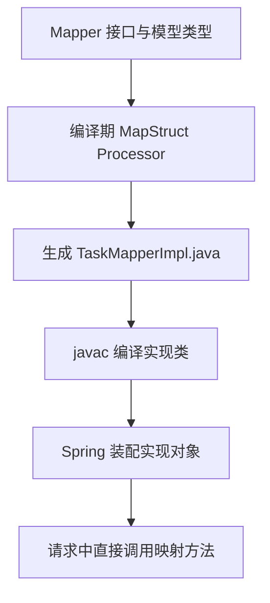

# MapStruct：生成映射、DTO 边界与空值策略

数据库对象、业务对象和接口响应不应该因为字段相近就混成一个类型。MapStruct 把重复的属性搬运变成编译期生成代码，但“哪些字段可以输出、哪些字段允许更新”仍是业务契约。

本篇使用 [foundation-lab](https://github.com/newswitch/newswitch.github.io/tree/main/examples/java-components/foundation-lab) 的 MapStruct 1.6.3、Lombok 1.18.48 与 JDK 25。先理解普通 Java 的构造器和方法调用；生成器不能替代这些基础。

## 1. 与手写映射、反射复制有什么区别

| 方案 | 映射发生在哪里 | 主要取舍 |
| --- | --- | --- |
| 手写构造与赋值 | 普通业务代码 | 清楚直接，但大量重复规则需维护 |
| 反射复制工具 | 通常在运行时发现和访问属性 | 行为、类型转换与错误可能延后暴露 |
| MapStruct | 构建期生成实现，运行时调用实现 | 需要正确处理器配置和明确映射规则 |

MapStruct 不是 JSON 序列化器，也不负责从数据库取出对象。JPA 的懒加载 getter 如果被生成映射调用，仍可能发 SQL；编译期生成不意味着运行期没有外部副作用。

## 2. 接口如何变成普通实现



处理器从映射方法的参数、返回类型和配置推导赋值。生成文件可在 target/generated-sources/annotations 观察；它是构建产物，不应手工维护或与接口各自修改。

官方参考区分 [映射定义、Spring 组件模型与生成策略](https://mapstruct.org/documentation/stable/reference/html/)。本例返回 record，所以实现通过构造器创建 TaskView，而不是凭空给 record 添加 setter。

## 3. API、处理器与 Lombok 桥接项

完整 POM 同时配置：

| 项目 | 本例版本 | 作用 |
| --- | --- | --- |
| org.mapstruct:mapstruct | 1.6.3 | 编译时的 Mapper/Mapping 等注解 API |
| org.mapstruct:mapstruct-processor | 1.6.3 | 生成映射实现 |
| org.projectlombok:lombok | 1.18.48 | 为输入对象生成访问器等成员 |
| org.projectlombok:lombok-mapstruct-binding | 0.2.0 | 协调 Lombok 与 MapStruct 的模型处理 |

JDK 25 下处理器列入 annotationProcessorPaths，而不是只把 mapstruct API 加到 dependencies。API 与 processor 保持同版；混用旧处理器常会让实际生成行为与文档不一致。

Lombok 改变编译器中的模型后，MapStruct 必须看到完整属性。桥接项的用途和配置见 [官方 FAQ](https://mapstruct.org/faq/)。它不是额外 Bean，也不参与每次转换。配套 POM 将仅用于编译的 API 排除出 Boot 应用归档，运行时由 Spring 提供生成实现，不调用 Mappers 工厂。

## 4. 从内部对象映射到公开 DTO

WorkItem 有 id、name、tenant、internalNote、status，而公开类型只有：

```java
public record TaskView(String id, String title) {}
```

Mapper 显式说明重命名关系：

```java
@Mapper(componentModel = "spring",
        injectionStrategy = InjectionStrategy.CONSTRUCTOR,
        unmappedTargetPolicy = ReportingPolicy.ERROR)
public interface TaskMapper {
    @Mapping(target = "title", source = "name")
    TaskView toView(WorkItem source);
}
```

id 按同名规则映射，name 改为 title。生成方法的核心相当于检查 source 为 null 后，读取 id/name，再 new TaskView；准确代码以该工程生成文件为准。

unmappedTargetPolicy=ERROR 约束目标属性遗漏，不是“所有来源字段都必须使用”。来源还有 internalNote 是有意的；若公开 DTO 增加一个无法映射的新属性，应让构建失败而不是悄悄返回空值。

目标 DTO 没有内部字段，比只在 Swagger 上隐藏更有力。但映射不是授权：对象能否被当前租户读取，仍要在查询与业务层检查；不能把拥有 DTO 当成可以读取任何对象。

## 5. 更新映射要先定义 null 的业务含义

完整接口另有一个更新方法：

```java
@BeanMapping(ignoreByDefault = true,
        nullValuePropertyMappingStrategy = NullValuePropertyMappingStrategy.IGNORE)
@Mapping(target = "name", source = "title")
void patchName(NamePatch patch, @MappingTarget WorkItem target);
```

ignoreByDefault 建立允许写入的字段清单，只更新 name；目标 id、tenant、status 不因相似字段自动被覆盖。MappingTarget 表示修改已有目标，不是每次创建新对象。

这里 title=null 表示保留原名称，非 null 则更新。它不是完整的 HTTP PATCH 协议：只用一个可空字段，无法同时表达“缺失、不修改”和“显式 null、清空”。需要清空语义时，应建立存在性模型或单独操作，不能把所有 null 一律 IGNORE 后宣称支持三态。

NullValuePropertyMappingStrategy 主要针对更新映射的源属性；源对象整体为 null、集合策略、转换器和默认表达式又有各自规则。回归应检查实际生成的 if 和测试结果，不从一个枚举推导所有情况。

## 6. 验证生成文件与真实响应

在工程目录运行：

```bash
mvn clean verify
```

然后查看：

```text
target/generated-sources/annotations/lab/components/TaskMapperImpl.java
target/classes/lab/components/TaskMapperImpl.class
```

测试分别验证重命名、null 源对象、null 更新、更新白名单，以及真实 HTTP JSON 只含 id/title。核心输入输出关系：

| 操作 | 结果 |
| --- | --- |
| id=t1、name=first → toView | id=t1、title=first |
| toView(null) | null |
| title=null 更新已有 first | 仍为 first |
| title=second 更新 | name 变为 second，id/tenant 不变 |

没有数据库的本地实验不证明 JPA 懒加载成本，也不证明并发更新安全。把映射加入真实持久化链时，还要验证 SQL 条数、事务范围和版本竞争。

## 7. 生成失败与装配失败分开排查

| 现象 | 检查顺序 |
| --- | --- |
| 找不到属性 name | 原模型是否有访问器、Lombok 是否执行、桥接项是否存在 |
| 只有接口，没有 Impl | processor 是否运行、是否被 proc=none 禁止 |
| Impl 存在但 Spring 找不到 Mapper | componentModel、包扫描、实际产物是否包含实现 |
| 新字段没被赋值 | 目标策略、ignoreByDefault、同名规则和实际生成代码 |
| null 更新行为不符 | 更新方法与创建方法区分，检查生成条件和业务三态 |

不要通过全局设置所有目标忽略来消除构建错误。出现遗漏时，先决定字段应该映射、显式忽略，还是根本不属于该 DTO。

## 8. 练习与答案

### 8.1 每次发布是否需要把生成的 Impl 手动提交到仓库

普通配置下不需要。接口、模型、处理器版本和构建配置才是输入；构建会重建实现。应通过干净构建验证，不维护一份可能陈旧的手写 Impl。

### 8.2 ReportingPolicy.ERROR 为什么没有要求输出 internalNote

本例检查未映射的目标属性。TaskView 本身没有 internalNote，不要求消费来源的所有字段。应检查目标 DTO 和真实 JSON，而不是为了“映射完整”公开内部数据。

### 8.3 IGNORE 能直接解决 PATCH 的显式清空吗

不能。它会把相应 null 当作保留旧值，无法表达另一个“清空”意图。业务必须额外表达字段存在性或提供清空操作，再选择合适映射策略。

## 9. 参考资料

- [MapStruct 1.6.3 参考手册](https://mapstruct.org/documentation/stable/reference/html/)
- [JSON 缺失与空值的协议边界](../../../spring-boot/02-web/03-JSON日期精度空值与对象边界.md)
- [组件实验源码](https://github.com/newswitch/newswitch.github.io/tree/main/examples/java-components/foundation-lab)
