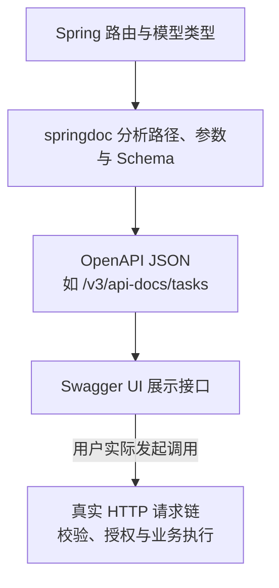

# springdoc-openapi：文档生成、Swagger UI 与接口契约

接口可以正常调用，却没有可供别人理解的契约；文档页面也可能正常打开，但描述的字段、鉴权和错误行为与真实接口不一致。springdoc 能减少从代码提取文档的重复工作，不能自动证明契约完整，更不能代替安全控制。

本篇使用 [foundation-lab](https://github.com/newswitch/newswitch.github.io/tree/main/examples/java-components/foundation-lab)，固定 Boot 4.1.1、springdoc-openapi 3.1.1、JDK 25，使用 MVC 与 Swagger UI。程序只提供内存映射演示，没有持久化或身份系统。

## 1. 三个名字各自负责什么

| 名称 | 职责 | 不负责什么 |
| --- | --- | --- |
| OpenAPI | 描述 HTTP API 的规范，包括路径、参数、模型、响应和安全声明 | 直接运行 Controller |
| springdoc-openapi | 在 Spring 应用运行时读取路由、类型和注解，生成相应文档 | 保证所有业务语义都可自动推导 |
| Swagger UI | 读取文档并展示、组织交互请求的界面 | 自动给服务增加鉴权与字段校验 |

Swagger UI 的 Try it out 会向真实接口发送请求，不是只在浏览器模拟业务。调试写接口也会走真实副作用，因此演示数据、可操作环境和权限必须明确。

springdoc 是独立社区项目。Boot 4 使用其相应 3.x 系列，不能把旧 Boot 2 的 Springfox 配置或 Boot 3 的依赖版本不加检查地复制进来；本例组合通过实际启动和 HTTP 验证。[项目文档与兼容说明](https://springdoc.org/)

## 2. 文档是怎样从应用中出现的



最后一条箭头重新进入应用的请求处理路径，不是生成 JSON 时已经完成业务。文档上的描述和安全图标不会替换 Filter、Controller 校验、事务或对象权限。

文档生成可能涉及延迟初始化与缓存；Controller 签名改变后要确保运行的是新构建。不能只看到旧页面还在，就认定新参数已发布。

## 3. 引入正确的应用集成

MVC + UI 的依赖片段为：

```xml
<dependency>
  <groupId>org.springdoc</groupId>
  <artifactId>springdoc-openapi-starter-webmvc-ui</artifactId>
  <version>3.1.1</version>
</dependency>
```

这是应用运行库，不是 annotationProcessorPaths 中的编译器插件。WebFlux 有相应的不同 Starter；只要文档 JSON、不需要 UI 时也有 API 侧模块，不必无条件把交互页面部署出去。

运行期文档、构建期导出静态规范、根据规范生成客户端是三件事。本篇先验证运行期文档，客户端生成还需要选择独立生成工具并验证请求兼容。

## 4. 公开 DTO 比隐藏页面字段更重要

本例内部 WorkItem 含 tenant、internalNote，而接口只返回 TaskView(id,title)。MapStruct 把 name 映射为 title，文档与真实 JSON 都应以公开类型为边界。

```java
@GetMapping("/{id}")
@Operation(summary = "Read an in-memory demonstration task")
public TaskView get(@PathVariable String id) {
    return mapper.toView(item(id, properties.greeting()));
}
```

Operation 描述操作，Schema 描述模型，Parameter 描述参数，ApiResponse 可补充具体响应。注解用于文档表达；若新增一种 409 错误，应同时实现真实错误契约、说明响应，并写测试，而不是只写一条注解。

把字段标记为文档隐藏，不等于 Jackson 不再输出它；把路径从文档排除，也不等于网络上无法访问。敏感数据应从真实公开模型和授权规则中治理。

## 5. 分组控制文档范围，不是访问控制

主应用注册一个文档组：

```java
@Bean
GroupedOpenApi taskApi() {
    return GroupedOpenApi.builder()
            .group("tasks")
            .pathsToMatch("/api/tasks/**")
            .build();
}
```

组名 tasks 对应 `/v3/api-docs/tasks`。它只收集相应路径；不表示其他接口被关闭，也不保证未分组的默认文档没有其他路径。生产若需要保留文档，应给所有文档入口、UI 资源和实际 API 分别设计访问规则。

本地开发接口 `/internal/dev-info` 不属于 tasks 组，而且只在 dev Profile 注册。分组与 Profile 注册是两种不同约束，测试应分别断言。

## 6. 默认关闭，显式进入本地文档模式

application.properties 默认：

```properties
springdoc.api-docs.enabled=false
springdoc.swagger-ui.enabled=false
```

application-docs.properties 再打开两项。只关 UI 而留 JSON，不等于关闭全部文档；相反只打开 UI 却没有可读取的 JSON，也不能完成正常展示。

在工程目录执行：

```bash
mvn clean verify
java -jar target/component-foundation-lab-1.0.0.jar --spring.profiles.active=docs
```

另一个终端检查：

```bash
curl http://127.0.0.1:8086/api/tasks/t1
curl http://127.0.0.1:8086/v3/api-docs/tasks
```

第一个响应为：

```json
{"id":"t1","title":"hello"}
```

第二个是完整 OpenAPI 文档，重点核对：paths 包含 `/api/tasks/{id}`，TaskView 的 properties 只含 id/title。浏览器访问 `http://127.0.0.1:8086/swagger-ui/index.html` 查看 UI，用完 Ctrl+C 结束应用。

若走反向代理，还要验证外部路径、前缀与可信转发头，不能简单信任任意调用方提供的 Forwarded。跨域配置与安全控制也不会因为 UI 能打开就自动正确。

## 7. 文档校验与真实请求要成对验证

本地测试会通过真实随机端口发请求，不只检查 Controller 注解：

| 检查对象 | 验证内容 |
| --- | --- |
| 实际 GET JSON | 只输出公开 DTO，名称映射正确 |
| 实际 POST 输入 | 空白 name 返回 400；合法 name 返回映射结果 |
| tasks 文档组 | 路径存在，不包含开发接口 |
| TaskView Schema | 不包含 internalNote |
| Swagger UI HTML | docs Profile 下可访问 |
| 默认 JAR 启动 | API 正常，文档与开发接口不可访问 |

POST 在本例只映射数据，不创建持久任务，所以返回 200，而不是伪装成已经保存资源的 201。自动生成文档也未穷尽全部错误响应；扩展契约时要检查真实错误体和声明是否匹配。

本例没有接入认证。文档里增加 bearerAuth 声明或 UI 的 Authorize 按钮，只描述调用方式，不会自动建立 JWT 验证器。相应运行能力见 [Spring Security](../../../spring-boot/05-security/01-SpringSecurity过滤器链与认证授权.md)。

## 8. 常见问题怎样定位

| 现象 | 优先检查 |
| --- | --- |
| UI 404 | Starter 类型、UI 开关、Profile、上下文路径与资源规则 |
| UI 能开但文档加载失败 | JSON 地址、API 文档开关、安全链和代理路径 |
| 文档缺接口 | 路由是否注册、分组条件、包扫描、隐藏配置与实际构建 |
| 返回字段与 Schema 不一致 | DTO、Jackson 注解/视图、自定义序列化和泛型声明 |
| 运行期 NoSuchMethodError | Boot、springdoc 与传递依赖组合，实际加载的类来源 |

不要通过允许所有请求来“修好”文档页面。先明确 UI、JSON 和业务 API 各自的访问边界，再验证需要开放的最小范围。

## 9. 练习与答案

### 9.1 文档声明了 Bearer Token，接口就会拒绝无 Token 请求吗

不会。声明只描述契约；拒绝请求需要真实安全链和授权规则。应发出无凭证、错误凭证和越权请求验证，而不是只看 UI 的锁形图标。

### 9.2 从 tasks 文档组排除开发接口，它是否就不能被访问

不是。文档范围和实际路由注册不同。还要检查 Profile、安全规则和网络入口；本例默认 Profile 不注册该开发 Controller。

### 9.3 UI 显示正常，为什么仍要检查实际响应

Schema 可能没有完整反映自定义序列化、错误分支或权限差异。真实 HTTP 测试才能证明选定输入下返回了什么，文档测试则确认对外描述没有意外变化，两者互补。

## 10. 参考资料

- [springdoc-openapi 文档](https://springdoc.org/)
- [OpenAPI 规范](https://spec.openapis.org/oas/latest.html)
- [公开 DTO 的 MapStruct 映射](../../01-developer-tools/mapstruct/01-MapStruct生成映射DTO边界与空值策略.md)
- [配套源码与测试](https://github.com/newswitch/newswitch.github.io/tree/main/examples/java-components/foundation-lab)
