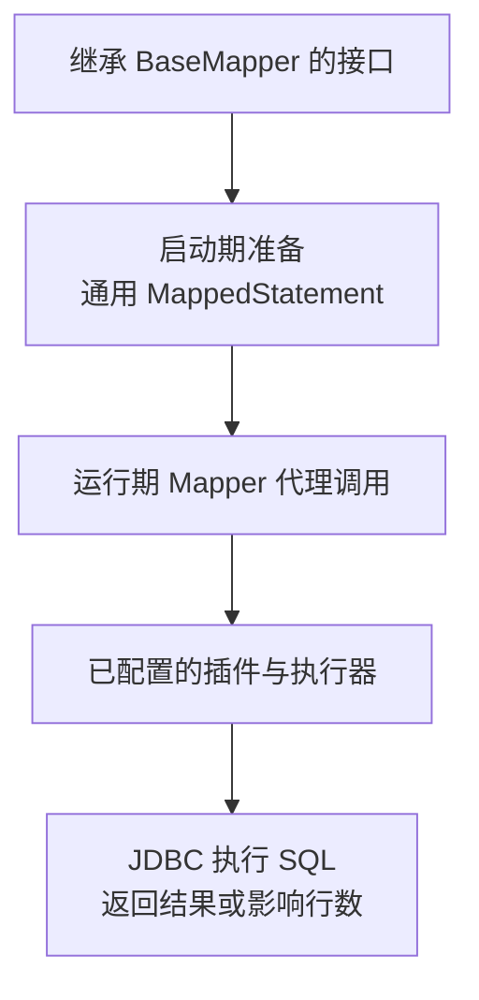

# MyBatis-Plus：BaseMapper、条件构造、分页、乐观锁与逻辑删除

继承 BaseMapper 后，不写 XML 也可以插入、查询和更新。省下的是常见 SQL 的重复组织工作，不是 SQL、权限、事务和索引的知识。真正需要看清的是：方法怎么对应语句，条件来自哪里，插件改了什么，以及返回零行时业务应怎样处理。

配套 [runtime-lab/mybatis-plus](https://github.com/newswitch/newswitch.github.io/tree/main/examples/java-components/runtime-lab/mybatis-plus) 固定 Boot 4.1.1、JDK 25、MyBatis-Plus 3.5.17；实验数据库为 H2 2.4.240。先阅读 [MyBatis 请求执行链](../../../spring-boot/03-data/03-MyBatis映射SqlSession执行与缓存.md)。

## 1. 它增强的是 MyBatis，不是替换数据库

| 能力 | 提供什么 | 不提供什么 |
| --- | --- | --- |
| BaseMapper | 常见按表 CRUD 方法 | 自动理解完整业务聚合 |
| Wrapper | 通过 Java API 组织条件、排序与更新字段 | 自动添加所有对象权限 |
| 映射注解 | 表列、主键、版本和逻辑删除等元信息 | 自动建立正确表结构与索引 |
| 拦截器 | 按启用配置改写或检查执行过程 | 对所有自定义 SQL 一律提供相同保障 |

它没有 JPA 的实体脏检查；修改一个普通返回对象后，仍需调用明确的更新方法。它也不同于 Spring Data JDBC 的聚合保存：一条父表 update 不会自动推导并保存所有业务子表。

## 2. 从接口到真实 SQL



这里的 SQL Injector 是框架扩展机制的名称，表示为 Mapper 准备映射语句，不是用户输入的 SQL 注入攻击。Mapper 方法最终仍进入 MyBatis 的 Session、Executor、参数处理与结果映射路径。

生成语句、XML/注解自定义语句和插件改写要分开分析。排查时先确定当前方法使用哪个 MappedStatement，再检查最终 SQL 与实际参数，不能只按方法名猜测。

## 3. 选对 Boot 集成，不叠加多个 Starter

本例引入：

```xml
<dependency>
  <groupId>com.baomidou</groupId>
  <artifactId>mybatis-plus-spring-boot4-starter</artifactId>
  <version>3.5.17</version>
</dependency>
<dependency>
  <groupId>com.baomidou</groupId>
  <artifactId>mybatis-plus-jsqlparser</artifactId>
  <version>3.5.17</version>
</dependency>
```

Boot 4 集成使用对应 Boot 4 Starter。不要同时再塞入普通 MyBatis Starter、Boot 3 版 Plus Starter，制造重复自动配置与版本竞争。分页等解析能力需要相应解析模块，不能只复制一个拦截器配置却漏掉依赖。[接入说明](https://baomidou.com/en/getting-started/)、[分页依赖说明](https://baomidou.com/en/plugins/pagination/)

Boot BOM 管理 Spring 与数据库基础依赖，Plus 及相应模块单独锁定。升级时检查完整依赖树和真实启动，不只确认 POM 能解析。

## 4. 主键、映射和更新字段

本例 TaskRow 使用 TableName("mp_task")，主键为 TableId(type=AUTO)，版本为 Version，删除标志为 TableLogic(value="0",delval="1")。完整类型使用普通访问器，不依赖 Lombok。

AUTO 依赖数据库生成标识，应与表中的 identity/自增策略一致；其他主键策略并不等价。插入后验证对象是否得到 ID，而不是固定认为第一条数据永远是 1。

按 title 查询的节选：

```java
tasks.selectList(Wrappers.<TaskRow>lambdaQuery()
        .eq(TaskRow::getTitle, "needle"));
```

Lambda 形式减少字段名字符串拼错的问题，普通比较值走相应参数绑定；它不是授权系统。租户和用户身份必须来自可信上下文，不能把调用方提交的整套条件直接作为服务端查询规则。

Wrapper 每次调用重新创建，不作为跨请求可变单例。排序字段、返回列、原生 SQL 片段也应由服务端白名单决定。对空值，明确是忽略条件、匹配 SQL NULL，还是拒绝请求；对更新，实体字段策略也可能影响 null 是否出现在 SET 中。

## 5. 分页解决返回规模，不消除扫描成本

配置 MybatisPlusInterceptor，在本例 H2 上注册 PaginationInnerInterceptor(DbType.H2)，并设置 maxLimit=100；分页拦截器放在示例链的最后。生产换库必须检查对应方言和完整插件顺序。

```java
var page = tasks.selectPage(new Page<TaskRow>(1, 2),
        Wrappers.<TaskRow>lambdaQuery().orderByAsc(TaskRow::getId));
```

Page 的当前页从 1 开始，本例 5 行数据得到 total=5、records.size=2。总数查询和数据查询可能是两条 SQL；复杂 JOIN 的 count 改写、排序唯一性和深分页仍要单独评估。

限制每页最多 100 条，不代表数据库只检查 100 行。大偏移、低选择性过滤与缺索引仍可能很慢。持续翻页还要考虑数据变化造成重复/遗漏，必要时改为稳定游标。

## 6. 乐观锁成功与失败怎么区分

Version 注解需要对应 OptimisticLockerInnerInterceptor 及符合要求的调用路径。测试从同一行读出 winner 与 stale，先让 winner 更新成功，再让 stale 调用 updateById：

| 操作 | 本例结果 |
| --- | --- |
| 当前版本更新 | 返回 1，数据库标题改变 |
| 旧版本更新 | 返回 0，数据库仍保留 winner 的标题 |

这与 Spring Data JDBC 的冲突异常表现不同。不能只写“没有异常，所以成功”；Plus 返回零行时必须结合资源存在性、版本和业务条件判断。

插件可能回写传入对象的版本，失败后也不应继续把该实例当作最新数据库状态。尤其不要复用旧 Wrapper，或假定纯 Wrapper 更新、自定义 SQL、批处理都自动获得同样的版本条件。[乐观锁支持范围](https://baomidou.com/en/plugins/optimistic-locker/)

本例的纯 Wrapper 更新测试只验证受影响行数，未声明它受 Version 自动保护；需要并发协议时应显式检查最终 SQL 和竞争结果。

## 7. 逻辑删除不是物理删除，也不是权限

对本例调用 deleteById 后，生成路径将 deleted 变为 1，正常 selectById 不再返回该行。但物理统计 physicalRows 仍得到 1：行没有从表中消失。

这会影响唯一约束、数据归档、表膨胀和恢复规则。deleted 也不是完整审计：它不自动记录谁删的、为什么删、历史值是什么。[逻辑删除规则](https://baomidou.com/en/guides/logic-delete/)

自定义注解 SQL `SELECT COUNT(*) FROM mp_task` 在工程里有意统计物理行，没有自动补上逻辑删除条件。不能把生成 CRUD 的过滤规则推广到所有手写 SQL；多租户、数据权限同样需要逐条验证。

删除标志也不能替代对象权限。用户能不能操作这一行，需要服务端检查可信身份与业务条件，而不是只加一条 deleted=0。

## 8. 事务、批处理与验证范围

多次 insert/update 仍应通过服务层事务组合。配套 TransactionTemplate 实验中，两次插入后抛异常，查询物理行数为 0，证明本例 MyBatis 操作参与了同一数据库事务。

saveBatch 等上层批处理接口不应被直觉理解成“数据库恰好执行一条多值 INSERT”。实际执行、flush、驱动重写和失败返回取决于实现与配置，需要测量。本文没有用单行测试冒充批量吞吐测试。

在仓库根目录执行：

```bash
mvn -B -ntp -f examples/java-components/runtime-lab/pom.xml -pl mybatis-plus verify
java -jar examples/java-components/runtime-lab/mybatis-plus/target/mybatis-plus-lab-1.0.0.jar
```

演示程序输出 `inserted=first` 后关闭上下文。七项测试覆盖主键、Lambda 查询、分页、旧版本返回零行、逻辑删除、Wrapper 更新与事务回滚。真实数据库锁、索引、网络、多租户插件和批量性能不在 H2 验证范围内。

## 9. 常见问题

| 现象 | 优先检查 |
| --- | --- |
| Mapper 无法创建或启动报方法缺失 | Starter 是否重复、Boot 集成版本与实际加载依赖 |
| 分页返回全部数据 | 分页拦截器、解析模块、调用是否进入相应执行链 |
| 更新返回 0 | ID、版本、业务条件、逻辑删除状态，而非直接报成功 |
| 删除后唯一键仍冲突 | 物理行仍在，唯一索引是否符合生命周期设计 |
| 自定义查询读到已删除行 | 最终 SQL 是否明确实现过滤契约 |

## 10. 练习与答案

### 10.1 使用 Lambda Wrapper 后，可以省去租户条件吗

不可以。它主要帮助组织字段引用与条件，不知道当前请求是否有权读取某个租户。身份、权限与可信过滤条件仍需明确实现和验证。

### 10.2 updateById 没有报异常，为什么还不能返回更新成功

返回值可能为零，例如旧版本已不匹配。必须检查行数并按业务区分冲突、不可见或不存在，不能把方法正常返回等同于写入成功。

### 10.3 deleted=1 的行是否不再占存储、也不影响唯一约束

不是。它仍是物理行，索引和约束仍生效。归档、清理、唯一性和恢复要另外设计，逻辑删除只是其中一种可见性约定。

## 11. 继续阅读

- [MyBatis-Plus 官方文档](https://baomidou.com/en/)
- [Spring Data JDBC 的聚合保存](../spring-data-jdbc/01-聚合建模Repository保存与并发控制.md)
- [MyBatis/JPA 对照实验](../../../spring-boot/03-data/07-MyBatis与JPA的SQL事务缓存对照实验.md)
