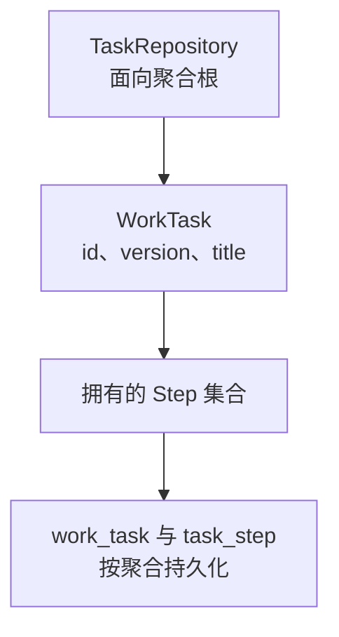

# Spring Data JDBC：聚合建模、Repository 保存与并发控制

同样是调用 save，JPA、Spring Data JDBC 和手写 SQL 的含义并不相同。理解 Spring Data JDBC 的关键不是背 CRUD 方法，而是先划定一个对象的保存边界：哪些数据必须一起保持一致，哪些对象应当独立拥有生命周期。

本篇使用 [runtime-lab/data-jdbc](https://github.com/newswitch/newswitch.github.io/tree/main/examples/java-components/runtime-lab/data-jdbc)，固定 JDK 25、Boot 4.1.1，BOM 管理 Spring Data JDBC 4.1.1 与 H2 2.4.240。先掌握 Java 对象、主外键以及 [JDBC 执行路径](../../../spring-boot/03-data/01-JDBC与JdbcTemplate执行路径.md)。

## 1. 它在数据访问栈中的位置

| 技术 | 主要替应用处理什么 | 仍由应用决定什么 |
| --- | --- | --- |
| JDBC/JdbcTemplate | 连接使用、参数绑定、结果遍历和异常翻译等基础工作 | SQL、映射、边界与事务 |
| Spring Data JDBC | 聚合映射、Repository 代理和相应持久化操作 | 聚合设计、查询与业务一致性 |
| MyBatis | Mapper 方法与 SQL、结果映射的组织 | SQL 及多语句业务边界 |
| JPA/Hibernate | 持久化上下文、实体状态、脏检查等 ORM 能力 | 事务范围、加载与实际 SQL 成本 |

Spring Data JDBC 使用 JDBC，但不是“把 JdbcTemplate 改个名字”；它有自己的对象映射和聚合持久化规则。它也不是精简版 JPA：没有因为查询返回了一个对象，就持续追踪其字段变化的承诺。

## 2. 聚合不是任意一张表

聚合是由一个根对象管理、在业务修改时作为整体保持一致的一组对象。本例的 WorkTask 是根，Step 是属于它的步骤：步骤离开任务没有独立含义，其他聚合不应绕过任务根修改这些步骤。



根上的 Repository 管理整个聚合。客户、商品等独立存在的对象通常应通过标识引用，而不是把完整对象图塞进任务并假定框架知道所有共享关系。把一个巨大对象图误建成一个聚合，会扩大读取、重建和冲突的范围。

聚合内操作仍需要正确数据库事务；跨聚合、消息与远程调用的一致性也不会由一个 Repository 自动完成。

## 3. 依赖、表结构与映射

核心依赖是 spring-boot-starter-data-jdbc，再加入目标数据库驱动。本例默认使用隔离的内存 H2；PostgreSQL 驱动用于后面的开发期 Compose 场景，不代表 H2 测试已经验证 PostgreSQL。

模型节选如下，完整构造器和访问器在工程中：

```java
@Table("work_task")
public class WorkTask {
    @Id @Column("id") private Long id;
    @Version @Column("version") private Long version;
    @Column("title") private String title;
    @MappedCollection(idColumn = "task_id")
    private Set<Step> steps = new LinkedHashSet<>();
}

public interface TaskRepository extends CrudRepository<WorkTask, Long> {
    List<WorkTask> findByTitle(String title);
}
```

这里的 Id、Version 来自 Spring Data，不是 jakarta.persistence。MappedCollection 指定子表回指根的列；Set 不表达业务顺序，需要步骤顺序时必须另外建模，不能依赖本次 SELECT 恰好返回的顺序。

schema.sql 显式创建根表与子表，根 ID 使用 identity，子表包含 task_id 外键。本例对表列名加引号以统一演示映射；真实库仍要核对标识符大小写、保留字和命名策略。[映射约定](https://docs.spring.io/spring-data/relational/reference/jdbc/mapping.html)

## 4. 一次 save 实际意味着什么

区分新聚合和已有聚合，是理解执行成本的起点：

| 输入状态 | 本例默认保存路径 |
| --- | --- |
| 新聚合 | 插入根，再插入拥有的子对象，得到生成的标识/版本 |
| 已有聚合 | 更新根，按聚合规则删除并重建相应子对象 |
| 只修改已查询对象，没有 save | 不会因为字段变化自动写回数据库 |

框架不拥有 JPA 式的原始快照，因此不能普遍通过比较旧对象和新对象，只更新改变的某一个子字段。测试用 H2 删除触发器观察到：只改根标题再保存，两个已有步骤发生了两次物理行删除，保存后步骤仍存在。最终行数相同，不等于没有删除/重建成本。

这个策略影响外键、子行标识、审计触发器和大量集合。若子对象需要被其他聚合长期引用，首先重新检查聚合划分，而不是立刻绕过根直接改子表。[持久化规则](https://docs.spring.io/spring-data/relational/reference/jdbc/entity-persistence.html)

状态判断也不是“ID 非空就一定更新”。Version、Persistable 等机制会影响新实体识别。保存后使用返回对象，避免假定所有不可变模型都一定原地获得生成字段；显式 insert/update/upsert 又有不同前提，不能把本篇 save 的观察推广到全部 API。

## 5. 版本控制与更新行数

两个调用方先后读出同一版本，都在内存修改标题。第一个保存后版本推进，第二个再保存应识别冲突，而不是覆盖第一个结果。

根上的 Version 参与条件更新，语义类似：

```sql
UPDATE work_task
SET title = ?, version = ?
WHERE id = ? AND version = ?;
```

这是表达意图的 SQL，不是逐字复制框架的完整语句。版本不匹配时，Spring Data JDBC 报 OptimisticLockingFailureException。不要捕获它后仍返回“更新成功”；需要重新读取并让业务决定放弃、合并或有限重试。

如果某条外部 SQL 修改业务字段却不遵守版本协议，版本检查也无法保证所有写入者都被保护。自定义修改查询还需分别验证是否参与版本推进和生命周期回调。

## 6. 一个 Repository 调用不等于整个业务事务

保存根及拥有的子项需要原子完成，但“先修改任务，再写审计记录”涉及多次操作。应在服务层通过同一数据源的事务将它们组合；远程 HTTP 和消息发送不因为处于相同 Java 方法就参与该数据库事务。

配套测试在外层 TransactionTemplate 中调用 save，再主动抛出异常；新事务查询看到的仍是原标题。这验证了本地事务参与，不代表已经解决跨服务一致性。

新增查询也要检查边界：findByTitle 适合演示根属性查询，不应该把无上限 List 当生产搜索接口。分页、投影、连接查询、SQL 计划和索引需要按目标库验证。

## 7. 构建与观察结果

在仓库根目录执行：

```bash
mvn -B -ntp -f examples/java-components/runtime-lab/pom.xml -pl data-jdbc verify
java -jar examples/java-components/runtime-lab/data-jdbc/target/data-jdbc-lab-1.0.0.jar
```

应用默认只监听 127.0.0.1:8087。另一个终端执行，JSON 引号写法按所用 shell 调整：

```bash
curl -i -H 'Content-Type: application/json' \
  -d '{"title":"first"}' http://127.0.0.1:8087/api/tasks
```

预期返回 201，Location 指向 /api/tasks/生成的ID，响应包含 id/title/version/steps；再 GET 该地址返回 200。空白 title 返回 400，不存在的 ID 返回 404。具体生成 ID 不应写死。用完 Ctrl+C 结束服务。

七项 H2 测试覆盖身份生成、无脏检查、子项重建、旧版本冲突、删除子项、外层回滚和派生查询；独立脚本另检查真实 HTTP。默认 H2 数据随进程消失，接口没有鉴权，不能直接作为生产服务。

## 8. 常见问题怎样收敛

| 现象 | 优先检查 |
| --- | --- |
| 表已存在却查询失败 | 引号、大小写、Schema、映射注解和真正连接的数据库 |
| 保存触发重复主键 | 新实体识别、版本初值、手工标识与实际 insert/update 路径 |
| 改对象后查库仍旧值 | 是否显式保存，不要期待 JPA 式脏检查 |
| 改一个字段却大量写子表 | 聚合规模和 save 的重建策略 |
| 并发更新异常 | 版本冲突、外部写入协议，而非先全局关闭 Version |

## 9. 练习与答案

### 9.1 子步骤需要被许多其他业务对象独立引用，仍应默认放在这个聚合里吗

应重新考虑。独立生命周期与共享引用通常提示它不只是根所拥有的内部子项；直接把它放进可整体重建的集合，可能使引用和保存语义冲突。

### 9.2 在内存中 setTitle 后，事务提交是否一定自动保存

不会。Spring Data JDBC 没有因此自动获得持久化上下文与脏检查。应通过明确持久化操作写入，再验证事务结果。

### 9.3 旧版本保存失败，可否把 version 改成新值直接重试

不能据此保证正确。这样可能把过时业务决策包装成“新版本”。应重新读取、重新检查业务条件，再决定合并、拒绝或有限重试。

## 10. 继续阅读

- [Spring Data JDBC 持久化与乐观锁](https://docs.spring.io/spring-data/relational/reference/jdbc/entity-persistence.html)
- [MyBatis-Plus 的按表操作与插件](../mybatis-plus/01-BaseMapper条件构造分页乐观锁与逻辑删除.md)
- [开发期 PostgreSQL 与 Compose](../../05-containers/docker-compose/01-开发服务连接生命周期与环境边界.md)
