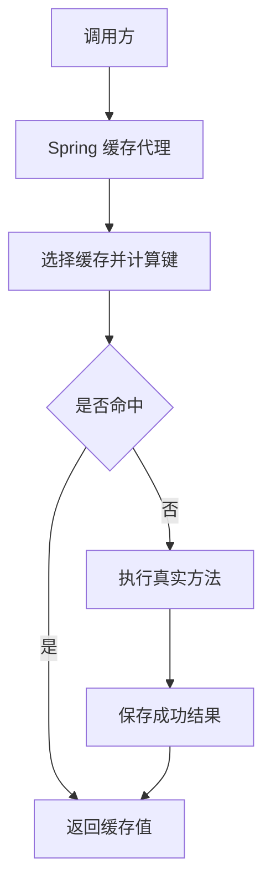

# Spring Cache 与 Caffeine：代理、键设计、过期、淘汰与一致性

给方法加上 Cacheable，只是让调用有机会经过一层缓存逻辑。是否真的经过代理、选中了哪个缓存、键是否完整、值允许多旧，才决定它能不能正确地节省工作。

本篇使用 [runtime-lab/cache](https://github.com/newswitch/newswitch.github.io/tree/main/examples/java-components/runtime-lab/cache)，固定 Boot 4.1.1、JDK 25，BOM 管理 Caffeine 3.2.4。数据源是进程内演示 Map，没有连接数据库，也不验证数据库事务一致性。

## 1. Spring Cache、Caffeine 与 Redis 不在同一层

| 名称 | 职责 | 边界 |
| --- | --- | --- |
| Spring Cache | 方法缓存抽象、注解与拦截逻辑 | 本身不是存储引擎 |
| CacheManager | 解析或管理具名缓存 | 选错实现会改变实际能力 |
| Caffeine | 高性能进程内缓存 | 各 JVM 独立，重启丢失 |
| Redis | 独立远端数据服务，可被相应 CacheManager 使用 | 有网络、序列化和服务端资源成本 |

切换实现不只是改一个依赖。Caffeine 常保存本机对象引用，Redis 通常需要序列化；多实例可见性、TTL、锁和错误路径也不同。先固定实现并验证，避免因 Classpath 多了一个提供者而改变行为。

## 2. 一次方法调用经过什么



命中时真实方法可能根本不执行。因此权限检查、审计等必做动作不能随意藏在一个可被缓存跳过的方法体里。缓存键必须包含所有影响结果的输入，权限还需要独立可靠的调用边界。

默认代理模式下，外部通过 Spring Bean 调用和对象内部 `this.read(id)` 不同。本例 readThroughSelf 在同一对象内部调用 read，连续两次会执行两次源读取；外部连续调用带注解的 read，只执行一次。[注解与代理规则](https://docs.spring.io/spring-framework/reference/integration/cache/annotations.html)

## 3. 固定提供者与资源上限

引入 spring-boot-starter-cache 与 caffeine，在独立配置类上 EnableCaching，然后设置：

```properties
spring.cache.type=caffeine
spring.cache.cache-names=tasks-v1
spring.cache.caffeine.spec=maximumSize=1000,expireAfterWrite=60s,recordStats
```

Boot 提供相应自动配置；如果自己声明 CacheManager，相关自动配置可能退让，不能假定这些属性仍控制自建对象。没有专用实现时的简单 Map 缓存，也不能当作自动具备过期与容量控制的生产方案。[Boot 缓存配置](https://docs.spring.io/spring-boot/reference/io/caching.html)

maximumSize 限制条目数量，不是 1000 字节或某个堆大小。每个值的体积、键、引用和维护结构都会占内存。maximumWeight 可以表达自定义权重，但也不自动精确测量 Java 堆占用；权重与可变值还需保持一致。

## 4. 键、返回值与 null 要有明确契约

本例的读方法为：

```java
@Cacheable(cacheNames = "tasks-v1", key = "#p0", sync = true)
public TaskStore.View read(long id) {
    return store.load(id);
}
```

#p0 使用第一个实参，本例只有单一演示空间。实际多租户数据通常需要可信 tenant、对象 ID，以及会影响结果的版本/语言等维度。不能把所有租户的 id=1 合成同一个键，也不要把访问 Token 原文作为键写进指标或日志。

返回值是只包含 long/String 的 record。若把可变 List 或实体引用直接缓存，调用方修改它可能改变后续命中者看到的内容，甚至把 ORM 对象生命周期一起带入缓存。record 包着可变集合，也不会自动深度不可变。

源数据不存在时，本例抛 NoSuchElementException，不把错误假装成普通值。需要负缓存时，要明确“确实不存在”与“数据库暂时失败”的区别、较短寿命和创建后的失效，不能把所有异常缓存成空结果。

## 5. 过期、淘汰和刷新是不同动作

| 策略 | 主要回答什么 | 容易误解的地方 |
| --- | --- | --- |
| expireAfterWrite | 距上次写入/替换多久后过期 | 不是距最近读取多久 |
| expireAfterAccess | 距相应访问多久后过期 | 热点不断访问可能长期不过期 |
| maximumSize/Weight | 内存压力下保留多少条目/权重 | 不能把容量当数据新鲜度 |
| refreshAfterWrite | 满足条件后请求触发重新加载 | 不是为普通 Cache 配个定时器就完成刷新 |

读取已过期条目不应得到旧值，但物理清理、移除通知与容量维护可能延后执行。不能仅看 estimatedSize 没立即下降，就断定过期失效。刷新还需要合适的加载器、执行器和失败策略；刷新进行中可能继续使用旧值，不能与过期删除混同。[Caffeine 淘汰规则](https://github.com/ben-manes/caffeine/wiki/Eviction)、[刷新规则](https://github.com/ben-manes/caffeine/wiki/Refresh)

测试使用可控 Ticker，把逻辑时间从 4 秒推进到 6 秒，验证 5 秒过期，而不是靠 Thread.sleep 让测试碰运气。容量测试在维护完成后检查条目上限，不把瞬时估算当作严格堆字节上限。

## 6. sync=true 能保护多大范围

对兼容提供者，sync=true 协调同一键的加载，减少同一缓存范围内重复执行昂贵方法。本例还通过原生 Caffeine 并发加载测试，验证同键加载函数只执行一次。

它不是跨 JVM 的分布式锁，也不保证所有租户键共用一个全局并发限额。100 个不同键同时缺失，仍可能并行访问下游；多实例同时冷启动，也仍会分别加载。应另设下游并发、超时与过载保护。

sync 模式还有注解组合限制，例如不能随意与 unless 组合；不能从一个开关推导所有缓存注解都兼容。需要异步返回、刷新与复杂条件时，检查所用版本和提供者的具体支持。

## 7. 修改源数据后，缓存什么时候失效

本例 rename 先更新演示 Map，再由 CacheEvict 在成功返回后删除该键，下一次读取获得新标题。这只证明单进程、无数据库事务的基本失效行为。

真实事务可能在方法返回后才提交。若另一个读者在提交前重新装入旧值，缓存可能再次变旧；如果提交最终失败，也不能简单认为注解天然处理了所有一致性问题。需要结合事务完成事件、transaction-aware 缓存装饰、版本或可靠失效消息等方案，验证具体操作时机。

CacheEvict 的 beforeInvocation=true 改变执行时点，不会自动解决数据库提交与并发回填问题；清整个缓存也不是事务协议。

多实例下，A 删除自己的 Caffeine 项，B 的缓存不自动消失。可以接受有限陈旧时设置合理过期；不能接受时，应选择相应一致性设计，而不是把 TTL 设得很短就宣称强一致。远端缓存也不会消除所有并发回填竞态，见 [Redis 一致性](../../../spring-boot/04-integrations/01-Redis序列化缓存策略与一致性.md)。

## 8. 运行与观察

在仓库根目录执行：

```bash
mvn -B -ntp -f examples/java-components/runtime-lab/pom.xml -pl cache verify
java -jar examples/java-components/runtime-lab/cache/target/cache-lab-1.0.0.jar
```

演示输出包含：

```text
loads-after-two-reads=1
after-evict=second
```

程序随后关闭上下文。八项测试分别验证 Caffeine 提供者与命中、删除后重读、自调用、不同键、失败不缓存正常结果、可控时间过期、容量维护、原生同键并发加载。并发实验使用有界等待和资源回收，不把一次通过解释成已经完成生产压测。

观察至少包括命中/未命中、加载耗时与失败、淘汰、容量和堆内存。高命中率不一定意味着 P99 变好：少量慢加载、热点失败和大值分配仍可能主导尾延迟；增加缓存后也要测量 GC 与下游负载。

## 9. 常见问题

| 现象 | 优先检查 |
| --- | --- |
| 注解存在却重复查源 | 是否经过代理、自调用、缓存名称、键和实际提供者 |
| 一个用户看到另一个用户的数据 | 键是否缺身份维度、授权是否被命中绕过 |
| 节点间数据不一致 | 本地缓存的独立性、失效传播与允许陈旧范围 |
| 过期后瞬时打满数据库 | 不同键/不同实例并发、加载预算和源站保护 |
| 堆持续上涨 | 大值、无界缓存、可变引用、维护与实际命中收益 |

## 10. 练习与答案

### 10.1 打开 sync=true，十个副本是否只会向数据库发一次查询

不是。它不自动跨 JVM 协调；每个本地缓存都可能加载一次。不同键的加载也不因此受一个统一上限保护。

### 10.2 maximumSize=1000 是否表示最多消耗 1000KB

不是。它限制条目数，不限制条目的实际对象大小。容量预算还需看键值体积、引用、维护结构与堆表现。

### 10.3 方法成功返回后删除缓存，是否等于数据库事务已经提交

不能这样推断。事务代理、提交阶段与缓存操作顺序需要明确验证。应按提交成功、回滚、并发回填和跨节点失效分别设计测试。

## 11. 参考资料

- [Spring 缓存注解](https://docs.spring.io/spring-framework/reference/integration/cache/annotations.html)
- [Caffeine 文档](https://github.com/ben-manes/caffeine/wiki)
- [Spring 事务完成路径](../../../spring/04-internals/05-事务拦截器连接绑定与完成路径.md)
