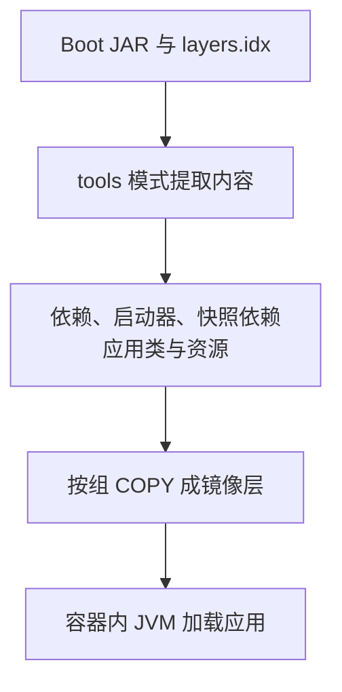

# Buildpacks 与镜像分层：从 JAR 到 OCI 镜像及运行验证

能运行 java -jar，不表示已经得到容器镜像；镜像构建成功，也不表示数据库、探针和退出过程都正确。先把产物、构建工具与运行环境分开，再讨论“容器化”到底完成了哪一步。

本篇使用 [runtime-lab/data-jdbc](https://github.com/newswitch/newswitch.github.io/tree/main/examples/java-components/runtime-lab/data-jdbc)，固定 Boot 4.1.1、JDK 25。可执行 JAR、tools 分层提取和合并后启动已在本机验证；Dockerfile、Compose 运行文件及 Buildpacks 命令需要 Docker 环境实测，当前没有执行镜像构建或容器运行。

## 1. 五种对象不是同一件东西

| 对象 | 代表内容 | 不能据此推出什么 |
| --- | --- | --- |
| 普通库 JAR | 可被应用消费的类与资源 | 一定有完整运行入口 |
| Boot 可执行 JAR | 应用、嵌套依赖与启动布局 | 自动包含 JRE 或 Linux 用户空间 |
| layers.idx | JAR 内容的逻辑分组与顺序 | 已经成为 OCI 文件系统层 |
| OCI 镜像 | 文件系统层与运行配置等 | 容器已经运行、数据已持久化 |
| 运行中的容器 | 进程、隔离与资源约束等 | 自动具有业务就绪和高可用 |

EXPOSE 是镜像元数据，不会自动发布主机端口；把源码文件放进镜像也不会自动完成编译。数据库驱动随 JAR 打包，不等于数据库服务器也被打进去了。

## 2. Dockerfile 与 Buildpacks 各自提供什么

| 路径 | 构建逻辑由谁组织 | 需要维护的重点 |
| --- | --- | --- |
| Dockerfile | 自己声明基础镜像、COPY、用户与启动命令 | 文件边界、补丁、分层、权限和运行参数 |
| Cloud Native Buildpacks | Builder 中的检测/构建组件和 Lifecycle 组织构建 | Builder/Run Image、Buildpack、JVM 配置与兼容性 |

Buildpacks 不要求业务项目手写 Dockerfile，但不是“没有基础镜像”“不需要 Docker”或“自动免除漏洞治理”。Boot Maven build-image 通常需要访问 Docker Daemon；最终运行镜像也仍需要操作系统和 Java 运行环境。[插件构建过程](https://docs.spring.io/spring-boot/maven-plugin/build-image.html)

开发机上的 JAVA_HOME 不等于镜像里一定是同一个 JRE。项目目标 Java 版本、Buildpack 设置和构建日志都要检查。本例在插件 image.env 中指定 BP_JVM_VERSION=25，实际构建时仍须确认 Builder 支持它。

## 3. Boot JAR 怎样形成可重用的镜像层



逻辑分组通常包含 dependencies、spring-boot-loader、snapshot-dependencies、application。将变化频率不同的内容分开，业务类变化时就有机会重用稳定依赖层。是否命中构建缓存还受基础镜像、指令、输入内容和构建器影响，不是看见四个名字就保证每次都命中。

一个大 JAR 直接 COPY 也能运行，但通常把应用和依赖合成同一个变化单元。逻辑分层本身不会减少需要的依赖、自动缩小堆内存，或加速数据库查询。[Boot 分层原理](https://docs.spring.io/spring-boot/reference/packaging/container-images/efficient-images.html)

## 4. 不用 Docker，也能先验证 JAR 分层

在仓库根目录构建，然后检查层名：

```bash
mvn -B -ntp -f examples/java-components/runtime-lab/pom.xml -pl data-jdbc package
java -Djarmode=tools \
  -jar examples/java-components/runtime-lab/data-jdbc/target/data-jdbc-lab-1.0.0.jar list-layers
```

本例输出四个层名，依次为：

```text
dependencies
spring-boot-loader
snapshot-dependencies
application
```

提取到一个新的、专用于实验的目标目录，不覆盖源码：

```bash
java -Djarmode=tools \
  -jar examples/java-components/runtime-lab/data-jdbc/target/data-jdbc-lab-1.0.0.jar \
  extract --layers --destination .java-article-checks/manual-layer-extract
```

这是 tools 模式的内容提取，不会启动业务 Web 服务。不要套用旧版本 layertools 参数而不检查当前 JAR 的帮助。配套验证还按层顺序合并内容，运行提取后的入口 JAR，通过真实 HTTP 验证创建、读取、非法输入与不存在资源。

这个结果证明 Java 产物与启动布局有效，不证明 OCI 层摘要、Linux 权限、基础镜像或容器信号已经验证。[当前 Dockerfile 与 tools 示例](https://docs.spring.io/spring-boot/reference/packaging/container-images/dockerfiles.html)

## 5. 先用简单 Dockerfile 理解运行边界

模块内 Dockerfile 的关键部分：

```dockerfile
ARG JAVA_IMAGE=eclipse-temurin:25-jre
FROM ${JAVA_IMAGE}
WORKDIR /app
COPY --chown=10001:10001 target/data-jdbc-lab-1.0.0.jar app.jar
USER 10001:10001
EXPOSE 8087
ENV SERVER_ADDRESS=0.0.0.0
ENTRYPOINT ["java", "-jar", "/app/app.jar"]
```

25-jre 是方便演示的可变标签，不是不可变生产锁定。应从可信来源取得匹配架构的镜像，记录并固定已核验 digest，持续跟进 JRE/基础系统补丁。Linux 镜像需要相应 Linux 容器环境；不要把操作系统或 CPU 架构差异误判为 Java 代码问题。

数值 USER 避免默认 root 运行，仍需核对写目录、挂载文件与卷权限。JSON 数组入口直接启动 Java，有利于正确接收容器信号；它不会自动赋予应用完善的排空逻辑。

SERVER_ADDRESS=0.0.0.0 是容器内部监听地址。主机上的端口发布仍限定为 127.0.0.1，不能因为本机开发应用默认只监听回环，就把同一设置原样用于容器并期待外部转发能进入。

## 6. 比较简单镜像与分层镜像

先进入 examples/java-components/runtime-lab/data-jdbc，在有 Docker 的环境执行：

```bash
docker build -t java-components/data-jdbc:single .
docker build -f Dockerfile.layered -t java-components/data-jdbc:local .
```

Dockerfile.layered 在提取阶段把输入重命名为 app.jar，通过 tools 模式分组，再用四次 COPY 把内容放入最终镜像。最后仍执行提取后 app.jar，而不是额外保留完整原始大 JAR。

观察 docker history、image inspect 与第二次构建日志，才能比较层、用户和缓存行为。不要只比较 JAR 文件大小来推断镜像、传输或运行内存。`.dockerignore` 限制上下文只保留需要的构建产物，避免无意携带源码外的本地配置或凭据。

## 7. 改用 Buildpacks 构建

在仓库根目录执行：

```bash
mvn -f examples/java-components/runtime-lab/pom.xml -pl data-jdbc spring-boot:build-image \
  "-Dspring-boot.build-image.imageName=java-components/data-jdbc:local"
```

这是 Dockerfile.layered 的替代构建路径，不要求先运行前面的 docker build。默认不需要推送远程仓库；本篇也没有设置发布凭据或自动发布。

重点读日志里的 Builder、Run Image、Java 版本、参与的 Buildpack、构建缓存及输出镜像摘要。生产需要记录这些输入，不把一个随时间变化的 Builder 标签当作永远可重现。Run Image 与 Builder/Lifecycle 有兼容要求，不随意混换。

重建、更新 Run Image、Rebase 和重新验证应用也有不同含义。基础层更新不等于应用依赖中的漏洞自动消失；容器里的所有来源都应进入软件清单与补丁范围。

## 8. 运行验收不止“容器没退出”

模块提供 compose.runtime.yaml，使用 local 镜像、512m 内存限制、回环主机端口和 30s 停止宽限期：

```bash
docker compose -f compose.runtime.yaml up -d
docker compose -f compose.runtime.yaml ps
docker compose -f compose.runtime.yaml logs --tail 100 app
```

再按 Spring Data JDBC 篇创建并读取任务，检查 201/200/400/404。结束本实验时使用针对该文件的 stop，不清理机器上的其他项目。

该运行文件使用 H2 内存库，重建进程会丢数据；它没有认证或 Actuator，就绪探针不能凭空指向 /actuator/health。它用于理解镜像，不是生产数据库方案。更完整的运行治理见 [Kubernetes 探针与退出](../../../spring-boot/06-production/06-Kubernetes探针资源摘流与滚动更新.md)。

JAVA_TOOL_OPTIONS 中 MaxRAMPercentage=60 也不是“保证不会 OOM”：堆之外还有线程栈、元空间、直接内存和其他 native 分配，必须结合容器限制实测。停止宽限期则要覆盖入口摘流、正在执行的请求和资源关闭；某个 Spring 阶段超时不是整个进程所有阶段的总预算。

## 9. 故障定位

| 现象 | 优先检查 |
| --- | --- |
| build-image 找不到 Daemon | Docker context、权限、CLI/Daemon 与远端连接安全 |
| 构建选择了不兼容 Java | 项目目标版本、BP_JVM_VERSION、Builder 能力和日志 |
| 容器 Running 但主机请求失败 | 容器监听地址、发布端口、启动完成与实际路由 |
| 修改代码后依赖也重复上传 | COPY 顺序、内容输入、基础镜像与缓存来源 |
| OOM 或停止时被强杀 | 总内存而非仅堆，信号、排空和关闭预算 |

## 10. 练习与答案

### 10.1 JAR 已经有 layers.idx，是否说明镜像已按四层构建

不是。它是逻辑分组；构建工具还需要按分组组织 OCI 层。直接把大 JAR 一次 COPY，不能由内部索引推断外部已经有四个内容层。

### 10.2 Buildpacks 不写 Dockerfile，是否意味着不用管 JRE 和基础镜像补丁

不是。Builder、Run Image、Buildpack 及应用依赖都有版本与安全边界。自动化构建减少手工工作，不转移维护和验证责任。

### 10.3 本机验证分层 JAR 可以启动，为什么还要跑容器验收

因为容器增加了平台、文件权限、网络、资源限制和信号等条件。本机 Java 行为正确不等于这些条件都正确，应分别记录验证证据。

## 11. 参考资料

- [Boot Maven 镜像构建](https://docs.spring.io/spring-boot/maven-plugin/build-image.html)
- [Cloud Native Buildpacks 概念](https://buildpacks.io/docs/for-app-developers/concepts/)
- [Docker 构建最佳实践](https://docs.docker.com/build/building/best-practices/)
