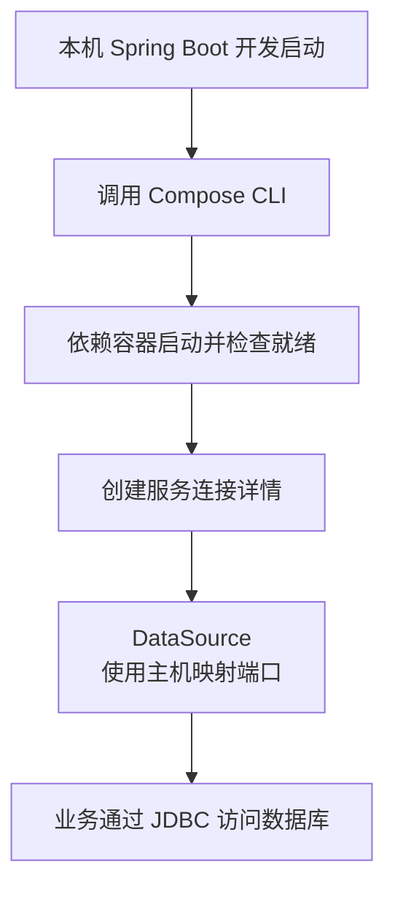

# Docker Compose Support：开发服务连接、生命周期与环境边界

本地应用依赖数据库时，通常先手工启动数据库，再把地址和凭据写入配置。Docker Compose Support 把一部分开发期工作连接起来：启动依赖服务，发现实际映射端口，再把连接信息交给应用。

它不是 Docker 本身，也不负责把 Java 应用自动部署到生产集群。本篇沿 [runtime-lab/data-jdbc](https://github.com/newswitch/newswitch.github.io/tree/main/examples/java-components/runtime-lab/data-jdbc) 的 PostgreSQL 开发环境解释这条链路，应用基线为 Boot 4.1.1、JDK 25。

本文的 Maven 依赖、最终 JAR 排除、H2 及应用启动已验证；Compose YAML 已做解析和关键约束检查。当前验证环境没有 Docker，因此没有执行 PostgreSQL 容器与 Compose 生命周期实验。下列容器步骤需要在具备 Docker 的环境完成，不能把它们当作已经实测的输出。

## 1. 三种技术分别管什么

| 技术 | 职责 | 不负责什么 |
| --- | --- | --- |
| Docker Engine | 创建、运行和管理容器等对象 | 自动理解 Java DataSource |
| Docker Compose CLI | 根据 Compose 文件组织服务、网络与卷 | 自动替 Spring 注入连接对象 |
| spring-boot-docker-compose | 开发启动中调用 Compose，识别支持的服务并生成连接详情 | 安装 Docker、生产编排、备份与数据库迁移 |

因此需要可用的 docker 与 docker compose CLI、Daemon 连接及镜像访问能力。只在依赖选择器勾选 Docker Compose Support，不能让一台没有 Docker 的机器凭空运行容器。[开发服务说明](https://docs.spring.io/spring-boot/reference/features/dev-services.html)

## 2. 启动链与业务链要分开



这是开发启动和连接准备过程。最后一步不是“每条 SQL 都调用一次 docker compose”，业务仍通过 JDBC 驱动和数据库网络连接执行。

ConnectionDetails 是描述连接的应用对象，不是数据库容器、连接池或数据库事务本身。连接详情就绪之后，连接池还可能因认证、TLS、网络或 Schema 问题失败。

## 3. 三套 Profile 不要混在一起

本例在 Maven 的 compose Profile 中增加 optional、runtime 的 spring-boot-docker-compose。应用默认配置关闭 Compose；Spring 的 compose Profile 才启用开发连接。

| 选择 | 本例作用 |
| --- | --- |
| Maven -Pcompose | 让开发运行 Classpath 有 Compose 支持模块 |
| Spring compose Profile | 读取 application-compose.properties，开启本例集成 |
| Compose profiles | Compose 文件自己的服务分组机制，本例没有使用 |

三个地方碰巧都可以叫 compose，但它们不是同一个开关。只打开 Spring Profile，不会自动给缺失的 Classpath 下载库；只引入库，也不代表应该在所有环境启动服务。

## 4. 准备只属于本实验的数据库

模块中的 compose.yaml 定义：

```yaml
name: java-components-jdbc-dev
services:
  postgres:
    image: postgres:17
    environment:
      POSTGRES_DB: component_lab
      POSTGRES_USER: lab
      POSTGRES_PASSWORD: local-lab-only
    ports:
      - "127.0.0.1::5432"
    healthcheck:
      test: ["CMD-SHELL", "pg_isready -U lab -d component_lab"]
      interval: 2s
      timeout: 2s
      retries: 20
    volumes:
      - jdbc-dev-data:/var/lib/postgresql/data
volumes:
  jdbc-dev-data:
```

这是本地演示凭据，不用于生产；端口只发布到回环地址，由 Docker 分配主机端口。postgres:17 是会随补丁更新的开发标签，运行前应记录实际镜像摘要；需要可重复基线时固定已核验的 digest，并持续更新安全补丁。

本例选择 PostgreSQL 17 的卷目录约定。不同大版本镜像的 PGDATA/卷布局可能改变，不能只改标签而忽略数据目录与升级过程。[官方镜像说明](https://github.com/docker-library/docs/blob/master/postgres/README.md)

pg_isready 说明数据库达到相应连接接受状态，不证明业务表、权限和历史迁移已正确。本例 schema.sql 只适合实验建表；生产采用 [版本化数据库变更](../../../spring-boot/03-data/05-Flyway-Liquibase与兼容数据库变更.md)。修改 POSTGRES_PASSWORD 等初始化变量，也不等于已有卷中的角色密码自动改变。

## 5. 从模块目录启动

先确认本机环境，而不是遇错就反复启动应用：

```bash
docker version
docker compose version
```

然后进入 examples/java-components/runtime-lab/data-jdbc，执行：

```bash
mvn -Pcompose spring-boot:run "-Dspring-boot.run.profiles=compose"
```

工作目录影响 compose.yaml 的发现。本例显式设置 spring.docker.compose.file=compose.yaml，仍需确保相对路径解析到这个模块；从其他目录运行时使用明确的绝对路径或相应运行配置。

另一个终端在同一模块检查：

```bash
docker compose -f compose.yaml ps
docker compose -f compose.yaml port postgres 5432
docker compose -f compose.yaml logs --tail 100 postgres
```

port 的输出应是类似 127.0.0.1:某个主机端口，而不是要求固定为 5432。使用上一篇任务接口创建记录，再检查 PostgreSQL 中的数据，才完成从 Java 到真实容器数据库的验证；仅看到容器 Running 还不够。

## 6. 为什么 application.properties 里的 URL 不一定是最终连接

在相应自动配置路径下，服务连接详情优先于连接相关属性。即使本例普通配置包含 H2 URL，启用并识别 PostgreSQL 服务后，也应通过相应连接详情建立 DataSource。不要只读配置文本就断言仍连接 H2。

要检查实际数据库产品、目标主机/端口和 JDBC 驱动，验证任务写入的真实位置。记录诊断信息时不要把密码打印出来；关闭集成或换成自建 DataSource 后，选择路径又可能改变。

本机 Java 进程应使用主机映射端口。在同一 Compose 网络中的应用容器通常使用服务名与容器端口；容器里的 localhost 指向该容器自身。把两种网络位置混用，是“能在终端连接，应用却连不上”的常见原因。

## 7. 谁启动，谁负责停止

| 情形/配置 | 应关注的行为 |
| --- | --- |
| 默认 start-and-stop，由当前启动创建依赖服务 | 应用退出时停止其管理的服务 |
| 服务在应用启动前已经运行 | 默认只消费连接详情，不擅自接管同样的启动/停止流程 |
| start-only | 启动服务，应用退出后保留服务运行 |
| none | 不执行启动/停止，仍需已有可用服务与正确发现 |

关闭应用、停止容器、移除容器和删除卷不是同一个动作。默认 stop 不清空数据库卷。不要把删除卷当作日常结束步骤；里面可能已有需要保留的数据。

检查多项目是否共用名称、端口、卷和连接详情。避免为了修本实验故障，对机器上的所有容器执行批量停止或清理。共享依赖应有明确所有者和生命周期约定，而不是依赖某个开发进程碰巧一直存活。

## 8. 测试、打包与生产边界

Boot 的 Compose 支持默认在测试中跳过，本例测试还使用默认关闭配置，因此七项 H2 测试不是 PostgreSQL 集成测试。若要在 CI 中验证目标库，应明确启用隔离依赖，或采用 Testcontainers，不能偷偷依赖开发者机器上的共享数据库。

Boot 重打包默认排除 Compose 支持。本例即使在 Maven -Pcompose 下构建，最终应用 JAR 也不包含该开发模块；验证脚本检查了实际 BOOT-INF/lib。optional 的传递依赖语义与打包排除仍是不同问题。

生产容器应该从部署环境获得服务地址与 Secret，不应为了数据库就绪，赋予业务 Pod 控制宿主 Docker Socket 的权限。Compose Support 不是 Kubernetes Operator。

## 9. 故障定位顺序

| 现象 | 优先检查 |
| --- | --- |
| 提示找不到 docker | CLI 路径、当前用户、Daemon 与 context |
| 找不到 Compose 文件 | 工作目录与 spring.docker.compose.file |
| 容器存在但应用认证失败 | 实际映射端口、连接详情、已有卷角色凭据 |
| 启动后仍使用 H2 | 依赖/Profile、服务是否受支持、自建 DataSource 与最终连接来源 |
| 退出后数据库仍在运行 | 是否原本已运行、start-only/none 与管理归属 |

## 10. 练习与答案

### 10.1 配置里写着 jdbc:h2，启用 Compose 后就一定仍连接 H2 吗

不能仅凭文本判断。相应自动配置会优先消费服务连接详情；需要核对实际 DataSource 和写入位置。自建 DataSource 或关闭集成时又可能不同。

### 10.2 应用停止后 PostgreSQL 卷还存在，是不是清理失败

不是。停止进程、停止容器和删除持久卷有不同语义。保留卷通常是为了保留开发数据，不应默认执行破坏性删除。

### 10.3 能否把本篇 H2 测试通过理解成 PostgreSQL 环境也已验收

不能。H2 验证应用的有限行为；真实 PostgreSQL 的驱动、方言、锁、权限、卷和容器生命周期必须另行运行验证。

## 11. 继续阅读

- [Spring Boot 开发服务与生命周期配置](https://docs.spring.io/spring-boot/reference/features/dev-services.html)
- [测试分层与 Testcontainers](../../../spring-boot/06-production/01-测试分层切片集成与Testcontainers.md)
- [Buildpacks 与镜像分层](../buildpacks/01-JAR到OCI镜像构建分层与运行验证.md)
