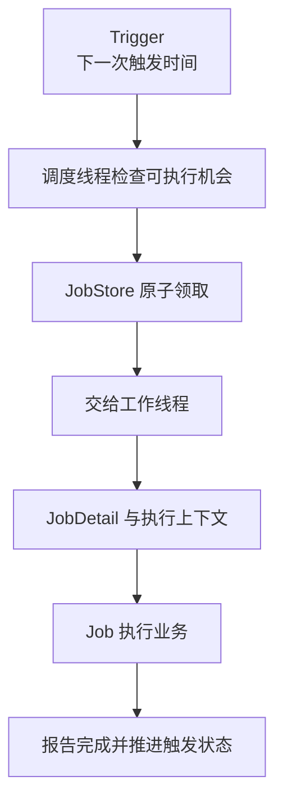

# Quartz：调度模型、触发领取、持久化与集群语义

“每天凌晨执行”至少有两个问题：什么时候产生一次执行机会，以及这次工作有没有可靠完成。Quartz 主要组织前者与相关执行状态；订单是否重复结算、消息是否重复发送，不能只靠定时器的名字保证。

本文以 Quartz 2.5.x 的模型说明原理，不包含安装或部署步骤。2.4.x 与 2.5.x 的 Java/命名空间要求不同，集成时需另核对对应版本，而不是无差别复制旧依赖。[版本文档](https://www.quartz-scheduler.org/documentation/)

## 1. Quartz 与其他任务机制的分工

| 机制 | 主要问题 | 不能自动解决什么 |
| --- | --- | --- |
| ScheduledExecutorService | 一个进程内的延迟和周期执行 | 持久化触发、多进程协调 |
| Spring Scheduled | 声明方法的周期触发及相应容器集成 | 默认跨 Pod 的唯一执行 |
| Quartz | 任务定义、触发规则、持久化和调度协调 | 任意外部副作用恰好一次 |
| Spring Batch | 一批数据如何分步处理、提交和恢复 | 业务应该何时定期启动 |

Quartz 可以启动一个 Batch 作业，但两者的 Job 不是同一个概念。调度触发记录与 Batch 的处理检查点也不应混为一张“任务状态表”。

## 2. 五个组件怎样协同

| 组件 | 含义 | 一个例子 |
| --- | --- | --- |
| Scheduler | 注册、管理并驱动调度的入口 | 管理某组结算任务 |
| JobDetail | 某个任务定义及其身份、数据等 | settle-orders 这份定义 |
| Job | 真正执行业务的实现契约 | 执行结算逻辑的 Java 类型 |
| Trigger | 某个任务的触发规则和相关状态 | 每日 02:00 的规则 |
| JobStore / ThreadPool | 保存与领取调度状态 / 承载执行 | JDBC 状态与工作线程 |

同一个 Job 类可以对应多个 JobDetail；同一个 JobDetail 又可以有多个 Trigger。类名相同不代表同一个任务身份，多个触发器也不代表必须创建多份业务实现。



图表达职责，不是要求每次执行都重新注册任务。调度线程负责组织机会，业务通常在工作线程执行；把慢业务堵在工作池里，增加一个 Trigger 并不会增加算力。

## 3. 一次触发如何进入业务

可以沿以下概念路径阅读源码：Scheduler 的调用入口，调度循环 QuartzSchedulerThread，JobStore 的 acquireNextTriggers，线程池提交，JobRunShell 的执行与完成处理，最后进入 Job.execute。

几个时间点要分别观察：

| 时间 | 反映的问题 |
| --- | --- |
| 计划触发时间 | 规则希望什么时候开始 |
| 领取/分派时间 | 调度和可用工作资源是否落后 |
| 实际业务开始时间 | 工作排队及初始化成本 |
| 业务完成与调度完成记录 | 业务耗时及状态确认是否完成 |

“02:00 的任务 02:05 才开始”不一定是 Cron 错误，也可能是线程不足、同任务并发限制、数据库领取等待或实例暂停。计划触发与实际开始之间的延迟，本身就是重要信号。

Job 实例的创建由 JobFactory 等机制组织。不能默认把实现类的普通实例字段当作持久化任务状态，更不能假定每次执行一定复用同一个业务对象。

## 4. 时间规则不等于业务日历

SimpleTrigger 适合间隔与次数等规则，CronTrigger 适合日历表达。Quartz Cron 包含秒字段，不是把常见 Unix 五段表达式直接搬过来即可。

时区、夏令时、Calendar 排除规则会影响具体日期的触发。每天当地时间 02:30 与每隔 24 小时不是严格等价；当地时间出现跳过或重复时，需要根据规则和业务日期定义处理方式。

Trigger priority 用于相应调度选择，不是 Java 线程优先级，也不能让任务抢占已经运行的工作。业务截止时间同样需要单独管理：计划时间到了，不代表执行期间就自动有超时取消。

## 5. 持久化保存了什么

RAMJobStore 将调度数据放在进程内，进程结束后不提供持久恢复承诺。JDBC JobStore 将 Job、Trigger、领取与集群相关状态等放入数据库，但不是把任意 Java 调用栈保存下来。

JobDataMap 用来携带相关任务数据。长期保存巨大对象图、连接、线程或不兼容的序列化对象，会把任务恢复变成类版本与资源恢复问题。更合适的是保存稳定标识和少量参数，再读取真实业务数据。

执行上下文的合并数据可能包含 Trigger 对 JobDetail 数据的覆盖。修改合并视图，不应想当然地等于持久修改原始任务定义；PersistJobDataAfterExecution 与具体修改对象需要分别理解。

持久化完成不等于业务事务完成。JobStoreTX、JobStoreCMT 与 Spring 集成的事务归属不同；即使都使用数据库，也不能由此推断调度表、业务表和消息发送处于同一原子事务。[JobStore 说明](https://www.quartz-scheduler.org/documentation/quartz-2.5.x/tutorials/tutorial-lesson-09.html)

## 6. 并发限制的单位是任务身份

DisallowConcurrentExecution 约束的是同一 JobDetail 对应的 JobKey，不是把整个 Job 类的所有定义全局串行化。相同实现类若注册成两个不同 JobKey，不能仅凭这个注解推断它们互斥。

例如：

| 定义 | 业务实现 | 能否由这个注解推断互斥 |
| --- | --- | --- |
| Trigger A 与 B 指向同一个 JobKey | 同一类型 | 在相应正确配置的调度范围内约束重叠 |
| 两个不同 JobKey | 同一类型 | 不能据此推断互斥 |
| 两个互不协调的独立调度器 | 同一类型 | 不能据此推断互斥 |

PersistJobDataAfterExecution 解决数据回写问题，不自动替代并发控制。多个执行同时修改同一份状态时，仍可能发生覆盖。[任务状态与并发](https://www.quartz-scheduler.org/documentation/quartz-2.5.x/tutorials/tutorial-lesson-03.html)

## 7. Misfire（错过触发）、恢复和重试不是同一件事

Misfire 表示某个持久 Trigger 错过了规定的触发时机并满足相应判定条件。调度器停机、资源不足或暂停过久都可能有关；不是所有轻微迟到都会立刻进入同一种处理。

不同 Trigger 类型有不同的 Misfire 指令，可以选择跳过某些机会、尽快补一次、调整后续时间等。不能把 SmartPolicy 理解为“框架自动替业务选择了最佳补偿”。

三种情形应分开：

| 情形 | 真正的问题 |
| --- | --- |
| 过去十次触发没执行 | 哪些业务日期需要补，补多少次 |
| 某次执行所在实例失联 | 这次工作是否要恢复，以及哪些副作用已发生 |
| 业务方法主动报错 | 是否重试、何时重试、最多多少次 |

JobExecutionException 的立即重执行不是天然的指数退避队列。无限立即重试可能一直占用工作资源；业务重试次数、等待和不可重试错误需要明确策略。

## 8. 集群如何协调，而不是如何“凭空恰好一次”

JDBC JobStore 集群依赖共享调度数据库中的领取与状态协调，还涉及实例标识、check-in 和失联检测。它不是每个节点各有一份互不关联的 RAMJobStore。

共享数据库、调度器名称、唯一实例身份、集群开关和时钟条件必须形成一致约定。失联检测存在时间窗口，不是一个进程刚暂停，另一个节点就必定立刻安全接手。[集群机制](https://www.quartz-scheduler.org/documentation/quartz-2.5.x/configuration/ConfigJDBCJobStoreClustering.html)

请求恢复执行也不等于从原来的 Java 指令继续。考虑这一段推演：

```text
A 已成功扣款
→ A 在记录调度完成前退出
→ 调度系统之后恢复执行
→ 新执行如果再次扣款，就产生重复副作用
```

这是业务效果与完成确认之间的窗口，不是简单增加调度表锁就能普遍消除。需要业务日期/业务 ID 等幂等键、唯一约束、状态转换或 Outbox 等协议。不能使用每次都变化的执行 ID，来假装同一业务操作已经去重。

## 9. 从现象反推负责组件

| 现象 | 应先理解的层 |
| --- | --- |
| 规则未产生预期机会 | Cron、时区、Calendar、暂停状态 |
| 机会存在但启动很晚 | 工作池、并发限制、领取与数据库等待 |
| 重启后出现补跑 | 持久 Trigger 的 Misfire 与恢复语义 |
| 相同业务重复执行 | JobKey、调度器范围、恢复窗口与业务幂等 |
| 修改任务参数后未保留 | 原始与合并数据、持久化和回写规则 |

这些是分析方向，不是部署清单。单看“进程在线”或“Cron 表达式正确”，不能解释整条调度链。

## 10. 练习与答案

### 10.1 同一个 Job 类注册成两个不同 JobKey，是否一定串行执行

不一定。DisallowConcurrentExecution 的核心身份范围是 JobDetail/JobKey，不是实现类名。需要互斥的业务资源还应有明确的业务协调协议。

### 10.2 调度数据写进数据库，能否保证外部扣款恰好一次

不能。外部扣款与调度完成确认之间可能发生故障，恢复后会再次执行。需按稳定业务身份实现幂等和状态约束，不能只依赖调度记录。

### 10.3 错过十次触发，是否应该无条件补十次

不是。计费、报表刷新和缓存刷新有不同语义，补跑数量应由业务日期、已有结果和过载预算决定，再选择对应 Misfire 或补偿策略。

## 11. 继续阅读

- [Quartz 2.5.x 文档](https://www.quartz-scheduler.org/documentation/quartz-2.5.x/)
- [Spring 调度与后台任务](../../../spring-boot/04-integrations/04-Async-Scheduled与后台任务资源.md)
- [Spring Batch 的处理与恢复](../spring-batch/01-作业身份分块事务检查点与恢复原理.md)
