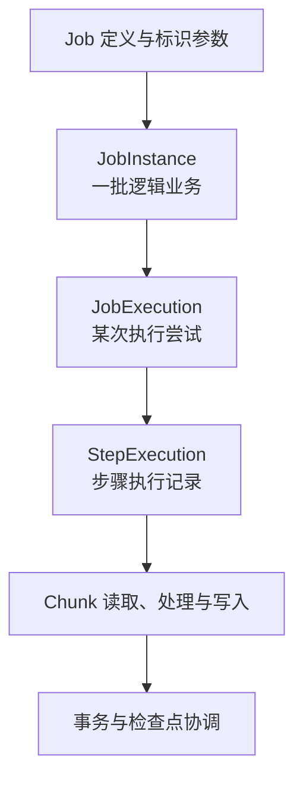

# Spring Batch：作业身份、分块事务、检查点与恢复原理

处理一千万条数据，不是把 for 循环放进定时任务就结束了。系统还要知道这批数据属于哪次业务、哪些部分已经提交、失败后从哪里恢复，以及再次执行时是否会重复产生副作用。

Spring Batch 用作业模型、步骤模型、事务与执行元数据组织这些问题。本文按 Spring Batch 6.x 说明机制，不提供部署工程，也不混用旧版本构建 API。

## 1. 批处理不等于调度

Quartz 或其他触发系统决定何时启动；Spring Batch 决定启动后如何组织步骤、数据处理与状态。它不要求每个作业都是定时作业，也可以由业务事件或显式操作启动。

| 问题 | 负责的概念 |
| --- | --- |
| 这是什么业务作业 | Job 定义 |
| 这一次逻辑业务是哪一批 | JobInstance 与 identifying parameters |
| 这是第几次尝试执行 | JobExecution |
| 某个步骤这次执行了什么 | StepExecution |
| 从哪里恢复，保存哪些状态 | ExecutionContext 与支持恢复的组件 |
| 谁操作与记录这些执行 | JobOperator、JobRepository 等基础设施 |

一个 Job 可以包含多个 Step；Step 可以采用 Chunk 模式，也可以采用 Tasklet 等方式。不能把“每个步骤必有 Reader/Processor/Writer”当作所有 Step 的定义。[核心模型](https://docs.spring.io/spring-batch/reference/domain.html)

## 2. 同一个作业，为什么有多种身份

图以一次尝试展示层级，同一个 JobInstance 可以经历多次 JobExecution，具体执行元数据由仓储协作管理。不要把每条箭头当成只创建一次的静态单例关系。

例如，作业名 daily-settlement、标识参数 businessDate=2026-10-01 表示一批逻辑结算。第一次失败，修正可恢复条件后再次运行，目标通常仍是同一个逻辑实例，但产生新的执行尝试。

如果每次失败都增加一个随机标识参数，可能创建了全新的 JobInstance，而不是恢复失败实例。这样会绕开原来的“已经完成哪些步骤”的判断，却没有解决业务重复问题。

参数身份也不会自动过滤数据。businessDate 写进元数据，不意味着任意 Reader 已经只读取该日期；数据选择条件必须真的使用这个业务边界。

## 3. Chunk 到底分的是什么

Chunk-oriented processing 将若干条输入组织到一次相应提交边界中：读取条目，进行可选处理，把输出交给 Writer，再完成事务与状态协调。[分块处理模型](https://docs.spring.io/spring-batch/reference/step/chunk-oriented-processing.html)

在一个没有重试、跳过和提前结束的简化例子中，提交间隔为 100：读取 100 条，Processor 过滤 20 条，Writer 接收剩余 80 条，随后完成这一块的提交。最后不足 100 条的部分也需要按完成条件处理。

这些“大小”必须区分：

| 参数/规模 | 表达什么 | 不等于什么 |
| --- | --- | --- |
| Chunk/提交间隔 | 相应一次提交组织的输入范围 | 必然写出同样条数 |
| Reader 的分页大小 | 一次从源端取得多少数据 | 事务一定按这一页提交 |
| JDBC batch size | 驱动/写入器如何组织语句 | 一个 Chunk 一定只发一条 SQL |
| 工作线程或分区数 | 并行执行范围 | 每条数据必定只处理一次 |

Chunk 增大可能减少提交开销，也可能增加占用内存、锁持有时间、事务日志和失败回滚成本。不存在一个脱离数据体积和数据库条件的“越大越好”。

## 4. Reader、Processor、Writer 与 Stream

Reader 提供输入，Processor 转换或过滤，Writer 承担相应输出工作。返回空结果用于过滤、输入耗尽、业务异常等语义，要按具体接口区分，不能统统叫“跳过”。

需要恢复的有状态组件，还要通过 ItemStream 等约定管理 open、update、close 与相应状态。框架知道一个 Reader 类名，不等于知道它的文件偏移、远端游标或已经消费到哪个业务 ID。

ExecutionContext 保存的是恢复所需的状态，不是整个 Java 堆快照。应使用稳定、可序列化且体积可控的值；保存了位置但输入文件后来被替换、源数据排序发生变化，恢复仍可能读错。

Job 范围和 Step 范围的上下文也不同。一个 Step 写入局部上下文，不代表下一个 Step 自动看到全部局部数据；共享、提升和键命名需要明确约定。

## 5. JobRepository 不一定是数据库

JobRepository 是管理执行元数据的抽象。想要持久化恢复，必须选择并正确配置具有相应能力的实现，而不是仅看到这个接口存在。

Spring Batch 6 的框架默认配置路径提供 ResourcelessJobRepository。它不持久保存批处理元数据，不适合依赖恢复、ExecutionContext 共享或并发执行的场景。这个结论针对框架的 EnableBatchProcessing/DefaultBatchConfiguration；Spring Boot 自动配置如何选择，应看实际 Bean 与条件，不能混为一条普遍默认规则。

JDBC、MongoDB 等持久化实现有各自的基础设施和事务要求。执行记录创建时的唯一身份保护，与业务数据修改时的锁和隔离也属于不同问题。[仓储与默认行为](https://docs.spring.io/spring-batch/reference/job/configuring-repository.html)

因此，“Spring Batch 支持重启”和“我的应用已经具备持久重启能力”不是同一句话。需要恢复状态的 Reader/Writer、自身输入稳定性和实际仓储都必须成立。

## 6. 事务和检查点为什么必须一起看

理想目标是：某一块业务修改成功提交时，恢复位置也与之协调；没有提交的工作不被误记为已经安全完成。

| 故障位置 | 必须判断什么 |
| --- | --- |
| 写入前 | 是否需要重新读取、重新处理 |
| 本地数据库写入后但事务回滚 | 数据是否确实回滚，Reader 状态如何恢复 |
| 业务提交成功但恢复记录未可靠完成 | 重跑是否重复产生效果 |
| 恢复记录已推进但外部效果失败 | 是否会遗漏本该完成的业务 |

能否把业务修改和元数据更新纳入相同原子边界，取决于资源、事务管理器和实际配置。两个独立数据库、文件输出、HTTP 调用和消息发送，不会因为都出现在 Writer 内就自动共享同一个本地事务。

Processor 也可能在回滚和重试后再次调用，因此不宜把不可重复的外部副作用随意放在转换阶段。唯一约束、幂等写、Outbox 或可确认的文件发布协议，依然需要根据输出资源设计。

检查点解决的是恢复定位，不是无条件的端到端 exactly-once 证明。

## 7. Retry（重试）、Skip（跳过）与 Restart（重新启动）

| 机制 | 发生的范围 | 应先问的问题 |
| --- | --- | --- |
| Retry | 执行中的某个失败操作重新尝试 | 是否暂时性、是否幂等、预算是否有限 |
| Skip | 按策略接受某些失败项并继续 | 丢弃什么、计数多少、如何对账 |
| Restart | 失败/停止后重新启动同一逻辑作业实例 | 哪些步骤与输入位置已可靠完成 |

一个脏数据反复重试不一定会变好；把所有异常都配置成可跳过，也可能得到“框架成功完成，业务数据却大量缺失”。异常分类、阈值和结果质量要同时解释。

Restart 也不是一定从头开始或一定从最后一行继续。已完成步骤的重执行规则、步骤自身恢复能力、检查点状态及启动限制共同影响行为。

新旧版本的重试与步骤构建 API 存在变化。理解了机制之后仍需按目标版本选择接口，不把旧示例中的类名当作永久契约。

## 8. 状态成功与业务成功的区别

BatchStatus 描述框架执行状态，ExitStatus 还可承载面向流程决策的退出信息，业务指标则回答处理数据是否达到要求。三者不应只压缩成一个布尔值。

例如，允许跳过 50 条坏数据的作业，可以按策略完成，但仍需报告 read/write/filter/skip、回滚、重试和业务对账结果。操作系统进程的退出码也要由入口集成正确表达，不能假定框架状态自动等同于 shell 退出码。

Stop 通常是协作式停止。一个持续阻塞且不观察退出条件的组件，不会因为状态被设置成停止请求就立刻安全结束；锁、连接和输出资源仍需有界等待与生命周期管理。

## 9. 并行不是简单把线程数乘大

多线程处理、并行流程、分区、远程分区和远程分块有不同资源与状态归属。Reader 是否线程安全、每个分区是否有独立上下文、输出是否允许乱序，都需要明确。

分区范围应避免无意重叠，并在恢复时保持可解释的身份。仅给每个工作线程起不同名字，不会让它们自动读取不同数据。

StepScope 等作用域帮助创建与执行范围相关的组件及延迟解析参数，但不自动把任意对象变成线程安全对象。共享连接、可变缓冲和局部统计仍需检查。

## 10. 如何沿组件解释一个慢作业

| 现象 | 可能需要分析的层 |
| --- | --- |
| read 很慢，write 很快 | 源扫描、分页/游标、网络与输入稳定性 |
| 每块提交耗时明显 | 数据库锁、提交日志、元数据更新与事务边界 |
| 提交间隔调大后内存上涨 | 条目体积、转换结果、缓冲与并发乘数 |
| 恢复后重复输出 | 检查点、输入身份、事务资源与输出幂等 |
| COMPLETED 但结果不足 | 过滤、跳过、业务核对与退出状态定义 |

这里只给出原理性的归因地图，不把某个组件名字当作根因。慢在 Writer，也可能是等待连接或提交，而不是字段转换算法。

## 11. 练习与答案

### 11.1 失败后每次增加随机 run.id，是否就是可靠续跑

不是。若它属于标识参数，可能创建全新的 JobInstance，避开原实例状态。应先确认业务批次身份，再依据持久检查点和组件能力恢复。

### 11.2 Chunk=100 是否意味着只执行一条包含 100 行的 SQL

不意味着。它描述相应分块/提交范围；过滤会改变输出数量，Writer 与驱动又决定 SQL 和 JDBC 批量方式，需要分别分析。

### 11.3 已经保存检查点，为何仍可能重复发消息

消息副作用与检查点可能不在同一个原子提交边界。故障后同一数据可能再次处理，仍需幂等、Outbox 或其他适合目标资源的协议。

## 12. 继续阅读

- [Spring Batch 6 核心模型](https://docs.spring.io/spring-batch/reference/domain.html)
- [ItemStream 与执行上下文](https://docs.spring.io/spring-batch/reference/readers-and-writers/item-stream.html)
- [Quartz 的触发与恢复](../quartz/01-调度模型触发领取持久化与集群语义.md)
- [事务与外部副作用](../../../spring-boot/03-data/06-业务事务Outbox与外部副作用.md)
