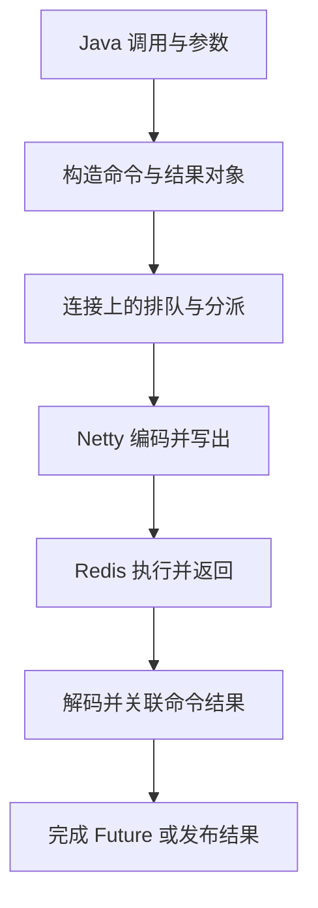

# Lettuce：命令执行、线程模型、连接复用与故障语义

Redis 命令在服务端只执行了很短时间，Java 调用却等了几秒，问题可能发生在客户端。连接租借、命令排队、网络写出、响应解码、回调阻塞和调用方等待，都是不同阶段。

Lettuce 是基于 Netty、提供同步/异步/响应式接口的 Redis 客户端。本文关注它如何把一次 Java 调用变成协议交互，不提供服务器部署步骤。具体选项、重连策略与默认值要按所用版本核对。[客户端概览](https://redis.github.io/lettuce/)

## 1. RedisTemplate 与 Lettuce 谁负责什么

| 层 | 主要职责 | 不应混淆的对象 |
| --- | --- | --- |
| 业务调用 | 决定键、命令、事务与一致性语义 | 不是只配置超时即可正确 |
| Spring Data Redis | Template、Serializer、ConnectionFactory 等集成 | RedisConnectionFactory 不是 Redis Server |
| Lettuce | 连接、命令、协议编解码、异步结果与拓扑处理 | RedisClient 不是一条命令 |
| Netty/网络 | Channel、事件循环与网络字节传输 | 网络写成功不等于业务命令成功 |
| Redis 服务端 | 解释并执行命令，返回结果 | 服务端慢日志不覆盖全部客户端等待 |

Spring Data 路径中，对象可能先由 RedisSerializer 转换成字节；直接使用 Lettuce API 时则需要理解所选 Codec。不能把 JSON 格式、RESP 协议和 TLS 当作同一层编码。

## 2. 客户端、资源与连接的生命周期

RedisClient/RedisClusterClient 是建立和管理连接等行为的入口；StatefulRedisConnection 是具体连接抽象；sync、async、reactive 是相应调用接口，而不是三个独立 Redis 数据库。

ClientResources 管理事件循环、执行资源及相关服务，可以在明确生命周期下共享。关闭一个连接、关闭客户端、关闭外部共享资源，具有不同影响；不应在每次请求结束时关闭容器共享的 ClientResources。

反过来，为每次调用新建客户端和线程资源，也会制造线程、连接和 DNS/TLS 等额外成本。线程数量持续增长时，先确认对象归属，不只扩大服务器连接上限。[资源模型](https://redis.github.io/lettuce/advanced-usage/client-resources/)

## 3. 一条命令的执行链



图是普通命令的概念链，不要求实现中每一步都由不同线程执行。Codec、ChannelHandler 与命令处理器共同组织字节和结果；具体源码类名会随版本调整，应沿 dispatch、编码、解码与完成路径阅读，而不是死记一份调用栈。

TCP 是字节流，没有“每次 read 恰好一份 Redis 响应”的保证。解码器需要处理分片和多份响应，并在相应连接/协议规则下关联待完成命令。RESP3 Push、订阅消息等也不能简单当作下一个普通请求的返回值。

## 4. 同步、异步与响应式改变的是调用方式

| 接口 | 调用方如何取得结果 | 仍然存在的成本 |
| --- | --- | --- |
| sync | 等待相应执行结果 | 业务线程等待、超时与取消 |
| async | 获得 RedisFuture，之后观察完成 | 排队、结果对象与回调执行 |
| reactive | 通过 Publisher 订阅、需求与取消组织结果 | 下游处理和已经发出的服务器工作 |

同步 API 并不是把网络层换成“一请求一条独占线程”。它可以在异步执行基础上等待结果，因此不能在负责推进 I/O 的事件循环中随意阻塞等待自身才能完成的结果。

异步回调不一定自动进入你期望的业务线程池。耗时 JSON 处理、阻塞数据库调用或锁等待若在 I/O 完成路径执行，可能拖慢同一资源承载的其他连接；需要明确执行器和并发预算。

响应式背压也不是远端撤销按钮。减少消费需求不能普遍撤回已经发出的 Redis 命令，取消订阅也不证明服务器没有执行写入。Publisher 的订阅次数与具体命令发布语义也需要分别理解。

## 5. 为什么普通命令可以复用连接

线程安全的普通 Lettuce 连接可以被多个线程共享，客户端组织命令与响应，不要求每个业务线程独占一个 TCP 连接。连接共享不等于服务器会把任意多条写入无上限并行处理。

需要关注的另一面是同一连接上的顺序与队头等待：一个耗时命令、大响应、慢网络或慢解码，可能让后续结果一起延迟。客户端和服务端都可能形成队列。

下列场景有连接级状态或特殊约束，不能随意混到普通共享路径：

| 场景 | 为什么应明确隔离 |
| --- | --- |
| MULTI/EXEC 事务 | 同一连接上的命令序列有事务状态 |
| 阻塞读取 | 相应连接可能等待数据，后续普通命令受影响 |
| Pub/Sub | 具有订阅及消息分派状态，需按协议/API 管理 |
| 更改自动 flush 等连接选项 | 影响可能超出当前线程的一条命令 |

“这个 Java 类型线程安全”并不意味着所有有状态操作任意交错仍符合业务意图。[连接共享与池化](https://redis.github.io/lettuce/advanced-usage/connection-pooling/)

## 6. 连接池不是越大越快

池化适用于确实需要独占连接等场景，但也增加租借、归还、验证和容量维护。若普通短命令本可共享连接，照搬 JDBC 的“一线程一连接”直觉，可能徒增资源而没有收益。

同步池和异步池的执行模型也不同。事件循环里阻塞租借连接，可能阻塞释放连接或完成命令所需的进展。池等待需要上限，但这个上限仍不等于命令整体截止时间。

池包装连接的 close 可能表示归还，普通连接的 close 则有另一种生命周期。关闭行为取决于实际对象，不可仅看方法名推断物理 TCP 是否断开。

Spring Data 的连接包装与共享策略还在原生 Lettuce 之上。看到 RedisTemplate 调用就认定每次都从池里取一条物理连接，同样不可靠。

## 7. Pipeline（流水线）减少等待，不提供事务原子性

Pipeline 允许在等待前一条响应之前继续发送后续命令，减少某些逐次往返等待。它不自动让多条命令成为不可分割的一次业务操作。

```text
普通逐次等待：发 A → 等 A → 发 B → 等 B
流水发送：    发 A → 发 B → 分别取得 A、B 的结果
```

控制发送/flush 的批次，改变的是写出和缓冲行为，不等于服务器必定执行一条组合命令。批次过大还可能增加待完成队列、内存和尾延迟。

事务、Lua/Function 的服务端执行、Pipeline 和应用侧批量 API 各有语义。即使一次网络写出了所有字节，断线时也未必能确认每条命令是否执行。

## 8. 超时之后，服务器到底做没做

| 超时/等待 | 主要覆盖的阶段 |
| --- | --- |
| 连接池租借等待 | 等待可用独占资源 |
| 连接建立相关超时 | 建连及相应网络过程，具体范围按选项核对 |
| 命令超时或同步等待 | 对应命令完成的等待，计时范围依配置而异 |
| 上层请求 Deadline | 整个业务允许消耗的总预算 |

某个等待结束，不等于服务器已经撤销操作。考虑：服务器完成计数增加，回包途中断线，客户端只得到超时。如果盲目重试，业务计数可能增加两次。

异常应区分“确定没发送”“返回明确业务错误”和“执行结果未知”。幂等写、条件更新或稳定请求标识，是业务协议的一部分；不能仅凭自动重连把非幂等操作变安全。[命令执行可靠性](https://redis.github.io/lettuce/advanced-usage/command-execution-reliability/)

## 9. 重连与拓扑变化各自恢复什么

重连恢复传输通道，命令队列是否接受、缓存、重放和如何超时取决于客户端选项及具体状态。断线期间持续无限接受请求，可能把短暂网络故障变成客户端内存故障。

Sentinel 的主节点切换与 Cluster 的槽位重定向、拓扑刷新又是额外层。MOVED/ASK 等协议处理不等于业务自动幂等；拓扑发现也不保证每个节点公告的地址都能从应用网络访问。

连接恢复、命令成功和业务结果正确是三个不同结论。诊断应记录事件时间、实际节点、队列和重试次数，避免只写一句“Redis 抖了一下”。[客户端选项](https://redis.github.io/lettuce/advanced-usage/client-options/)

## 10. 用指标区分慢在何处

| 观察 | 更接近哪类问题 |
| --- | --- |
| 服务端执行短，客户端待完成队列上涨 | 排队、网络、解码/回调或下游处理 |
| 获取连接慢，执行后很快 | 池容量、独占连接生命周期 |
| 多条连接一起停顿 | 共享事件循环、执行资源、进程暂停 |
| 故障后请求量成倍增加 | 客户端重放与上层重试叠加 |
| 新建连接持续增长 | 客户端复用、拓扑与关闭归属 |

这些关系用于提出可验证的解释，不等于看到某个计数就能直接证明根因。端到端耗时与服务器慢日志必须放在各自覆盖范围内比较。

## 11. 练习与答案

### 11.1 线程安全的连接是否可以任意交错执行事务命令

不能这样推断。事务等操作带有连接级状态，线程安全并不自动隔离不同业务的命令序列，需要独占或其他清晰的边界。

### 11.2 Pipeline 是否让一百条命令变成一次原子修改

不会。它主要改变发送与等待方式，失败时可能只有部分命令完成。需要原子或幂等语义时，必须选择对应的服务器能力和业务协议。

### 11.3 客户端等待超时，为什么不能直接断言写入失败

因为命令可能已经执行，只是响应未及时到达或未完成解码。此时结果未知，盲目重试非幂等操作可能重复产生效果。

## 12. 继续阅读

- [Lettuce 参考文档](https://redis.github.io/lettuce/)
- [Spring Data Redis 与缓存一致性](../../../spring-boot/04-integrations/01-Redis序列化缓存策略与一致性.md)
- [Redisson 的协调与租约](../redisson/01-分布式对象锁租约续约与一致性边界.md)
