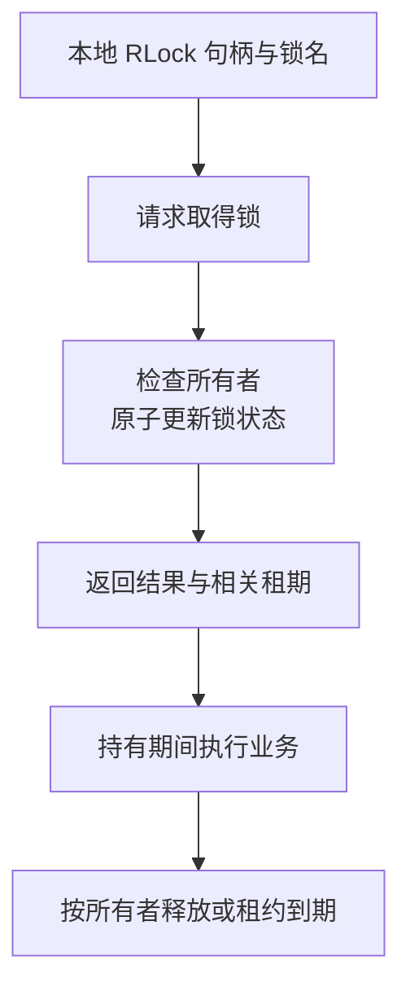

# Redisson：分布式对象、锁租约、续约与一致性边界

把 synchronized 换成一把 Redis 锁，并不等于把单机程序原样变成可靠分布式程序。锁的持有者会暂停，网络会超时，副本会切换，旧工作还可能在租约失效后继续执行。

Redisson 提供贴近 Java 对象的 Redis/Valkey 客户端能力。本文以常见对象代理与 RLock 模型讲原理，不提供部署方案；不同发行版、版本和对象类型的能力需要分别核对，不能由某个方法存在就推导全部产品承诺。

## 1. 与 Lettuce、RedisTemplate 的区别

| 接口风格 | 应用主要看到什么 | 需要额外理解什么 |
| --- | --- | --- |
| Lettuce | 命令、连接和异步结果 | 命令协议与客户端执行模型 |
| RedisTemplate | 命令分组、序列化和 Spring 集成 | 键值协议、连接与事务边界 |
| Redisson | Map、锁、队列、信号量等远端对象抽象 | 每种对象的远端协议、状态与失败语义 |

Redisson 不只是给普通缓存再加一个注解。一个远端对象的方法可能涉及多次网络交互、脚本、订阅或后台维护；名字像 Java 集合，不代表成本和 JDK 内存集合相同。

## 2. 分布式对象不是共享 Java 堆

获取某个名称对应的 RMap/RLock 等句柄，得到的是本地访问对象，不是把 Redis 中的值直接映射成所有 JVM 共用的一块内存。

远端数据仍有键名、编码、存储结构、过期与资源归属。对象值更新、序列化版本和跨语言访问都需要协议；本地修改一个已经取回的普通对象，也不代表远端结构已经同步修改。

| 对象类型 | 可以帮助组织什么 | 不能自动推导什么 |
| --- | --- | --- |
| Map/集合 | 远端数据结构访问 | 整个应用事务原子性 |
| 锁 | 遵守协议的持有者协调 | 数据库或外部系统一定拒绝旧持有者 |
| 信号量 | 许可数量和获取/释放 | 任意进程崩溃都自动无损归还普通许可 |
| 队列 | 相应入队、出队和等待模型 | 任意队列都具有确认、重试和永久消息保障 |

必须阅读具体对象语义，不能仅凭名字把所有“分布式集合”当成可靠消息系统或关系数据库。

## 3. 一把普通可重入锁包含哪些部分



图是概念生命周期，不表示每次获取句柄就已经加锁，也不表示只有这六次网络动作。竞争等待、续约和异常补偿会带来额外行为。

常见 RLock 实现需要表达：锁名、持有者身份、重入计数、过期时间。持有者身份与客户端实例及相应线程身份有关，不是仅靠业务方法名识别。

相应脚本在目标 Redis 执行上下文中检查并修改状态，减少“先查询、再写入”之间的竞争。但一段脚本的原子性不等于它和外部数据库修改构成原子事务；Cluster 场景还需遵守键槽等限制。

## 4. 重入、所有权与解锁

可重入表示同一所有者可以再次获取相应锁，状态需要记录次数。只释放一次，不一定清除之前的多次重入。

解锁需要校验持有者，并按协议修改计数、删除锁及通知等待者。不能用“先看锁存在，再删除键”替代，因为两步之间持有者可能改变。

isLocked 表达锁状态，不意味着当前线程是所有者。异步流程切换执行线程后，也不能随意把原有线程身份丢掉；需要理解具体 API 的所有者传递和释放责任。[锁与同步器](https://redisson.pro/docs/data-and-services/locks-and-synchronizers/)

锁名还决定协调范围。两个进程若使用不同名称，或连接到不同的 Redis 环境，即使业务操作的是同一数据库记录，也不会因为 Java 代码相似而自动互斥。

## 5. 四种“超时”分别约束什么

| 名称 | 主要含义 | 不等于什么 |
| --- | --- | --- |
| 获取等待时间 | 允许为取得锁等待多久 | 持有锁多久 |
| leaseTime | 明确设定的一段持有租期 | 业务方法完成需要的时间 |
| lockWatchdogTimeout | 看门狗路径使用的过期预算 | 进程活着就永不失锁 |
| 命令/网络超时 | 等待相应远端操作多久 | 服务器一定没有执行操作 |

常见 RLock 用法中，显式指定 leaseTime 后按固定租期处理；未显式指定租期的相应获取路径由看门狗管理续约。两种方式不能想当然地叠加成“固定租期到期前总会无限延长”。具体以目标方法和版本为准。

例如把租期设为 10 秒，业务却跑了 30 秒，不会因为业务尚未返回就自动证明锁仍归它。反过来，调用等待时间是 1 秒，也不表示取得锁后只能执行 1 秒。

## 6. 看门狗怎样续约，为什么仍会失锁

看门狗通过客户端的定时维护，在条件允许时延长相关锁的过期时间。官方文档给出的常见默认预算为 30 秒，可以配置；它不是为所有业务选择的安全时间常量。

续约依赖客户端调度、进程运行和网络/服务器交互。长时间进程暂停、事件处理资源阻塞或网络分区，都可能让续约无法在有效期内完成。

```text
A 取得锁并开始业务
→ A 暂停到租约失效
→ B 成功取得同名锁
→ A 恢复运行，但原来的业务线程还在继续
```

锁在 Redis 中过期，不会直接终止 A 的 CPU 指令，也不会自动撤销它对其他系统的写入。这是租约型协调必须理解的边界，不是多写一次 finally 就能消除。

## 7. 等待通知不等于授予锁

常见锁竞争路径结合发布/订阅通知、剩余租期和再次获取等机制，减少单纯高频轮询。其他锁类型可能使用队列或退避等方式，不能将所有对象归为一种等待协议。

收到“某锁已释放”的通知，只是有机会再竞争，不能直接进入业务临界区。通知和真正取得所有权是两件事；进程重新连接后也需要按协议确认状态。

公平锁尝试表达排队次序，但排队、失联等待和吞吐之间有取舍。普通锁不因使用 Redis 就自动公平，公平也不等于请求具有业务截止时间保障。

## 8. 复制与切换为什么影响锁

如果主节点接受了锁状态，而切换后的副本没有相应状态，另一个客户端可能再次取得同名锁。锁的安全范围必须包含复制和故障切换假设。

Redisson 的相应锁路径具有副本同步确认等选项，用来处理某些风险窗口。仍要核对具体版本、拓扑、确认条件与失败行为，不能把“启用了一个检查”理解为任意故障下都变成共识系统。

确认、持久性、可用性和网络分区各有条件。也不要把客户端超时直接当成确定未加锁：执行结果可能未知，应遵守获取结果、取消/补偿和租期协议，而不是在异常后照常执行受保护业务。

## 9. Fencing（栅栏机制）保护的到底是什么

Fencing 使用可比较的令牌，让受保护资源能够识别并拒绝落后的持有者。假设 A 获得令牌 41，之后 B 获得 42，资源已接受 42 后应拒绝 A 的旧令牌写入。

关键不只是“锁 API 返回了一个数字”，而是：

1. 令牌来源在目标故障模型下具有所需的排序保证。
2. 真正写入的资源检查该令牌。
3. 检查和资源修改必须形成可靠的原子边界，而不是先查再改。

随机 UUID 可以识别身份，却不能直接表达先后顺序；把令牌只写进日志，也不产生 fencing。某些 Redisson 版本/发行版提供相关锁能力，需要按实际支持核对。

即使资源拒绝旧持有者，相同持有者的重复请求仍可能需要业务幂等键。互斥、租约、fencing 与去重不是四个同义词。

## 10. 锁、事务和幂等各解决什么

| 机制 | 主要保障方向 | 仍需补充的边界 |
| --- | --- | --- |
| 分布式锁 | 持有者的协调 | 失联、租约过期及外部资源 |
| 数据库事务/行锁 | 相应数据库内修改的原子性和隔离 | 外部副作用与跨资源协议 |
| 乐观版本 | 对遵守版本条件的竞争写进行约束 | 所有写入方是否遵守协议 |
| 幂等键/唯一约束 | 同一业务操作的重复效果控制 | 键的身份、有效期与冲突处理 |

只修改一条数据库记录时，直接使用该资源的条件更新或事务，可能比新增远端锁协议更清楚。引入锁应由需要跨进程协调的资源语义决定，而不是所有并发问题都先套 RLock。

## 11. 原理性的排查地图

| 现象 | 应检查的关系 |
| --- | --- |
| 有锁仍发生并发写 | 锁名/环境、租期、暂停、切换与资源侧校验 |
| 解锁提示不是所有者 | 获取结果、线程身份、重入次数和过期 |
| 获取越来越慢 | 临界区长度、竞争、等待协议与远端延迟 |
| 业务超时后出现重复效果 | 结果未知、重试、幂等与事务边界 |
| 锁释放了，业务仍在跑 | 租约状态与线程执行没有自动等价关系 |

## 12. 练习与答案

### 12.1 看门狗开启后，只要 Java 进程没有退出，就一定还持锁吗

不一定。续约还依赖客户端调度和远端交互，长暂停或网络故障可能使租约到期。业务线程继续运行不证明所有权仍有效。

### 12.2 获取到锁后，是否可以省去支付请求的幂等键

不能。锁与执行确认之间仍可能出现故障和重试，旧持有者也可能继续运行。稳定业务身份与资源侧约束仍然必要。

### 12.3 给请求加一个随机 UUID，为什么不等于 fencing

UUID 可以区分请求，却不天然表达令牌先后。Fencing 还要求可靠排序，以及受保护资源在修改时原子校验并拒绝旧令牌。

## 13. 继续阅读

- [Redisson 锁、复制确认与 fencing](https://redisson.pro/docs/data-and-services/locks-and-synchronizers/)
- [Lettuce 的连接与命令可靠性](../lettuce/01-命令执行线程模型连接复用与故障语义.md)
- [数据库版本并发控制](../../03-data/mybatis-plus/01-BaseMapper条件构造分页乐观锁与逻辑删除.md)
