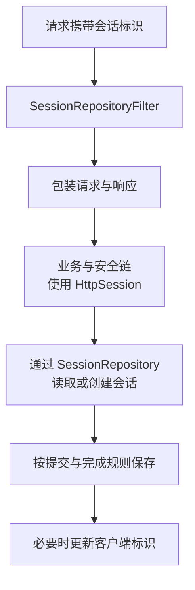

# Spring Session：会话接管、保存、过期与多实例一致性

多个应用副本能读取同一份会话，不表示登录安全、并发修改和过期问题都自动解决了。共享存储只改变状态的归属；谁识别会话、什么时候保存、何时不再接受它，仍然需要明确机制。

本文以 Spring Session 4.x 的 Servlet/HttpSession 集成为主，解释调用链，不提供多节点部署步骤。响应式 WebSession 具有另一套集成路径，不能把 Servlet Filter 的结论直接套过去。

## 1. Cookie、Session 与认证不是同一个对象

| 对象 | 主要作用 | 不能由此推出什么 |
| --- | --- | --- |
| 会话 Cookie/请求头 | 携带相应会话标识 | 一定包含完整用户状态 |
| Session ID | 定位会话的凭据/标识 | 自动证明调用方有权访问任何业务对象 |
| HttpSession 属性 | 保存服务器侧需要的会话状态 | 所有属性天然线程安全 |
| Spring Security 上下文 | 表达身份与安全上下文 | 任意放进 ThreadLocal 就会跨请求保存 |
| Spring Session | 替换并管理相应会话存储实现 | 自动提供完整认证、授权与 CSRF 防护 |

持有有效会话标识可能意味着可以使用对应登录状态，因此标识本身需要像凭据一样保护。它不是一个可以随意输出到公共日志的普通查询参数。

Session 与 JWT 也不能简单按“一个有状态、一个一定无状态”归结全部行为。JWT 系统可能仍有撤销、刷新和登录状态存储；使用 Cookie 也不等于一定使用 HttpSession。

## 2. Spring Session 怎样替换 HttpSession



这是职责关系图，不表示仓储操作只出现在链路末尾。包装后的 getSession 可以按需要访问仓储；完全不访问会话的请求，也不应被想当然地理解为每次都创建一份新会话。

Filter 需要位于使用 HttpSession 的相关组件之前，通常包括相应安全链；这不意味着它必须是整个应用绝对第一个 Filter。只创建一个仓储 Bean，而没有正确的集成与注册，不会替换任意 Servlet 容器的会话行为。[HttpSession 集成](https://docs.spring.io/spring-session/reference/http-session.html)

## 3. SessionRepository 是存储契约，不是固定 Redis 布局

仓储负责创建、读取、保存、删除等行为。使用内存 Map、Redis 或 JDBC，资源、序列化、过期和事件能力并不相同。

RedisSessionRepository 与 RedisIndexedSessionRepository 也不是一个名字的两个拼写：后者有索引和相应事件/查找能力，所需数据结构与维护工作更多。不能默认每一种仓储都支持按用户列出所有会话、提供同样的过期通知。

同一份 Redis 可以承载多个应用的会话，但 namespace 只是数据命名与隔离约定，不等于 Redis ACL 或完整租户安全边界。命名冲突、权限和不同应用的会话信任关系要分别处理。[Redis 仓储与配置](https://docs.spring.io/spring-session/reference/configuration/redis.html)

## 4. 一次请求何时读取和保存

会话标识通常经 HttpSessionIdResolver 一类机制解析。包装请求访问会话时，通过仓储查找并校验有效性；业务改变属性后，保存行为由集成生命周期和仓储策略协调。

响应提交前可能需要确认会话及客户端标识，请求完成时也有保存处理。不能机械认为“一个请求只发一条 Redis GET 和一条 SET”，也不能认为 Java 方法返回后才开始所有持久化。

若响应已经提交，修改客户端标识受到 HTTP 语义限制。异步请求、错误处理和提前提交，都需要放回具体请求生命周期分析，而不是仅看 Controller 的方法结尾。

Spring Security 保存身份还依赖相应 SecurityContextRepository 等配置。Spring Session 接管会话，并不替任意手写认证代码自动持久保存安全上下文。

## 5. FlushMode（刷新时机）与 SaveMode（保存范围）

| 策略维度 | 主要问题 | 不解决什么 |
| --- | --- | --- |
| FlushMode | 相应变化何时刷新到存储 | 属性修改本身是否符合业务并发协议 |
| SaveMode | 哪些属性变化/访问需要被保存 | 任意可变对象的全部内部变化自动被追踪 |

常见的 on-save、immediate 以及按设置/获取/全部保存等模式，会影响访问量、可见时点和覆盖范围，支持情况按仓储与版本核对。更频繁保存不等于更强的全局事务保证。

例如从 Session 取出一个 List，直接在原对象上追加内容，没有再次 setAttribute。能否正确持久保存，取决于保存策略和具体实现，不能期待 JPA 式的完整脏检查。

更可理解的方式是明确哪些值发生变化、谁负责回写，并尽量避免在会话中存放巨大且任意可变的对象图。

## 6. 浏览器过期与服务器过期不同

至少要区分以下时间：

| 时间/状态 | 所属层 |
| --- | --- |
| Cookie 的 Max-Age/Expires | 浏览器是否继续保留和发送 Cookie |
| 会话最大不活动时间 | 服务端如何判断会话因空闲失效 |
| 业务要求的绝对登录期限 | 即使持续活跃，也是否必须重新认证 |
| Redis 键的物理 TTL/清理 | 存储项何时移除及相应维护 |

持续访问可能延长空闲会话，但不能据此假定已经实现绝对登录期限。删除客户端 Cookie 也不等于服务端会话已撤销；服务端失效后，浏览器仍可能继续发送旧标识。

部分 Redis 会话实现保留过期索引、过期标记或用于事件处理的数据，物理键的寿命可能与逻辑可接受期限不同。不能仅凭“某个 Hash 仍存在”推断该会话还能被合法使用。

过期事件的投递、索引维护与失效判定也不是同一件事。不要将事件通知当成一个不会丢失的业务结算消息队列。

## 7. 多实例共享不等于并发修改自动合并

两个请求可能读到同一会话属性的旧值，然后分别修改。保存策略可以减少某些无关字段覆盖，但不能把任意对象修改自动变成原子合并。

```text
A 读取购物车数量 1
B 读取购物车数量 1
A 写回数量 2
B 也写回数量 2
最终并不一定是期望的 3
```

这是并发读改写问题，不是把存储从内存换成 Redis 就自然消失。库存、余额、计费等关键事实不宜把 Session 当唯一真相，应放入拥有明确事务/条件更新协议的业务资源。

共享 Session 也不能共享任意 JVM 内部资源。数据库实体、连接、线程对象和运行期代理，跨实例与版本未必能恢复，应只保存必要且稳定的身份/业务引用。

## 8. 序列化和滚动升级也是协议

Java 原生序列化、JSON 和其他格式具有不同的兼容及安全要求。换成 JSON 并不意味着任意多态反序列化都安全，也不意味着已经支持新旧类型混读。

需要考虑字段增删、类名/包名变化、枚举、Security 对象，以及回滚旧应用时能否读取新会话。相同 namespace 下运行新旧版本，会直接共享这个协议。

标识与会话内容应有最小暴露范围，不向不可信来源开放任意对象反序列化。命名空间、序列化器和身份结构的升级应一起设计，而不是只升级一个 Starter。

## 9. Cookie 安全与认证责任

HttpOnly、Secure、SameSite、Domain、Path 各有作用，不能互相替代。HttpOnly 不是 CSRF 防护；Cookie 的路径范围也不是后端对象授权规则。

登录后的会话固定攻击防护、会话标识轮换、登出撤销和并发登录策略，通常需要与 Spring Security 等认证机制协作。Spring Session 负责会话实现，不会因启用共享存储就自动建立完整安全策略。

多个应用共享会话，实际上还要共享兼容的身份协议与信任边界。单纯让两个域名读到同一个 Cookie，不能代替 OIDC 等明确的跨应用登录方案。

## 10. 存储故障时应该如何理解状态

会话存储不可用，不应被解释成“所有用户已经认证通过”。允许公开匿名内容降级，与受保护业务绕过身份验证，是两个完全不同的决定。

临时退回各 Pod 内存，也会改变会话可见性、撤销和后续恢复语义，不是透明且无风险的开关。需要先明确业务能接受的故障模式，再决定拒绝、有限降级或其他路径。

| 现象 | 应检查的层 |
| --- | --- |
| 换副本后丢登录态 | 标识传递、namespace、仓储及序列化兼容 |
| Redis 还有键，但请求被判过期 | 逻辑有效期与物理清理是否不同 |
| 属性偶尔被旧值覆盖 | 并发请求、SaveMode 和可变对象回写 |
| Session 有值但身份未恢复 | 安全上下文的读取/保存路径 |
| 登出后仍可访问 | 客户端标识、服务端撤销、身份缓存与授权链 |

## 11. 练习与答案

### 11.1 将 Session 放进 Redis，购物车数量的并发加一就一定正确了吗

没有。两个请求仍可能基于同一个旧值回写，仓储不自动为任意属性实现原子加一或事务合并。需要明确业务资源和并发协议。

### 11.2 Cookie 还没有到期，为什么服务器仍可拒绝会话

客户端保留时间与服务端有效性不同。会话可能已空闲过期、被撤销或不再满足认证要求，不能只看浏览器 Cookie。

### 11.3 为什么共享存储不能自动解决滚动升级后的反序列化错误

共享的是相同字节与数据协议，不是相同运行时类。新旧应用仍需兼容字段、类型、身份结构与序列化配置，存储可达不代表对象可恢复。

## 12. 继续阅读

- [Spring Session 的 HttpSession 接管](https://docs.spring.io/spring-session/reference/http-session.html)
- [Spring Session API 与仓储契约](https://docs.spring.io/spring-session/reference/api.html)
- [Session、密码与安全上下文](../../../spring-boot/05-security/02-Session密码存储与安全上下文.md)
- [CSRF、CORS 与 Cookie](../../../spring-boot/05-security/05-CSRF-CORS-Cookie与会话边界.md)
