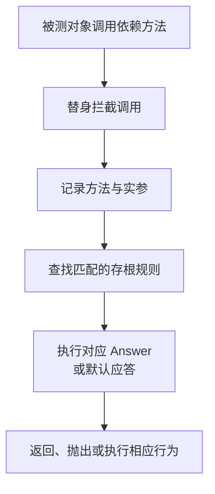

# Mockito：测试替身、调用拦截、存根匹配与验证边界

测试一个服务时，可以替换它依赖的仓储，让测试只关注服务决策。但如果被替换的仓储本身配置错了，Mockito 通常不会替你发现。理解测试替身，首先要理解测试主动切掉了哪一段真实系统。

本文以 Mockito 5.x 的模型和默认 inline MockMaker 为主讲机制，不提供测试项目搭建步骤。具体可模拟类型、JDK 与插桩要求仍需按所用版本核对。[Mockito API 说明](https://javadoc.io/static/org.mockito/mockito-core/5.24.0/org.mockito/org/mockito/Mockito.html)

## 1. 测试替身不是只有 Mock

| 概念 | 主要用途 | 一个典型含义 |
| --- | --- | --- |
| Dummy | 占位，不参与关注行为 | 满足某个参数位置 |
| Stub | 为调用提供预先安排的结果 | 查询某 ID 返回一个对象 |
| Fake | 用较简单但有行为的实现替代真实组件 | 一个明确实现约束的内存仓储 |
| Mock | 记录交互并支持期望验证的替身 | 是否请求保存、参数是什么 |
| Spy | 对真实行为进行部分观察/替换 | 部分方法仍执行真实逻辑 |

这些是理解边界的概念，不是每个框架都提供五个完全对应的类。Mockito 创建的 mock 也能承担 stubbing 工作；不要因为英文叫 Mock，就认为每次测试必须验证所有调用次数。

Fake 和真实数据库也不等价。如果内存 Fake 没有唯一约束或事务隔离，用它验证成功不能证明真实数据库也允许同样操作。

## 2. MockMaker 怎样改变方法调用

Mockito 通过 MockMaker 扩展点组织替身创建与相关能力。不能把所有 Mockito 对象都解释成 JDK 动态代理：目标类型和所选实现会改变实际路径。

| 方式 | 大致原理 | 典型限制来源 |
| --- | --- | --- |
| 子类式 | 创建可拦截的子类型方法路径 | final、可见性、类结构 |
| inline 式 | 在受支持类型上通过字节码插桩转入处理器 | Instrumentation、JDK、特殊方法/类型 |
| 自定义 MockMaker | 按扩展协议建立替身 | 扩展自身能力与兼容性 |

Mockito 5 默认使用 inline MockMaker，但不意味着任意类、任意平台都能被无条件模拟。某些条件还会影响实际生成和实例化方式；普通 mock 也不能被假定执行了真实构造器。

新 JDK 对动态附加 Agent 的约束，需要与测试 JVM 的受支持插桩设置一起理解。关闭一条警告不会自动建立正确的能力边界，也不应为了测试全局修改生产 JVM 的安全配置。

## 3. 调用如何变成一个安排好的结果

这里的 Answer 表达一次调用应怎样响应，可以是返回值、异常或自定义应答逻辑。配置了一条规则，不会让 Mockito 去真实数据库“帮你验证这个返回值合理”。

未配置调用通常使用相应默认应答，例如基本类型零值、null 或某些空容器。它不是业务层查无数据的完整实现，更不是所有未配置调用都会主动报错。

如果服务的一个错误分支恰好接受默认空结果，测试可能通过，却没有安排清楚真正想证明的输入。清晰的 stubbing 比依靠默认值碰巧走过路径更可靠。

## 4. when/then 为什么不是编译器语法

`when(dependency.find(id)).thenReturn(value)` 看起来像专用语法，但本质仍是 Java 方法调用。Mockito 借助拦截与相应调用上下文，识别被安排的方法，再将匹配条件与 Answer 关联起来。

因此必须注意配置表达式本身的求值过程。普通 mock 的调用会被拦截；对 Spy 使用相同表达式时，却可能已经调用真实方法。方法若访问文件、数据库或修改状态，副作用可能在“安排返回值”的阶段发生。

doReturn 等配置风格允许在相应场景避免先求值真实方法，但它不是所有设计问题的通用解法。需要大量部分模拟，往往也提示对象职责或依赖边界不清楚。

## 5. 参数匹配与捕获分别证明什么

默认的参数比较、eq、类型匹配、自定义匹配器等，决定哪条存根或验证适用。不要把“匹配任意参数”当作已经验证了业务 ID、租户和数量都正确。

| 机制 | 用途 | 容易忽视的边界 |
| --- | --- | --- |
| 精确/相等性匹配 | 约束方法实参 | equals 契约不一定表达全部业务属性 |
| 宽泛匹配 | 屏蔽与当前关注点无关的细节 | 可能屏蔽真正应该检查的错误 |
| 自定义匹配器 | 表达复杂参数条件 | 匹配逻辑本身也可能错误或有副作用 |
| ArgumentCaptor | 取得记录到的实参再断言 | 可变对象可能在调用后继续变化 |

匹配器由框架通过相应上下文记录，不是一个可以随意传进任何业务方法的普通“匹配值”。混用匹配器和普通实参时，应遵守 Mockito 的一致性规则。

Captor 也不是自动生成调用时刻的深度快照。若对象之后继续变化，读取捕获对象时看到的可能是后来的状态。不可变输入和明确的断言时点有助于避免误判。

## 6. verify 检查的是交互记录

verify 按方法、参数和次数等条件检查已经发生的调用，不是重新执行一次真实仓储。验证 save 被调用，不能推出写入已经提交；验证 send 被调用，也不能推出消息已经被 Broker 持久接受。

| 断言目标 | 更适合观察什么 |
| --- | --- |
| 领域规则是否正确 | 返回值、状态与错误 |
| 是否触发某个依赖动作 | 相应交互记录 |
| SQL、序列化与事务是否正确 | 对应真实集成边界 |
| HTTP 请求形状是否正确 | 网络边界的模拟/真实服务器 |

过度验证每一个内部调用，会让不改变外部行为的重构也大量失败。只验证对目标保证重要的交互；verifyNoMoreInteractions 不是每个测试都应该默认追加的质量分数。

## 7. Strictness（严格性）与测试隔离

严格存根检查有助于发现无效安排、参数不符等问题，但是否启用及具体规则取决于 Extension/Session 和 Strictness 配置。不能仅凭引入依赖就推断所有严格检查已生效。

同一个 mock 的安排和调用记录也是状态。跨测试共享它们，容易让测试顺序影响结果；随意 reset 又可能掩盖依赖组织问题。更清楚的生命周期通常是让每个测试拥有可解释的替身和输入。

异步业务需要等到明确完成条件再验证。立刻 verify 失败，可能只说明工作尚未完成；长时间睡眠后恰好通过，也没有说明真实时序。等待应有稳定条件和有限预算。

## 8. Mock、Spy 与静态模拟的不同风险

Spy 允许真实方法执行，所以真实异常、I/O 和对象状态仍存在。它不是“拥有真实类型但绝对不会碰真实系统”的安全开关。

静态方法和构造相关模拟具有自己的作用域与实现约束。静态模拟通常带线程/范围边界，不能假设自动传播到线程池；作用域没有正确关闭，也可能污染后续代码。

这些能力适合解释难以替换的边界，不应成为把所有内部实现细节都固定死的默认架构。生产代码的明确接口和依赖注入，往往能减少对特殊模拟的依赖。

## 9. Mockito 注解与 Spring 容器不能混同

| 机制 | 创建/改变的范围 |
| --- | --- |
| Mock / Spy | 相应测试替身对象 |
| InjectMocks | 按构造器、属性/字段等策略组织被测对象的依赖 |
| Spring 的 MockitoBean 等测试集成 | 在相应测试上下文中替换或提供 Bean |

InjectMocks 不是一个完整 Spring 容器：它不因此执行自动配置、事务代理、配置绑定和所有生命周期。无法匹配的依赖也不能被想当然地理解为容器启动失败一样的诊断。

同样，创建了一个普通 Mock，不代表正在运行的 ApplicationContext 已经使用它。Bean 替换、测试上下文缓存和实际注入对象，应由对应 Spring 测试机制解释。[InjectMocks 语义](https://github.com/mockito/mockito/blob/main/mockito-core/src/main/java/org/mockito/InjectMocks.java)、[Spring MockitoBean 集成](https://docs.spring.io/spring-framework/reference/testing/annotations/integration-spring/annotation-mockitobean.html)

## 10. 如何判断一项模拟有没有价值

先写清这项检查想排除哪种错误，再决定替换什么。例如，模拟支付网关可以验证订单服务面对拒绝时的决策，但不能证明 HTTP Header、TLS 或真实支付方错误码被正确处理。

如果测试只是让一个 mock 返回自己刚安排的值，既没有穿过业务决策，也没有检查关键交互，证明能力很有限。相反，小而准确的模拟可以隔离失败输入，让规则更清楚。

Mockito、HTTP 模拟和真实依赖验证可以互补，不需要为了追求某一种测试形式而把所有依赖全部替换或全部保留。

## 11. 练习与答案

### 11.1 验证 repository.save 被调用一次，是否证明数据库记录已提交

不能。验证的是替身交互，而不是 SQL、事务与数据库状态。提交保证需要在相应真实集成边界验证，不能由方法次数推导。

### 11.2 为什么给 Spy 安排返回值时也可能触发真实副作用

因为 Java 会先求值方法调用表达式，Spy 的真实方法可能在配置阶段就执行。应理解所用配置风格和对象行为，而不是把 Spy 当成纯空壳。

### 11.3 InjectMocks 成功后，能否认为 Spring 自动配置也正确

不能。它组织的是测试对象依赖，不提供完整容器的条件判断、代理、属性绑定与生命周期；应使用对应层次的 Spring 验证。

## 12. 继续阅读

- [Mockito 官方源码与项目](https://github.com/mockito/mockito)
- [JUnit 的测试隔离与替身边界](../../../java/05-build-testing/04-JUnit参数化测试隔离与测试边界.md)
- [WireMock 的 HTTP 模拟边界](../wiremock/01-HTTP模拟匹配响应状态与验证边界.md)
