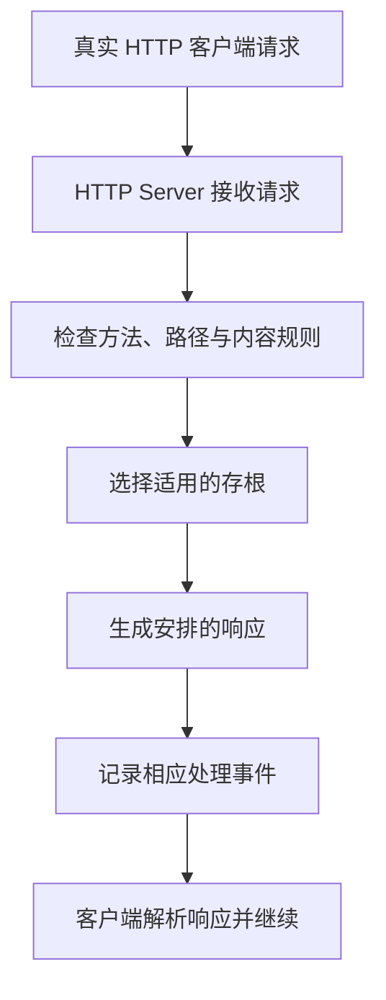

# WireMock：HTTP 模拟、请求匹配、响应状态与验证边界

Mockito 可以让某个 Java 方法返回安排好的值，但它通常不会检查 HTTP 客户端最终发送的路径、Header 和 JSON。WireMock 把替身放到 HTTP 边界，使客户端可以真正组织并发送请求，而远端服务的业务实现被替换。

本文讨论 WireMock Java 常规 3.x 文档中的 HTTP Server 路径，只分析机制，不提供服务搭建步骤。官方另有 v4 Beta 文档及其他运行方式，版本和集成能力不应混读。[官方文档入口](https://wiremock.org/docs/)

## 1. 模拟发生在系统哪一段

| 方式 | 被保留的真实部分 | 被替换的部分 |
| --- | --- | --- |
| Mockito 替换客户端接口 | 调用方的业务逻辑 | 客户端方法后面的实现 |
| WireMock HTTP 模拟 | 客户端序列化、请求构造与相应 HTTP 交互 | 远端业务及其依赖 |
| 真实服务集成 | 服务实际接口和实现 | 仍可能没有生产网关与真实规模 |
| 契约验证 | 双方对接口约定的相应检查 | 不自动保证全部运行行为 |

使用 WireMock 不会把整个测试变成生产系统。客户端确实经过网络，并不意味着真实服务的数据库事务、限流、权限和数据变化也已经被覆盖。

## 2. 五个核心概念

| 概念 | 含义 |
| --- | --- |
| Stub Mapping | 一组请求匹配规则与对应响应定义 |
| Request Matcher | 以方法、路径、参数、Header、Body 等判断是否适用 |
| Response Definition | 状态码、Header、Body、延迟等响应安排 |
| Scenario | 为相应规则提供可变化的场景状态 |
| Request Journal / Serve Event | 请求与处理事件的相应记录，供观察与验证 |

存根定义表达“怎样回答”，请求记录表达“实际收到了什么”。注册了一条规则，不证明客户端一定调用过；看到请求到达，也不证明选中了想要的规则。

## 3. 请求如何得到一个响应

图只表达概念职责，记录等行为可能穿插在处理生命周期中；不是每一步都由独立进程执行。未匹配、代理模式和扩展处理也有不同分支，不应仅根据“服务器返回了内容”推断存根命中。

一个可检查的调用至少包含两边：WireMock 侧的匹配/记录，以及客户端侧对真实响应的解析和业务决策。

## 4. 匹配的是路径，还是完整 URL

完整 URL 匹配可能包含查询串，路径匹配则需要另行约束查询参数。查询参数顺序、编码和重复值，也不应被无意写成与业务无关的严格条件。

| 条件 | 应明确的语义 |
| --- | --- |
| Method | GET、POST 等是否真的相符 |
| Path / URL | 是否包含查询串，是否精确或模式匹配 |
| Query/Header/Cookie | 必填、值、重复项与匹配范围 |
| JSON Body | 语义相等、字段存在、路径条件或严格文本 |
| 认证相关字段 | 请求是否按约定携带，不代表真实授权已验证 |

JSON 属性顺序与业务意义通常不同；精确比较整段字符串，可能把格式变化当成功能错误。反过来，所有字段都匹配“任意值”，又可能漏掉真实契约缺陷。[请求匹配](https://wiremock.org/docs/request-matching/)

条件应围绕接口真正保证的内容定义。宽泛的兜底规则只适合表达明确的回退，不应让所有写错路径的请求也得到成功响应。

## 5. 多个存根都匹配时怎么办

WireMock 的存根优先级数值越小，优先程度越高；没有显式指定时使用相应默认优先级。同等优先级下的匹配选择还受注册先后规则影响，不能依赖测试运行顺序碰巧得到目标响应。

例如，针对具体资源的规则与匹配整组路径的兜底规则重叠，若兜底抢先，客户端可能始终收到通用结果。解决方向是明确条件与优先级，而不是把客户端改到接受错误数据。

默认未匹配行为常见为 404，但自定义兜底、代理或扩展可以改变路径。WireMock 返回的 404 不一定就是被模拟业务的“资源不存在”。[Stubbing 与优先级](https://wiremock.org/docs/stubbing/)

## 6. 响应模板不是业务实现

响应可以包含安排好的状态码、Header 和 Body，也可以通过模板从请求提取部分内容生成动态结果。模板让数据有变化，不会自动获得真实业务的数据约束、事务和授权。

| 安排 | 可以帮助观察什么 | 不能推出什么 |
| --- | --- | --- |
| 固定成功响应 | 客户端正常解析路径 | 真实服务也会接受相同输入 |
| 结构化错误 | 错误码与错误体处理 | 真实错误集合已经完整覆盖 |
| 动态模板 | 请求字段与响应形状关系 | 完整业务规则正确 |
| 非预期内容 | 客户端解码与容错边界 | 生产依赖只会以这种方式失败 |

状态码、Content-Type、编码和实际内容需要一致地安排，除非目标就是研究它们不一致时客户端如何处理。不能只验证请求次数，而完全忽略真实解析结果。

## 7. Scenario（场景）状态不是每个用户的独立会话

Scenario 可以表达“初始状态返回失败，之后转入另一状态”等有序行为。它是模拟服务器中的场景状态，不会默认按业务用户、线程或请求 ID 自动隔离。

两个并行检查共享同名场景时，可能互相推进状态，导致一个调用消耗了另一个调用期望的响应。仅换成不同 URL，也不一定隔离相同 Scenario 名称下的状态。

场景适合表达有限、清楚的协议过程，不是拥有事务隔离、持久业务数据和所有并发规则的真实数据库。[状态模型](https://wiremock.org/docs/stateful-behaviour/)

## 8. 延迟与故障模拟应拆成具体阶段

等待连接、等待响应头、读取响应体与上层总截止时间并不相同。安排整段延迟、缓慢输出响应体或连接异常，会经过不同客户端路径。

“模拟服务器三秒后返回”也不能简单等价于“真实服务器已经执行业务但回包丢失”。后者还涉及结果未知、重复请求和下游副作用，模拟需要表达目标故障模型，而非只拉长等待。

重试次数、退避和并发叠加都应回到客户端机制解释。一个安排好的“第二次成功”场景，并不证明真实服务在第二次调用前没有完成第一次写入。

## 9. 请求记录与验证能证明什么

请求 Journal 可以支持方法、参数和次数等验证，但其记录范围受启用方式、容量、清理和具体处理路径影响。TLS 握手之前就失败的连接，未必成为一个正常 HTTP 请求记录。

调用次数还要区分时间范围、重试和并发：收到三次请求，可能是同一业务重试三次，也可能是三个独立业务。需要稳定业务标识和时间关系，而不是只读总数。

验证请求到达，不证明客户端成功读取响应，更不证明真实服务提交了事务。相反，客户端解析失败也可能发生在模拟服务器已经正常记录之后。[请求验证](https://wiremock.org/docs/verifying/)

## 10. 重置、并行和资源边界

存根规则、请求历史与场景状态是不同的可变内容。清空请求历史，不应被自动理解为所有规则与 Scenario 都恢复到初始；重置操作的范围需要按 API 确认。

不同端口可以隔离不同服务实例，但不能修复同一个实例中的状态共享。全局静态客户端指向哪一个服务器，也可能影响注册与验证；“我创建了一个新服务器”不等于所有工具都已经切到它。

嵌入式与独立进程的依赖边界不同。Jetty、Servlet、日志等版本冲突需要检查实际依赖，换端口无法解决类加载错误。这是集成兼容问题，不是存根内容问题。

## 11. 安全与契约边界

管理接口能修改规则或查看请求，不应作为普通公开业务接口暴露。请求历史、录制回放和模板素材可能含 Token、Cookie 或个人信息，需要脱敏、限制保存范围，并避免直接提交原始录制数据。

一个消费者维护的模拟，只证明它与自己写的预期一致。提供者接口发生变化时，旧模拟可能继续返回旧结构；契约需要与提供者的实际协议和版本一起维护，而不是永远相信一份固定 JSON。

WireMock 能减少对真实外部环境的依赖，但不能替代真实服务的兼容、认证、性能与恢复验证。本篇关注这种分工，不将模拟次数当作覆盖真实系统的数量。

## 12. 练习与答案

### 12.1 模拟服务器收到了请求，是否证明客户端正常解析了返回值

不能。请求到达与客户端读取、解码、业务决策是不同阶段。需要分别观察匹配/记录与调用方的实际结果。

### 12.2 两个检查使用不同 URL，就一定不会共享 Scenario 状态吗

不一定。状态按场景配置组织，不会自动根据 URL 或用户隔离；共享同名场景仍可能互相影响，需要明确服务器与场景生命周期。

### 12.3 为什么模拟接口长期全部通过，真实服务升级后仍可能失败

模拟规则可能仍停留在旧协议，测试只是在重复证明消费者自己的假设。需要维护真实提供者的契约与版本兼容，不能仅凭固定响应宣布集成正确。

## 13. 继续阅读

- [WireMock Java 文档](https://wiremock.org/docs/)
- [Mockito 的方法级替身](../mockito/01-测试替身调用拦截存根匹配与验证边界.md)
- [HTTP 客户端的等待与重试](../../../spring-boot/02-web/06-HTTP客户端连接池超时重试与取消.md)
- [API 契约与演进](../../../02-services/01-HTTP-gRPC与API契约设计.md)
