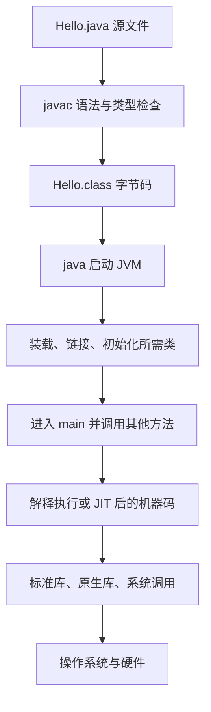

# Java 技术栈与程序执行路径

Java 源文件是程序的描述，CPU 最终执行的是机器指令。常见 Java 应用先把源码编译为 Class 字节码，由 JVM 装载、验证和执行；HotSpot 可以解释执行字节码，也可以把热点代码编译为机器码。Spring 和 Spring Boot 在这一执行环境中提供应用组织能力。

本篇以 JDK 25 为基线。先看完整路径，再运行一个可以独立编译的程序。

## 1. 各层解决什么问题

| 名称 | 含义与职责 | 不应混淆的边界 |
| --- | --- | --- |
| Java 语言 | 类型、语法、异常和并发等规则 | 不等于一个具体 JVM 实现 |
| Java SE 标准库 | String、集合、文件、网络等 API | 有些实现最终进入原生库和系统调用 |
| JDK | 开发工具和运行应用所需的组成部分 | 包括 javac、java、jar、javadoc 等 |
| JVM | 装载 Class、执行代码、管理运行时 | HotSpot 是一种实现；GC/JIT 细节不都是规范要求 |
| JRE | Java 运行环境的概念 | 现代部署通常使用 JDK 或裁剪运行时，不必另找独立 JRE 安装包 |
| Maven | 读取工程描述并编译、测试和打包 | 不替代 JVM，通常通过插件调用编译和测试能力 |
| Spring | 管理对象、依赖和调用增强 | 自身仍是运行在 JVM 中的 Java 代码 |
| Spring Boot | 启动、自动配置、依赖约定和应用集成 | 不会让 Java 类型和资源规则失效 |

## 2. 从文件到运行



图表示依赖关系，不代表启动时把全部依赖类一次性加载。后续执行也可能触发新的类加载、初始化或编译。

字节码可由不同平台上的兼容 JVM 读取；JVM 自身、原生库和依赖外部程序仍要匹配操作系统与 CPU 架构。调用 Linux 专用命令或加载 x86 原生库的程序，不能仅凭 Class 文件跨平台就认为整套应用跨平台。

## 3. 第一个完整程序

先按[环境安装文章](./02-JDK安装IDE-JShell与命令行工具.md)准备 JDK。新建工作目录，在编辑器中保存以下 UTF-8 文件。

```java title="Hello.java"
public class Hello {
    public static void main(String[] args) {
        String name = args.length == 0 ? "Java" : args[0];
        System.out.println("Hello, " + name);
    }
}
```

先只理解四件事：文件声明 `Hello` 类；`main` 是这里选择的启动入口；`args` 保存程序参数；`println` 输出一行文本。`public`、`static` 和数组在后续文章逐步展开。

Linux 和 PowerShell 都可以逐行执行：

```bash
javac -encoding UTF-8 --release 25 -d out Hello.java
java -cp out Hello
java -cp out Hello Infra
```

输出：

```text
Hello, Java
Hello, Infra
```

| 命令部分 | 含义 |
| --- | --- |
| `javac` | 把 Java 源文件编译为 Class 文件 |
| `-encoding UTF-8` | 指定源文件字符编码 |
| `--release 25` | 使用 Java 25 对应的语言、目标字节码和可用平台 API |
| `-d out` | 把编译结果写入 out，并按包组织子目录 |
| `java` | 启动 Java 应用的工具 |
| `-cp out` | 从 out 这一 Classpath 根查找应用类 |
| `Hello` | 入口类名，不是 Hello.class 文件路径 |
| `Infra` | 交给 main 的应用参数 |

编译成功通常没有输出。产生 `out/Hello.class` 是一个构建结果；第二条命令才真正运行应用。

## 4. 看见字节码而不必先学完整指令集

```bash
javap -classpath out -c Hello
javap -classpath out -verbose Hello
```

`-c` 输出方法的字节码指令，`-verbose` 输出常量池、版本等详情。Java 25 目标的 Class 文件主版本号为 69；不同 JDK 的常量池索引和编译细节可能不同。

在 `main` 的输出附近能看到对 `System.out` 的读取和 `PrintStream.println` 的调用。它解释了源代码方法调用会成为 Class 文件中的符号引用和指令，而不是把源代码文本交给 CPU。

`javap` 是静态反汇编工具，这份输出本身看不到后来 JIT 生成的机器码，更不能由此认定某段代码始终解释执行。

## 5. 源文件运行和 JAR

JDK 25 也可运行：

```bash
java Hello.java Infra
```

输出仍为 `Hello, Infra`。这是启动器的源文件模式，内部仍需要编译与执行，并不意味着 Java 变成逐行执行源文本。学习 Classpath 时优先使用显式的两步命令。

把已有结果打包：

```bash
jar --create --file hello.jar --main-class Hello -C out .
java -jar hello.jar Infra
```

`-C out .` 把 out 中内容作为 JAR 根内容加入，不会额外套一层 out。`--main-class` 写入入口信息。普通 JAR 默认不把所有第三方依赖装进去，后续 Maven 和 Boot 的产物要分别分析。

## 6. 三类错误要在正确位置修复

| 现象 | 阶段 | 优先检查 |
| --- | --- | --- |
| `cannot find symbol` | 编译 | 名称、作用域、导入和编译期依赖 |
| `Could not find or load main class` | 启动 | 类名、包名、Classpath 根、Class 文件位置 |
| `UnsupportedClassVersionError` | 加载 | 编译目标高于当前运行 JDK 支持范围 |
| 程序启动后抛出业务异常 | 执行 | 输入、方法调用和异常堆栈 |

这里的 `--release 25` 需要支持该目标的编译器。把 JDK 8 的环境变量改成名为“25”的目录，不会改变真正运行的编译器。

## 7. 练习与答案

### 7.1 javac 成功后，为什么修改源码没有改变下一次运行结果

若运行 `java -cp out Hello`，读取的是上次编译的 Class 文件。需要重新编译，或明确使用源文件模式。保存源文件和更新构建产物是两件事。

### 7.2 为什么不能直接执行 java out/Hello.class

常规类模式需要类名和 Classpath 根，应使用 `java -cp out Hello`。文件系统路径不能替代类的二进制名称。

### 7.3 JAR 在另一台机器打不开，是否一定是 Java 不跨平台

先区分运行时版本、入口、依赖与原生组件。Class 格式和 API 要被目标 JVM 支持；路径、原生库和外部程序也要匹配目标环境。

## 8. 继续阅读与资料

- [JDK 安装与工具](./02-JDK安装IDE-JShell与命令行工具.md)
- [Java 与 JVM 学习路线](../00-Java与JVM学习路线.md)
- [java 启动器](https://docs.oracle.com/en/java/javase/25/docs/specs/man/java.html)
- [javac 编译器](https://docs.oracle.com/en/java/javase/25/docs/specs/man/javac.html)
- [JVM Class 格式](https://docs.oracle.com/javase/specs/jvms/se25/html/jvms-4.html)
