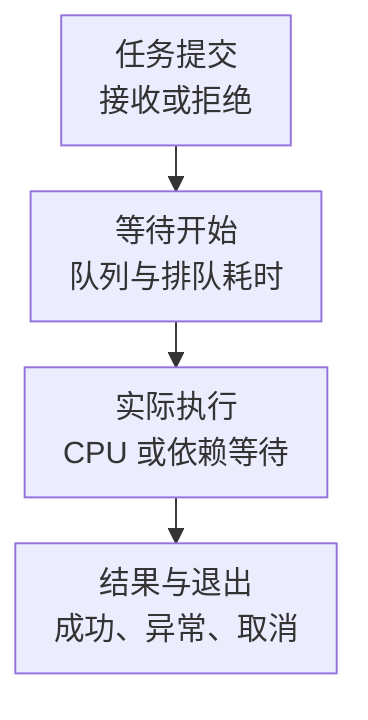

# 线程池核心监控指标采集与告警

线程池监控要回答：任务是否及时开始、能否及时结束、过载时是否按设计拒绝或降级。线程数很多、CPU 很高甚至 completed 持续增加，都不能独立证明用户请求成功；任务可能在等数据库，也可能完成时抛出异常。

本文以 **ThreadPoolExecutor 与 Micrometer v1.15.0 的 ExecutorServiceMetrics**为契约，不是依赖版本推荐。示例采用普通有界工作队列与 ExecutorService 计时包装；ForkJoin、Scheduled、虚拟线程和框架执行器需分别验收。基础约定见[监控指标地图](../../../sre/observability/01-主流组件监控指标地图.md)，`job="app-executor"`，保留 service、instance 和稳定的 name 标签。

## 1. 排队与执行是两段时间



等待结果的调用者超时，不自动停止底层任务。任务取消、线程中断、外部 IO 取消和连接归还需要各自的协作协议，不能只看 Future 已结束就认为资源已经释放。

## 2. 状态绑定不等于计时接入

`new ExecutorServiceMetrics(...).bindTo(registry)` 主要读取执行器状态；若要记录任务排队与执行时间，需要通过 `ExecutorServiceMetrics.monitor` 返回的包装器提交任务。只创建包装器但继续向原始池提交，Timer 会漏掉这部分工作。

```java
ExecutorService observed = ExecutorServiceMetrics.monitor(registry, rawExecutor, "orders");
observed.submit(task);
```

这是接入关系片段，rawExecutor、registry、task 由应用管理。不要因监控绑定而创建第二个承担业务的池，也不要在请求路径反复注册 binder。关闭池与监控生命周期应由同一个明确的所有者管理。

## 3. 核心指标卡片

以下为默认 metricPrefix、ExecutorService 重载及 Prometheus registry 的名字。普通 Executor 重载、框架自动绑定和其他 registry 不保证完全相同。

| 问题 | 指标 | 类型、单位与边界 |
| --- | --- | --- |
| 活动线程 | `executor_active_threads` | G，正在执行任务的近似线程数；包含任务阻塞等待 |
| 当前/Core/Max | `executor_pool_size_threads`、`executor_pool_core_threads`、`executor_pool_max_threads` | G，线程数；配置最大值不等于当前可立即执行能力 |
| 当前队列 | `executor_queued_tasks` | G，近似任务数；不等于所有已接收未完成业务数 |
| 剩余队列名额 | `executor_queue_remaining_tasks` | G，名额；无界队列或直接交接队列不能按普通容量百分比解释 |
| 完成量 | `executor_completed_tasks_total` | FunctionCounter，近似完成任务次；异常完成也可计入，不是成功次数 |
| 执行时间 | `executor_seconds_sum/count` | Timer，累计秒/已完成包装任务；不是每个活动任务的实时年龄 |
| 开始前等待 | `executor_idle_seconds_sum/count` | Timer，累计秒/已开始包装任务；idle 指任务开始前等待，不是工作线程空闲率 |
| 拒绝与业务结果 | 自有 `site_executor_rejected_tasks_total`、业务成功/失败/取消 Counter | 原生 binder 不提供通用拒绝/业务结果指标；自定义命名和更新契约需单独实现 |
| 最老任务年龄 | 自有队列/在途年龄指标、Trace/JFR | 可弥补平均等待和完成样本的盲区，不能声称原生总有该指标 |

## 4. 源码分析与查询

[ExecutorServiceMetrics](https://github.com/micrometer-metrics/micrometer/blob/v1.15.0/micrometer-core/src/main/java/io/micrometer/core/instrument/binder/jvm/ExecutorServiceMetrics.java)从 ThreadPoolExecutor 读取 active、queue、remainingCapacity 和 completed 等值。它们是不同时间点的近似观测，不应要求每次样本都严格满足状态守恒式。

[TimedExecutorService](https://github.com/micrometer-metrics/micrometer/blob/v1.15.0/micrometer-core/src/main/java/io/micrometer/core/instrument/internal/TimedExecutorService.java)使用 `executor` 和 `executor.idle` Timer；[TimedRunnable](https://github.com/micrometer-metrics/micrometer/blob/v1.15.0/micrometer-core/src/main/java/io/micrometer/core/instrument/internal/TimedRunnable.java)在包装时开始等待计时，run 开始时停止等待、开始执行计时，并在 finally 记录执行时间。因此异常执行也有耗时，未开始/永不结束的任务则没有完整的相应样本。

平均开始前等待秒数：

```promql
(
  rate(executor_idle_seconds_sum{job="app-executor"}[5m])
  / rate(executor_idle_seconds_count{job="app-executor"}[5m])
)
and (rate(executor_idle_seconds_count{job="app-executor"}[5m]) > 0)
```

平均执行秒数：

```promql
(
  rate(executor_seconds_sum{job="app-executor"}[5m])
  / rate(executor_seconds_count{job="app-executor"}[5m])
)
and (rate(executor_seconds_count{job="app-executor"}[5m]) > 0)
```

已完成任务/秒，不能标成成功请求/秒：

```promql
rate(executor_completed_tasks_total{job="app-executor"}[5m])
```

对明确使用固定容量队列的 orders 池，观察队列占用比例：

```promql
(
  executor_queued_tasks{job="app-executor",name="orders"}
  / (executor_queued_tasks{job="app-executor",name="orders"} + executor_queue_remaining_tasks{job="app-executor",name="orders"})
)
and ((executor_queued_tasks{job="app-executor",name="orders"} + executor_queue_remaining_tasks{job="app-executor",name="orders"}) > 0)
```

无界队列的 remainingCapacity 可能非常大，比例长期很低仍然可能堆积到 OOM；SynchronousQueue 的队列尺寸/剩余容量通常不能按普通缓冲队列解释。此时应观察等待、拒绝、在途数与任务年龄。

## 5. 为什么线程池没有达到 Max 却一直排队

ThreadPoolExecutor 通常先创建到 core，再尝试入队；队列放不下才考虑继续创建到 max。使用无界队列时，提高 max 往往不能解决积压。线程都在等数据库连接时继续扩池，还可能放大数据库压力。机制见[线程池、队列与拒绝](./06-线程池队列拒绝与关闭.md)。

拒绝也不是同一种结果：AbortPolicy 抛异常，CallerRunsPolicy 在调用方执行，Discard 类策略可能静默丢弃。自定义拒绝 Counter 应记录拒绝事件，同时由业务结果指标说明最终完成、丢弃或降级；不能把所有拒绝直接当 HTTP 失败。

ForkJoin 的窃取与任务队列、Scheduled 的延时任务、虚拟线程的承载与外部并发限制均有不同语义。不要将普通池的 queued/max 比例推广到所有执行器。

## 6. 示例告警与排障

orders 约定为有界、固定容量队列。排队比例超过 80% 且有任务，持续 5 分钟提示饱和；阈值需根据允许等待时间、突发和处理速度调整。

```yaml
groups:
  - name: executor-queue-core
    rules:
      - alert: ExecutorBoundedQueuePressure
        expr: |
          (
            executor_queued_tasks{job="app-executor",name="orders"}
            / (executor_queued_tasks{job="app-executor",name="orders"} + executor_queue_remaining_tasks{job="app-executor",name="orders"})
          ) > 0.8
          and (executor_queued_tasks{job="app-executor",name="orders"} > 0)
        for: 5m
        labels:
          severity: warning
        annotations:
          summary: "业务有界线程池队列持续接近容量上限"
```

| 现象 | 优先关联 |
| --- | --- |
| active 高、CPU 高、执行变慢 | CPU 配额、GC、算法/序列化与真实 CPU Profile |
| active 高、CPU 低 | 锁、连接池、同步 IO 和下游等待，查看线程/Trace |
| queued 高、平均等待不高 | 未开始任务尚未形成等待样本，查看最老年龄与队列趋势 |
| completed 高、业务失败高 | 异常、取消、重试；完成计数不保证成功 |

恢复需要任务等待与业务 SLO 达标，拒绝/取消符合策略，底层工作真实退出并释放资源。不要直接清空队列、无限增线程或关闭超时来消除告警。

## 7. 掌握检查

1. 为什么 binder 有 active，但 idle Timer 没数据？任务可能没有经过 monitor 返回的包装器，或尚未开始。
2. 为什么 completed 不代表成功？执行结束和业务结果是两种事实。
3. 为什么低队列百分比不证明无界池安全？分母并不是可接受的业务积压预算。
4. 为什么调用者超时后还要看活动任务？停止等待不等于中断/取消成功，资源可能继续被占用。
