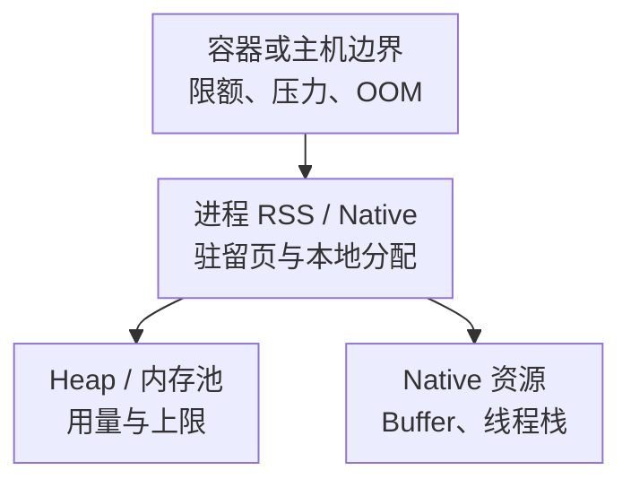

# JVM 核心监控指标采集与告警

JVM 监控首先要回答三个问题：请求是否受到影响，运行时在等待什么，以及进程离资源上限还有多远。Heap 使用率高可能只是正常的回收周期；Heap 不高也可能因 Direct Buffer、线程栈或容器限额而 OOM。

本文以 **Micrometer v1.15.0 的 JVM binders 与 Prometheus registry**说明指标契约，不是推荐依赖版本。[Java/JVM 学习路线](../00-Java与JVM学习路线.md)的 JDK 主线不变；不同 JDK、GC 和框架会改变 pool、事件和自动绑定范围。这里不是 JMX Exporter 命名规范，两套采集器不能照抄名称或重复相加。标签沿用[监控指标地图](../../../sre/observability/01-主流组件监控指标地图.md)，示例 `job="jvm"`。

## 1. 内存是包含关系，不是一个百分比



图表示逐层缩小观测范围，不是把这些数字相加。容器记账还涉及文件缓存等内容，RSS 也不是所有虚拟地址空间。预算应预留堆外和回收器开销，不能把 `-Xmx` 直接设成容器内存限额。

## 2. 接入清单

Micrometer 的 meter 需要绑定到 registry 后才能暴露。框架可能自动配置 JVM binders；普通 Java 服务需要显式绑定，不能因为依赖包存在就假设指标齐全。GC binder 的监听器和生命周期也要正确关闭，避免重复注册。

| 接入层 | 应验收的内容 |
| --- | --- |
| JVM binder | 内存、GC、线程、Buffer；JDK/GC 是否支持，collector 是否重复 |
| Prometheus registry | meter 到线上名称/单位的转换；抓取端点、TLS/认证和网络权限 |
| 服务身份 | `cluster,instance`，另加低基数 `service,env`；实例重启后可区分 |
| OS/容器 | RSS、CPU 时间、配额、throttling、OOM 事件；不是所有 registry 都自动提供 |
| 应用 | 请求结果、直方图、线程池、连接池、任务等待；必须有相应 instrumentation |

不要将 URL 参数、用户 ID、异常全文、线程 ID 作为长期标签。HTTP、数据库池、Executor 指标也不是所有 JVM 天然都有，必须确认框架或 binder 的实际注册与标签。

## 3. 核心指标卡片

| 问题 | Prometheus 名称 | 类型与边界 |
| --- | --- | --- |
| 内存池 | `jvm_memory_used_bytes`、`jvm_memory_committed_bytes`、`jvm_memory_max_bytes` | G，字节，标签 `area,id`；max 可能为 -1，表示未知/未定义 |
| GC 后存活 | `jvm_gc_live_data_size_bytes` | G，字节；与收集器事件和老年代识别有关，不是每次抓取都重新测量 |
| 长期数据上限 | `jvm_gc_max_data_size_bytes` | G，字节；支持情况依赖 GC，不应当通用进程上限 |
| 分配与晋升 | `jvm_gc_memory_allocated_bytes_total`、`jvm_gc_memory_promoted_bytes_total` | C，字节；事件驱动估算，不等于完整逐对象追踪 |
| 暂停时间 | `jvm_gc_pause_seconds_sum`、`jvm_gc_pause_seconds_count` | C，秒/事件数，标签含 action/cause；不是所有 Safepoint 或所有请求停顿 |
| 暂停最大值 | `jvm_gc_pause_seconds_max` | 时间窗口最大值，不是 P99，也不是进程启动以来永不回落的最大值 |
| 并发 GC 阶段 | `jvm_gc_concurrent_phase_time_seconds_sum` 等 | Timer，秒；并发阶段不能全部当作 STW 时间 |
| 平台线程 | `jvm_threads_live_threads`、`jvm_threads_daemon_threads`、`jvm_threads_states_threads` | G，线程数；state 是状态快照，不是 CPU 用量 |
| Buffer | `jvm_buffer_count_buffers`、`jvm_buffer_memory_used_bytes`、`jvm_buffer_total_capacity_bytes` | G，个/字节，标签 id；不能覆盖所有 Native 内存 |

Meter ID 的点号经过 Prometheus registry 转换，单位成为后缀；这里采用默认命名。GC `action,cause`、内存 `id` 不能跨 JDK 硬编码为唯一固定值，接入先查看实际标签集合。

## 4. 源码分析：为什么 Heap 比例经常算错

[JvmMemoryMetrics](https://github.com/micrometer-metrics/micrometer/blob/v1.15.0/micrometer-core/src/main/java/io/micrometer/core/instrument/binder/jvm/JvmMemoryMetrics.java)读取各 `MemoryPoolMXBean` 的 usage 并附加 `area,id`。MXBean 的 max 可为 -1，而且各池的最大容量并不总是独立、可相加的份额。因此，直接 `sum(used)/sum(max)` 可能引入负分母或重叠预算，不能称作准确的全局 Heap/Xmx 比例。

对**同一个定义了上限的池**观察比例：

```promql
(
  jvm_memory_used_bytes{job="jvm",area="heap"}
  / jvm_memory_max_bytes{job="jvm",area="heap"}
)
and (jvm_memory_max_bytes{job="jvm",area="heap"} > 0)
```

若要全局 Heap/Xmx，应另行明确从 MemoryMXBean/启动配置获取总堆上限的契约，而不是把每池 max 凑成 Xmx。used/committed 反映已提交池容量的占用，也不是容器 OOM 风险比例。

[JvmGcMetrics](https://github.com/micrometer-metrics/micrometer/blob/v1.15.0/micrometer-core/src/main/java/io/micrometer/core/instrument/binder/jvm/JvmGcMetrics.java)订阅 GC 通知，将暂停和部分并发事件记录到不同 Timer，并根据回收前后内存变化更新相关估算。没有事件或不支持的池可能造成缺失/滞后；不要统一补零再宣布回收健康。

## 5. GC 与线程的查询边界

窗口内平均 GC 暂停秒数：

```promql
(
  sum by (cluster, instance) (rate(jvm_gc_pause_seconds_sum{job="jvm"}[5m]))
  / sum by (cluster, instance) (rate(jvm_gc_pause_seconds_count{job="jvm"}[5m]))
)
and on (cluster, instance)
(sum by (cluster, instance) (rate(jvm_gc_pause_seconds_count{job="jvm"}[5m])) > 0)
```

已观测暂停在窗口内的时间占比线索：

```promql
sum by (cluster, instance) (
  rate(jvm_gc_pause_seconds_sum{job="jvm"}[5m])
)
```

结果 0.1 表示平均每秒记录 0.1 秒暂停，不应乘线程数。它不覆盖所有 Safepoint、分配等待或 CPU 竞争，也不是应用 P99。并发 GC 即使暂停低，也可能消耗 CPU/带宽并影响业务。

分配速率，字节/秒：

```promql
sum by (cluster, instance) (
  rate(jvm_gc_memory_allocated_bytes_total{job="jvm"}[5m])
)
```

平台线程中当前阻塞在 monitor 的数量：

```promql
jvm_threads_states_threads{job="jvm",state="blocked"}
```

Runnable 不代表一定在 CPU 上运行，Waiting 也可能是正常空闲。虚拟线程不能简单由平台 `ThreadMXBean` 数量推断，需结合 JDK 的 JFR/虚拟线程诊断和执行器状态。[JvmThreadMetrics 源码](https://github.com/micrometer-metrics/micrometer/blob/v1.15.0/micrometer-core/src/main/java/io/micrometer/core/instrument/binder/jvm/JvmThreadMetrics.java)能帮助确认观测范围。

### 5.1 P99 必须有真实桶

`jvm_gc_pause_seconds_bucket` 只有在对应 Timer 启用 Prometheus percentile histogram 等配置后才存在。启用会增加序列数，需先检查实际桶与开销。下面仅适用于已完成直方图接入的实例：

```promql
histogram_quantile(0.99,
  sum by (cluster, instance, le) (
    rate(jvm_gc_pause_seconds_bucket{job="jvm"}[5m])
  )
)
```

没有 GC 样本时分位数可能为 NaN，不是零延迟；`_max` 不能拿来填补 P99。原理与配置见[Micrometer 直方图说明](https://docs.micrometer.io/micrometer/reference/concepts/histogram-quantiles.html)和[Timer 说明](https://docs.micrometer.io/micrometer/reference/concepts/timers.html)。

## 6. 示例告警：持续暂停压力

下面 10%/10 分钟只用于示范持续条件，不是所有 GC 的健康标准。低延迟服务可能在更小暂停比例时就违反 SLO，批任务则可能容忍不同预算。

```yaml
groups:
  - name: jvm-runtime-core
    rules:
      - alert: JVMObservedGCPausePressure
        expr: |
          sum by (cluster, instance) (
            rate(jvm_gc_pause_seconds_sum{job="jvm"}[5m])
          ) > 0.1
        for: 10m
        labels:
          severity: warning
        annotations:
          summary: "JVM 持续存在较高的已观测 GC 暂停占比"
```

先对齐业务慢请求时间线，再看 GC 日志/JFR、回收后存活量、分配速率、CPU 配额和 Native/容器预算。不要因一张 Heap 曲线自动 Full GC、抓全量 Heap Dump 或增大 Xmx；暂停、磁盘占用和敏感数据都需要评估。

| 现象 | 需要区分的原因 |
| --- | --- |
| Heap 高且回收后基线持续增长 | 缓存增长、真实活跃数据、泄漏；需对象存活与引用证据 |
| Heap 不高但容器 OOM | Direct/Native、线程栈、文件缓存、限额；查 RSS/NMT/容器事件 |
| 暂停低但请求长尾高 | 锁、池排队、CPU throttling、下游、并发 GC 资源竞争 |
| 线程数稳定但任务积压 | Executor 队列和拒绝策略，不能只看线程总数 |

## 7. 掌握检查

1. max=-1 的池为什么不能参与普通容量比例？上限未知，负值不是负容量。
2. GC 暂停平均值很低能否证明无长尾？不能，需真实分布和请求时间线。
3. 进程 RSS 减 Heap used 是否就是准确的 Native 泄漏量？不是，驻留、提交和分配是不同口径。
4. 为什么虚拟线程服务仍需看平台线程与 CPU？虚拟线程执行仍依赖承载线程和资源，但两类线程数量不能等同。

继续阅读：[容器资源预算](./08-JVM容器资源CPU与内存预算.md)、[GC 日志与延迟归因](../06-diagnostics/05-GC日志安全点与延迟归因.md)、[Heap 与 Native 排查](../06-diagnostics/04-Heap-NativeMemory与OOM排查.md)。
