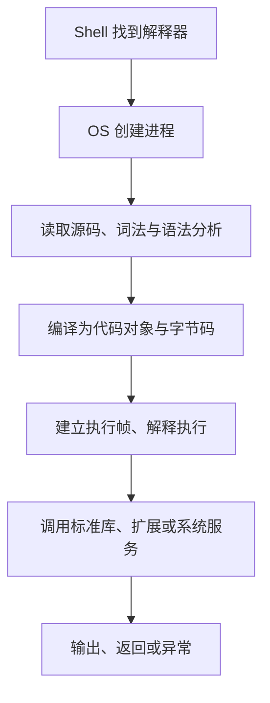

# Python 程序如何运行：解释器、脚本、模块与交互环境

Python 是语言，CPython 是它的一种实现。执行 `python hello.py` 时，操作系统先启动解释器进程，解释器再读取源文件、建立运行环境并执行代码。`hello.py` 本身通常不是 CPU 能直接执行的机器指令。

本系列使用常规 CPython 3.14。先看清入口和执行阶段，再学习语法，可以少遇到“代码一样，为什么在另一处运行就不同”的困惑。

## 1. 从源文件到结果



CPython 不是“每读一行就完全独立地执行一行”。普通模块会先被编译，再执行其顶层代码。函数体也在编译过程中形成代码对象，但函数里的业务语句要到调用时才运行。

三种东西需要分开：

| 对象 | 含义 | 是否等于完整应用 |
| --- | --- | --- |
| 源码 `.py` | 人可阅读的程序文本 | 否，还需要解释器和依赖 |
| 代码对象/字节码 | CPython 执行所需的内部表示 | 否，不是通用 CPU 机器码 |
| 运行进程 | 解释器、对象、线程、连接等运行状态 | 是某一次实际执行，不是永久产物 |

导入模块时可能生成 `__pycache__` 中的 `.pyc`，用于减少后续的源码编译工作。它不是执行结果缓存，不会免除模块顶层代码的执行，也不保证跨 Python 版本可用。直接运行主脚本通常不会仅为了主文件生成同样的缓存。

## 2. 第一个完整脚本

如果此前没有写过程序，先完成[安装与解释器定位](./02-Python安装虚拟环境pip与解释器定位.md)，在编辑器里新建 hello.py，只写 `print("Hello, Python!")`，从保存文件的目录运行 `python hello.py`。编辑器保存的是文本，终端命令才启动执行；不要把 `>>>` 提示符也复制进文件。

然后逐次增加一项能力：用 `name = "Ada"` 保存名称，再把 print 改成 `print("Hello,", name)`；下一步用 `input("name: ")` 从终端读取。input 返回字符串，不会因为输入 123 就自动成为整数。每次只改变一处，预测输出，再运行验证。

下面的完整脚本把这些动作组织成函数和入口。初读时先按后面的五步跟踪，暂不要求提前掌握所有语法；学习[函数](./08-函数参数默认值返回值与调用.md)和[条件](./06-条件循环match与控制流.md)后再回来逐行解释。

将文件保存为 UTF-8。代码前的空格是语法的一部分；统一使用四个空格，不混用 Tab。

```python title="execution_demo.py"
import sys

def greet(name):
    return f"Hello, {name}!"

def main():
    name = sys.argv[1] if len(sys.argv) > 1 else "Python"
    print("entry:", __name__)
    print(greet(name))
    return 0

if __name__ == "__main__":
    raise SystemExit(main())
```

运行：

```bash
python execution_demo.py
python execution_demo.py Ada
```

第一条命令的输出：

```text title="execution_demo.out"
entry: __main__
Hello, Python!
```

第二条最后一行变成 `Hello, Ada!`。Shell 把参数传给进程，解释器将它们放入 `sys.argv`；脚本名通常是第 0 项，所以第一个业务参数是第 1 项。

逐步看发生了什么：

1. `import sys` 绑定模块名称；这时没有调用 `greet`。
2. 执行两个 `def`，创建函数并绑定名称；函数体尚未执行。
3. 主脚本的 `__name__` 是 `"__main__"`，入口条件成立。
4. `main()` 获取输入、调用函数、打印结果并返回整数。
5. `SystemExit(0)` 让进程以成功状态退出；其他退出码通常表示失败。

把 `print(greet(name))` 写在函数外，会在模块导入时也执行。入口保护可以隔离 CLI 行为，但不会阻止入口条件之外的顶层代码运行。

## 3. 四种运行方式

| 方式 | 示例 | 适合什么 |
| --- | --- | --- |
| 脚本 | `python execution_demo.py` | 明确执行某个文件 |
| 模块入口 | `python -m package_name` | 按导入规则定位模块或包入口 |
| 短命令 | `python -c "print(2 + 3)"` | 一次性诊断 |
| 交互环境 | `python` 后出现 `>>>` | 探索表达式与小实验 |

`-m` 不是换一种拼写运行相同路径。它先按模块规则定位代码，为包内相对导入提供相应上下文；直接运行一个包内文件，未必有相同上下文，详见[模块与导入](./10-模块包导入路径与导入副作用.md)。

交互环境会展示表达式结果，脚本不会自动展示：

```python
2 + 3            # 在脚本里计算后丢弃结果
print(2 + 3)     # 明确产生输出
```

Notebook 还会保留之前单元格的对象。单独重跑一个格子成功，不代表重启内核后从头执行也成功；正式示例应能在新进程中完整运行。

## 4. 三个不同的路径

解释器路径、源文件路径和当前工作目录不是同一个东西：

```bash
python -c "import os,sys; print(sys.executable); print(os.getcwd())"
```

`sys.executable` 回答“谁执行代码”；`__file__` 通常回答“模块文件在哪里”；`os.getcwd()` 回答“相对文件路径以哪里为基准”。从另一个目录运行同一个脚本，工作目录可能改变，不能假设 `open("config.json")` 一定读取脚本旁边的文件。

交互环境等场景不一定定义 `__file__`。应用的配置目录应该明确约定，不应靠切换运行方式碰运气。

## 5. 按阶段理解错误

`SyntaxError` 表示源码没有通过语法分析/编译，例如漏了冒号。普通模块存在语法错误时，模块顶层语句尚未开始执行；但在导入它之前，其他模块可能已经执行过。

`NameError`、`TypeError`、`ZeroDivisionError` 等通常发生在执行阶段。解释器已经理解语法，但某个实际操作失败。

Traceback 从调用链逐层指向发生异常的位置。先读最后一行的异常类型和说明，再回看自己的文件与行号；不要只截取日志第一行。未捕获异常通常使进程失败退出，但“进程仍在”也不代表所有线程或后台任务正常。

## 6. 练习与答案

### 6.1 为什么直接运行后得到结果，导入同一个文件却没有问候输出？

答案：导入时仍会执行模块顶层代码并创建函数，但模块的 `__name__` 通常是导入名称，不是 `"__main__"`；入口条件不成立，所以没有调用 `main()`。

### 6.2 删除 pyc 能修复业务计算错误吗？

答案：通常不能。它缓存编译表示，不缓存业务计算结果。应先核对实际解释器、实际导入文件和输入；删除缓存不能修复源码中的错误规则。

### 6.3 在交互环境执行五次成功，是否证明脚本可独立运行？

答案：不能。交互环境可能保留导入、变量和修改后的状态。应从新进程运行完整文件，并验证默认输入、指定输入和失败路径。

## 7. 参考资料

- [CPython 执行模型](https://docs.python.org/3.14/reference/executionmodel.html)
- [命令行与环境](https://docs.python.org/3.14/using/cmdline.html)
- [顶层代码环境](https://docs.python.org/3.14/library/__main__.html)
- [模块教程](https://docs.python.org/3.14/tutorial/modules.html)
