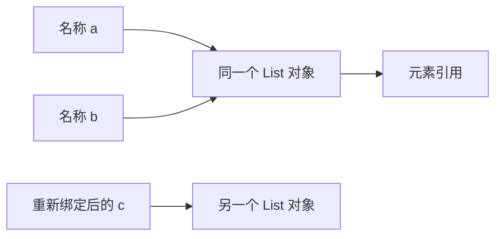

# 变量、对象、引用、可变性与复制

`a = b` 不表示“把 b 的整份数据复制给 a”。Python 的赋值让名称绑定到对象：多个名称可以指向同一个对象，容器也可以保存对同一对象的引用。

解释变量时，先区分三个问题：名称绑定在哪里，对象能否改变内部状态，是否需要创建独立副本。

## 1. 名称不是装着数据的固定盒子



对象有身份、类型和值。名称本身没有固定的数据类型：`x = 1` 之后可以 `x = "ready"`，这是把 `x` 重新绑定到另一类对象，不是把整数对象改成字符串对象。

`del x` 删除的是名称绑定，不保证对象立即销毁。只要其他名称、容器或执行状态还持有引用，对象仍可能可达。具体回收时机属于解释器实现与资源管理问题。

## 2. 修改、浅复制与深复制

```python title="references_demo.py"
from copy import deepcopy

def main():
    original = {"ports": [80]}
    alias = original
    shallow = original.copy()
    deep = deepcopy(original)

    alias["ports"].append(443)
    shallow["name"] = "copy"
    print("original:", original)
    print("shallow:", shallow)
    print("deep:", deep)
    print("same outer:", original is shallow)
    print("same inner:", original["ports"] is shallow["ports"])

    rows_bad = [[]] * 2
    rows_good = [[] for _ in range(2)]
    rows_bad[0].append(1)
    rows_good[0].append(1)
    print("repeat:", rows_bad)
    print("separate:", rows_good)

if __name__ == "__main__":
    main()
```

```text title="references_demo.out"
original: {'ports': [80, 443]}
shallow: {'ports': [80, 443], 'name': 'copy'}
deep: {'ports': [80]}
same outer: False
same inner: True
repeat: [[1], [1]]
separate: [[1], []]
```

顺着引用解释，比背结果更有用：

1. `alias` 与 `original` 是同一个字典。
2. `copy()` 创建了新字典，但里面的列表引用仍共享。
3. 修改共享列表，两本字典都能观察到；给浅复制字典新增键，只改变它自己。
4. `deepcopy` 对本例的内层列表也建立了副本，所以不受后来的修改影响。
5. `[[]] * 2` 重复的是一个内层列表的引用；推导式每次执行 `[]`，才得到两个列表。

深复制不是通用隔离方案：连接、锁、文件等资源不应按普通数据复制；自定义对象也可以改变复制行为。更稳妥的设计往往是明确状态归属，或只复制需要修改的那一层。

## 3. 重新绑定和原地修改是两种操作

```python
a = [1]
b = a
a = a + [2]
print(a, b)       # [1, 2] [1]

c = [1]
d = c
c += [2]
print(c, d)       # [1, 2] [1, 2]
```

内置列表的 `+` 创建新列表，`+=` 通常原地扩展；不能据此推导所有类型的 `+=` 都原地修改。例如整数不可变，`n += 1` 会计算整数结果并重新绑定名称。

赋值语法只告诉你操作入口；具体是否修改对象，要看类型协议。函数参数同样绑定对象：函数能修改传入列表，但给参数名重新赋值不会自动改变调用方的名称，详见[函数与参数](./08-函数参数默认值返回值与调用.md)。

## 4. 不可变容器不等于深层不可变

```python
record = ("api", [80])
record[1].append(443)
print(record)                # ('api', [80, 443])
```

Tuple 固定的是各位置引用，不能写 `record[0] = "worker"`；它指向的列表仍能改变。冻结外壳不等于冻结整个对象图。

“不可变”和“可哈希”也不是完全同义词。Tuple 只有在元素都可哈希时才能作为字典键；包含列表的 Tuple 不可以。哈希键要求在其参与集合/字典期间保持哈希与相等关系的一致性，不应把可变业务字段随意用作键。

## 5. 相等与同一对象

`==` 比较值是否相等，具体由类型的相等协议决定；`is` 比较是否同一个对象。两个独立创建的列表可以相等但不是同一个对象。

使用 `value is None` 判断缺失哨兵，不使用 `value is 1000` 判断数值。小整数缓存、字符串驻留和编译优化可能让某些对象暂时共享，属于实现现象，不能用来编写值比较逻辑。

`id(obj)` 在对象存活期间标识其身份；对象回收后身份值可能被复用。不要把它当成跨进程、跨重启或数据库里的业务 ID，也不要依赖其一定是内存地址。

## 6. 怎么判断是否该复制

先问调用方是否仍会使用旧状态，以及双方是否允许观察彼此的修改。只读共享通常不需要复制；临时排序可以用 `sorted(items)` 保留原序列；真正需要独立的嵌套数据时才设计复制策略。

复制会增加 CPU 和内存成本，也可能复制过多状态。并发共享状态问题不能仅靠“深复制一次”解决，仍要考虑后续修改、同步和生命周期。

## 7. 练习与答案

### 7.1 a 和 b 指向一个列表，del a 后 b 还能使用吗？

答案：能。删除 `a` 不会删除 `b` 的绑定。只要列表仍被 `b` 等对象引用，它仍可访问。

### 7.2 字典 copy 后修改内层列表，原字典为什么跟着变？

答案：只复制了字典这一层；两边的值仍引用同一个列表。若只需修改该字段，可以构造新字典并单独复制该列表，不一定需要复制整个对象图。

### 7.3 怎样创建三行彼此独立的空列表？

答案：`rows = [[] for _ in range(3)]`。不要使用 `[[]] * 3`，后者重复同一个内层列表的引用。

## 8. 参考资料

- [数据模型：对象、值与类型](https://docs.python.org/3.14/reference/datamodel.html)
- [copy：浅复制与深复制](https://docs.python.org/3.14/library/copy.html)
- [赋值语句](https://docs.python.org/3.14/reference/simple_stmts.html#assignment-statements)
