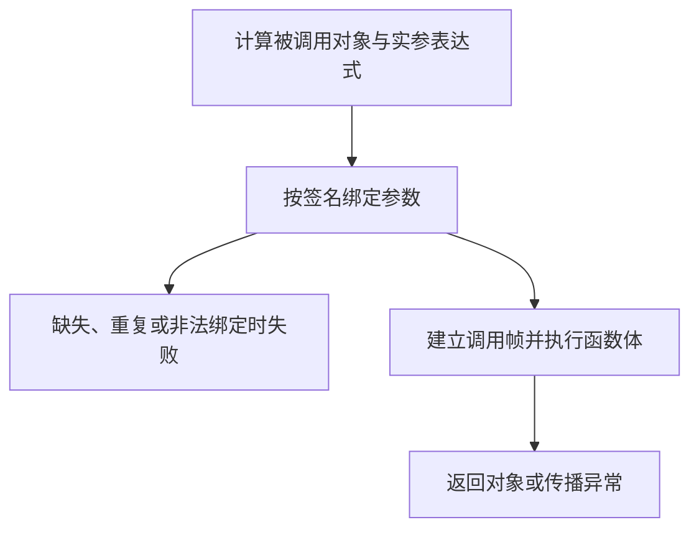

# 函数、参数、默认值、返回值与调用

函数把一组规则组织成可复用的调用边界。这个边界应当说明接受什么、返回什么、修改什么，以及失败如何表达，而不只是把长代码缩进到 `def` 下面。

## 1. 定义阶段与调用阶段

执行 `def` 时，解释器创建函数对象并绑定函数名；函数体在调用时运行。默认参数表达式在定义执行时求值，不是在每次调用时重新求值。

因此“定义一次”不是“程序永远只发生一次”：模块通常在首次导入时执行定义，嵌套函数则可能在每次外层调用时重新定义。关键是每个函数对象拥有自己的默认参数对象。

一次普通调用大致经过：



实参表达式可能先产生副作用，即使后续参数绑定失败。不要假设“函数体没进入”就意味着整个调用没有发生任何动作。

## 2. 位置、关键字与签名

```python
def connect(host, /, port=443, *, timeout=3.0):
    return host, port, timeout
```

`/` 前是仅限位置参数；`*` 后是仅限关键字参数。因此 `connect("api", timeout=1.0)` 合法，`connect(host="api")` 不合法。`port` 可按位置或关键字提供。

`*args` 收集额外位置参数为 Tuple，`**kwargs` 收集额外关键字参数为 Dict。调用中的 `*items`、`**options` 是展开，不是声明；重复提供同一个参数通常会抛 `TypeError`。

不要为了“灵活”让所有函数只接收 `**kwargs`，这样会丢失可读签名和明确错误。稳定公共参数应显式声明，扩展字段再单独处理。

## 3. 默认参数与对象共享实验

```python title="functions_demo.py"
def append_bad(value, bucket=[]):
    bucket.append(value)
    return bucket

def append_good(value, bucket=None):
    if bucket is None:
        bucket = []
    bucket.append(value)
    return bucket

def configure(host, /, port=443, *, timeout=3.0):
    return host, port, timeout

def change(values):
    values.append("shared")
    values = ["local"]
    return values

def main():
    print("bad1:", append_bad("a"))
    print("bad2:", append_bad("b"))
    print("good1:", append_good("a"))
    print("good2:", append_good("b"))
    print("signature:", configure("api", timeout=1.0))
    original = []
    result = change(original)
    print("caller:", original)
    print("result:", result)

if __name__ == "__main__":
    main()
```

在新进程里运行：

```text title="functions_demo.out"
bad1: ['a']
bad2: ['a', 'b']
good1: ['a']
good2: ['b']
signature: ('api', 443, 1.0)
caller: ['shared']
result: ['local']
```

`append_bad` 的默认列表属于同一个函数对象，两次未传 `bucket` 的调用共享它。`append_good` 在缺省时于函数体内创建列表。

如果 `None` 本身也是合法且不同的业务输入，就需要独立哨兵，而不是把 `None` 同时当作“未提供”和“显式清空”。带时间、随机值、配置读取的默认表达式也有相同的定义时机问题，不能仅防可变列表。

## 4. 参数传递到底传了什么

调用 `change(original)` 时，参数名 `values` 与调用方名称 `original` 指向同一个列表。`append` 修改列表，所以调用方看得见。

随后 `values = ["local"]` 只是把参数名称重新绑定到新列表，不会重绑调用方的 `original`。函数返回新列表后，调用方可以选择用另一个名称接收。

这通常称为对象共享传参或 call by sharing。不要用“所有参数深复制”解释，也不要将它等同于能任意重绑定调用方变量的引用参数。对象的可变性与函数是否主动修改对象，才决定外部能观察到什么。

## 5. 返回值、注解与文档

没有显式 `return` 或只写 `return`，会返回 `None`。`return a, b` 返回一个 Tuple，不是语言层面返回两个独立通道。

```python
def total(price: int, count: int = 1) -> int:
    """Return the total price in the smallest currency unit."""
    return price * count
```

这里的类型注解本身不执行运行时输入校验。直接 `total("x", 3)` 仍可能得到字符串重复结果；静态检查器或 FastAPI 等框架在各自边界使用注解，才赋予进一步检查行为。

Python 3.14 改变了注解求值机制；后续类型专题会区分延迟求值、前向引用与运行时反射。本阶段只要求理解：写了注解不等于调用自动严格检查。

Docstring 是函数体第一条字符串语句，可由 `help` 等读取。文档应补充单位、是否修改输入、失败类型等签名表达不了的信息。

## 6. 设计可靠的小函数

计算规则尽量与文件、HTTP、打印分开；返回值比到处输出更容易测试。需要日志或存储时，在明确的边界调用。

区分 `None`、空列表和异常：空列表可以表示“查询成功但无结果”，`None` 可以表示“缺失”，异常可以表示“查询没有成功完成”。不能把所有失败都返回空列表，否则调用方无法区分。

递归适合自然递归的数据，但 CPython 不提供普遍的尾调用消除保障，深递归会碰到递归限制。不要靠随意增大限制处理不可信深度输入。

## 7. 练习与答案

### 7.1 默认参数写 time.time() 能得到每次调用时刻吗？

答案：不能。表达式在函数定义执行时求值。可用 `None` 或哨兵作为默认值，在函数体内读取时间；同时根据用途区分时间点与单调计时。

### 7.2 参数名重新赋值后，调用方的列表会被替换吗？

答案：不会。重新绑定只改变当前函数中的参数名称。之前对共享列表的原地修改仍然保留，返回新对象也不会自动让调用方改绑。

### 7.3 标注 timeout: float 能拒绝字符串吗？

答案：普通 Python 调用不能自动拒绝。可以在输入边界主动校验，或由明确配置的数据模型/框架校验；内部函数的注解仍然很有价值，但不是运行时防火墙。

## 8. 参考资料

- [函数定义与参数](https://docs.python.org/3.14/tutorial/controlflow.html#defining-functions)
- [函数定义语义](https://docs.python.org/3.14/reference/compound_stmts.html#function-definitions)
- [调用表达式](https://docs.python.org/3.14/reference/expressions.html#calls)
- [注解求值](https://docs.python.org/3.14/library/annotationlib.html)
