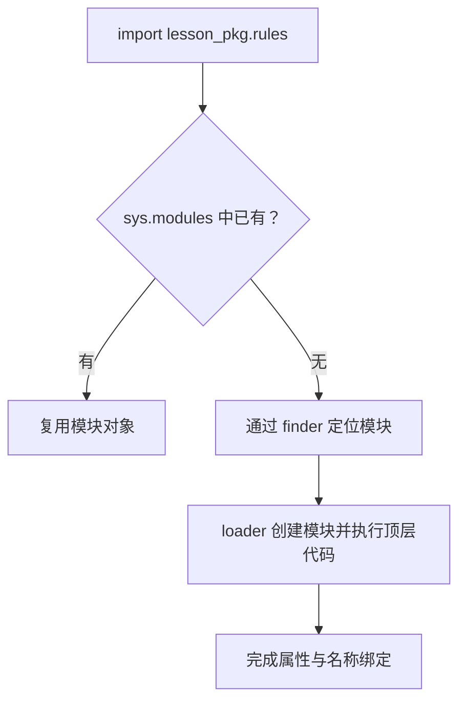

# 模块、包、导入路径与导入副作用

`import` 不只是“让编译器知道一个名字”。它可能查找文件、创建模块、执行模块顶层代码，并将对象放入缓存。导入过程中若创建网络连接或启动任务，程序还没进入明确的入口，就已经产生外部动作。

## 1. 模块、包和分发包

模块是拥有命名空间的组织单元，常见形式是一个 `.py` 文件，也可以是扩展模块或内置模块。包用于组织子模块，普通包通常有 `__init__.py`；命名空间包允许没有这个文件，不能把“没有 init 就一定不能导入”当成规则。

pip 安装的“分发包”和代码中的导入名不是同一个概念。一个分发包可以提供多个模块，也可能使用不同的导入名；应查包文档，不要看到导入失败就安装一个同名的陌生包。

## 2. 最小可执行包

在一个独立目录放置以下文件：

```text
language-lab/
└── lesson_pkg/
    ├── __init__.py
    ├── __main__.py
    └── rules.py
```

```python title="lesson_pkg/__init__.py"
"""Small import-safe package used by the language examples."""
```

```python title="lesson_pkg/rules.py"
def normalize_name(value):
    normalized = value.strip().casefold()
    if not normalized:
        raise ValueError("name must not be empty")
    return normalized
```

```python title="lesson_pkg/__main__.py"
import sys

from .rules import normalize_name

def main(argv=None):
    args = sys.argv[1:] if argv is None else argv
    if len(args) != 1:
        print("usage: python -m lesson_pkg NAME", file=sys.stderr)
        return 2
    try:
        result = normalize_name(args[0])
    except ValueError as error:
        print(str(error), file=sys.stderr)
        return 2
    print(result)
    return 0

if __name__ == "__main__":
    raise SystemExit(main())
```

从 `language-lab` 目录运行：

```bash
python -m lesson_pkg "  API  "
```

输出为 `api`，退出码为 0。缺参数或只提供空白名称，会向标准错误输出说明并返回退出码 2。这里的 2 是此 CLI 的约定，不是所有 Python 程序统一的业务错误码。

导入 `lesson_pkg.rules` 则只建立定义，不打印结果，也不访问网络。这使规则可以被 CLI、测试和后续 FastAPI 入口复用。

## 3. 导入大致经历哪些步骤



这是简化路径。实际导入还涉及包初始化、导入锁、异常处理以及导入钩子；模块会在其代码执行完成之前加入 `sys.modules`，以支持依赖处理，因此循环导入可能观察到“部分初始化”的模块。

对普通模块，同一进程中重复导入通常复用缓存，不会每次重跑顶层代码；但不同进程各有一份模块状态，`reload` 或把同一文件用不同模块名加载也会改变行为。不要把导入缓存当成全局唯一分布式锁。

## 4. 名称查找与路径

常见的路径型模块查找会使用 `sys.path`，它受启动方式、环境、虚拟环境、安装位置和配置影响。通常：

- `python script.py` 会将脚本所在目录放入相关搜索位置。
- `python -m package` 通常使当前工作目录参与查找。
- 安全/隔离启动选项、`._pth` 文件、环境定制可能改变默认行为。

排障先观察，不急着 `sys.path.append`：

```bash
python -c "import sys; print(sys.executable); print(*sys.path, sep='\n')"
python -c "import lesson_pkg.rules as m; print(m.__file__)"
```

后者要在包可导入的目录/环境中执行。`__file__` 对某些模块不适用，因此不要假设所有模块都对应普通文件。

当前目录的 `json.py`、`http.py` 可能遮蔽标准库；错误的解释器或启动目录可能让开发机成功、服务启动失败。长期解决方案是可安装的项目结构与明确入口，不是到处追加硬编码路径。

## 5. 为什么不要直接执行包里的 main 文件

`python -m lesson_pkg` 设置包入口所需的模块上下文，再执行 `__main__.py`；其中 `from .rules import ...` 可以按包关系解析。

`python lesson_pkg/__main__.py` 则把该文件当独立主脚本执行，通常没有同样的包上下文，相对导入会失败。两者都是运行 Python，却不是相同的启动语义。

`import lesson_pkg.rules as rules` 让 `rules` 指向模块；`from lesson_pkg.rules import normalize_name` 把当时的对象绑定到当前命名空间。后者不是一个自动跟随原模块属性重新赋值的“实时链接”，但若绑定的是共享可变对象，对其内部修改仍然可见。

## 6. 循环导入与副作用

A 导入 B，B 又从 A 导入一个尚未定义的名称，就可能出现 partially initialized module 错误。根本问题是依赖方向和初始化顺序，不是“Python 不支持两个模块互相调用”。

常见处理是把共同的数据类型放到独立模块，减少顶层依赖，或将确实需要推迟的导入放到使用位置。延迟导入只是调整时机，不应掩盖混乱架构。

模块顶层适合定义函数、类型和简单常量；需要关闭的连接、线程池、数据库 Session 或后台任务应在明确的应用生命周期里管理。`if __name__ == "__main__"` 只保护其下方代码，不会使整个文件自动无副作用。

## 7. 练习与答案

### 7.1 import 两次会发送两次顶层 HTTP 请求吗？

答案：普通同名模块在同一进程中通常只执行一次；但多 Worker、多进程或重新加载都可能再次执行。正确做法不是依赖这次“只有一次”，而是不要在导入阶段发送该请求。

### 7.2 为什么包入口用 -m 成功，直接运行文件失败？

答案：`-m` 按模块规则定位并提供包上下文；直接运行包内文件通常被当作独立脚本，显式相对导入缺少所属包信息。应固定入口方式。

### 7.3 生产里 ModuleNotFoundError，先加 sys.path 可以吗？

答案：先核对解释器、当前目录、安装环境、模块真实路径与部署产物。硬编码路径可能暂时绕过症状，却让环境不可移植或意外加载同名文件。

## 8. 参考资料

- [模块教程](https://docs.python.org/3.14/tutorial/modules.html)
- [导入系统](https://docs.python.org/3.14/reference/import.html)
- [模块搜索路径初始化](https://docs.python.org/3.14/library/sys_path_init.html)
- [包入口](https://docs.python.org/3.14/library/__main__.html)
