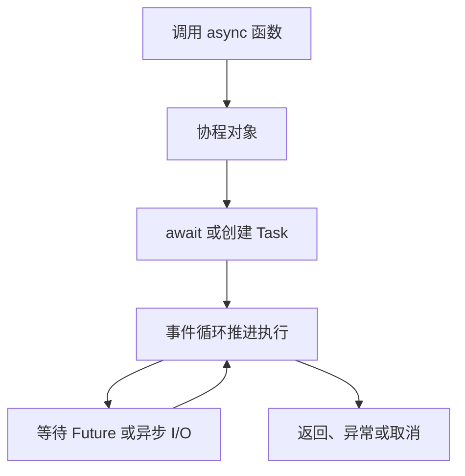

# async、await、事件循环、Task 与 Future

`async def` 定义协程函数；调用它得到协程对象，通常不会立即完成工作。事件循环通过 Task 推进协程，在等待点切换其他可运行任务。

## 1. 四个对象的关系



Future 是结果就绪的抽象，Task 管理协程执行并关联结果。直接调用异步函数却既不 await 也不安排 Task，可能只创建了一个最终从未执行的协程。

## 2. 确定次序的实验

```python title="concurrency_async.py"
import asyncio

async def worker(name, gate):
    await gate.wait()
    return name

async def main():
    gate = asyncio.Event()
    tasks = [asyncio.create_task(worker(name, gate))
             for name in ("a", "b")]
    print("scheduled", len(tasks))
    gate.set()
    print(await asyncio.gather(*tasks))

if __name__ == "__main__":
    asyncio.run(main())
```

```text title="concurrency_async.out"
scheduled 2
['a', 'b']
```

gather 的返回结果保持参数顺序，不代表任务按这个顺序完成。示例用 Event 表达同步条件，没有通过碰运气的睡眠推测状态。

## 3. await 不一定真的让出执行权

等待一个已经完成的结果，可能立即继续；CPU 密集循环即使写在 async 函数里，也可能长时间占用事件循环。`time.sleep`、同步数据库驱动和普通文件操作也不会因外层 async 自动变非阻塞。

需要选择真实的异步驱动、受控线程池或进程池。`asyncio.to_thread` 适合移出部分阻塞调用，但不能无限提交，也不能默认给纯 Python CPU 计算带来多核加速。

## 4. 生命周期与并发数

保留创建的任务引用，观察异常，并在退出时等待/取消。无界 create_task 会把队列隐藏在 Task 对象里；Semaphore 只能限制进入某段工作，若先创建百万任务，仍会占用大量内存。

事件循环属于特定运行环境。已在异步框架内时应 await，不要再调用 `asyncio.run` 试图嵌套另一个主循环。

### 4.1 一次等待怎样恢复

以默认、非 eager 任务创建方式为例：create_task 把协程交给 Task，并安排初次推进；循环运行到它时，协程执行到一个尚未就绪的等待对象，登记恢复关系并暂停。I/O、计时器或其他任务使结果就绪后，回调安排 Task 再次进入可运行状态，协程从暂停点继续。

这里不是操作系统为每个协程创建一个线程。事件循环线程一次只能推进一个普通 Python 执行片段；遇到同步阻塞时，其他已经就绪的协程也无法得到这条线程。不同平台的事件循环 I/O 实现可能不同，Windows 的完成通知与 Unix 常见就绪通知不能画成所有平台完全相同的内部调用。

`await child()` 通常把控制流委托给 child，不必创建独立 Task；`create_task(child())` 才为它建立独立调度与结果对象。等待一个已完成的 Future 也可能直接继续，因此循环里出现 await 不等于每轮都会公平让出。

调试时查看 asyncio.all_tasks、任务栈与 slow callback 日志，先确定谁没有结束、谁在等待、谁占着循环。每秒创建多少 Task 不是成功吞吐；取消后的残留 Task 与未观察异常同样需要计入资源。

## 5. 练习与答案

### 5.1 async 函数里调用同步 HTTP，一定不会堵住其他请求吗？

答案：不一定，通常会阻塞执行它的事件循环线程。应使用异步客户端或受控卸载。

### 5.2 gather 返回 a、b，说明 a 先执行完吗？

答案：不能据此判断。结果按参数顺序排列，完成次序需要独立观测。

### 5.3 Semaphore 十个许可，就能创建无限 Task 吗？

答案：不应如此。等待许可的 Task 仍占内存，需要在创建任务之前或输入消费处设置有界窗口。

## 6. 参考资料

- [协程与任务](https://docs.python.org/3.14/library/asyncio-task.html)
- [事件循环](https://docs.python.org/3.14/library/asyncio-eventloop.html)
