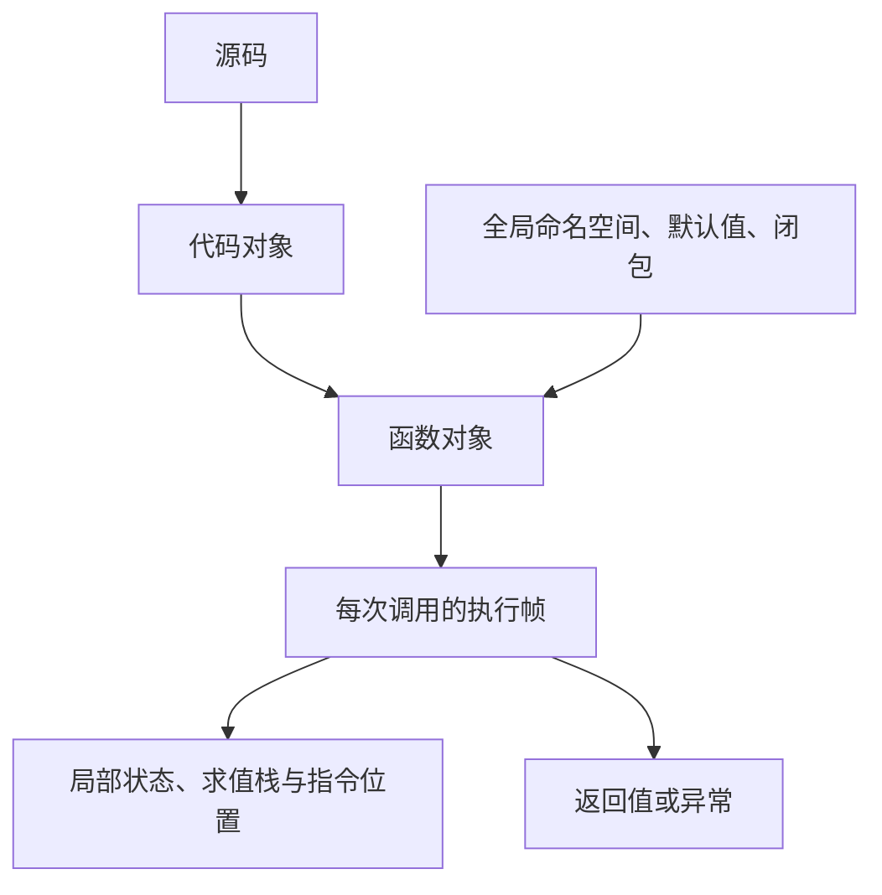

# 源码、字节码、代码对象与执行帧

Python 源码描述规则，CPython 将其编译成代码对象，再在执行帧里解释运行。函数对象还关联全局命名空间、默认参数与闭包，不能把它等同于一段字节码。

## 1. 运行时对象地图



模块编译也会产生代码对象；执行模块顶层代码才创建函数并绑定名称。调用同一个函数多次会产生不同的调用状态，局部变量不保存在一份公共“函数局部字典”中供所有请求共享。

## 2. 查看实际编译产物

```python title="runtime_bytecode.py"
import dis
import sys

def add(first, second):
    frame = sys._getframe()
    return first + second, frame.f_code.co_name

def main():
    code = compile("value = 2 + 3", "<lesson>", "exec")
    namespace = {}
    exec(code, namespace)
    print(namespace["value"])
    print(add(2, 3))
    print(add.__code__.co_argcount)
    print(any(item.opname == "RETURN_VALUE"
              for item in dis.get_instructions(add)))

if __name__ == "__main__":
    main()
```

```text title="runtime_bytecode.out"
5
(5, 'add')
2
True
```

`compile` 生成代码对象，`exec` 才执行。示例仅执行固定受信任文本，绝不能让外部用户把任意表达式送进 exec/eval；为它提供一个字典也不是可靠沙箱。

## 3. 字节码能回答什么

dis 可帮助理解局部读取、调用与分支，但指令名称、缓存槽、偏移和专门化策略会随版本改变。某条高层语句不一定对应一条指令，一条指令也不等于一个不可分割的业务操作。

CPython 可利用自适应专门化优化热点；实验性 JIT、不同构建与第三方解释器又有不同路径。分析前记录版本与构建，不拿旧版本反汇编证明新版本性能或线程安全。

## 4. 帧与内存

执行帧包含调用所需状态，Traceback 可以保留异常相关帧，进而保留局部大对象。长期缓存异常对象、帧或调试结果可能造成意外的可达内存保留。

可观测工具会影响运行成本。优先获取限定范围、限定时长的证据；不要在每个请求里遍历完整堆栈或导出全部局部变量。

## 5. 练习与答案

### 5.1 compile 成功意味着业务执行成功吗？

答案：不是。它只完成编译，名称解析、I/O 与业务运算等仍可能在执行时失败。

### 5.2 函数对象与代码对象有什么区别？

答案：代码对象描述可执行表示；函数还关联运行环境、默认值与闭包等。一次调用又有自己的帧状态。

### 5.3 保存完整异常可能为什么增加内存保留？

答案：Traceback 可能引用帧，帧再引用局部对象。应限制长期缓存的异常与诊断数据，并明确释放边界。

## 6. 参考资料

- [dis](https://docs.python.org/3.14/library/dis.html)
- [代码对象与帧](https://docs.python.org/3.14/reference/datamodel.html)
- [compile 与 exec](https://docs.python.org/3.14/library/functions.html)
