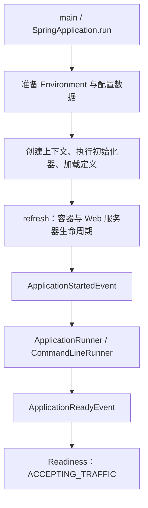

# 从 main 到端口监听的启动生命周期

进程已经存在、端口已经监听、应用已经就绪，是三个不同的状态。启动慢或者上线期间出现请求失败时，先确认卡在哪个状态，而不是只看有没有打印 Started。

## 1. 先把启动阶段分开



源码入口可从 [SpringApplication 4.1.1](https://github.com/spring-projects/spring-boot/blob/v4.1.1/core/spring-boot/src/main/java/org/springframework/boot/SpringApplication.java) 定位。不要把图中的每一格都当成一个线程，也不要把 Spring Framework 的 ContextRefreshedEvent 视为 Boot 所有启动动作的终点。

## 2. 为什么准备环境在创建业务对象之前

环境准备要先决定应用类型、配置位置、活动 Profile 和启动参数等。随后创建合适上下文，执行初始化器并装入源配置，才进入 Bean 定义处理和实例创建。

某些事件发生时还没有 ApplicationContext，因此监听它们不能只依赖一个普通 `@Bean` 监听器。实验在调用 run 之前通过 SpringApplication 注册监听器，才能观察早期阶段。

需要在早期读取的 `logging.*`、`spring.main.*` 等属性，也不能寄希望于刷新过程中才加入的 PropertySource。属性来源的加载时点与优先级是两个问题。

## 3. 端口监听早于 Runner 全部完成

嵌入式 Web 服务器参与 Web 上下文的刷新和生命周期管理。服务器初始化事件说明已经取得服务器实例及实际端口，但不等于初始化任务、缓存准备或其他 Runner 全部完成。

Runner 适合有明确上限的启动工作。ApplicationRunner 接收解析后的 ApplicationArguments，CommandLineRunner 接收原始字符串数组；可通过顺序配置协调它们，不要依赖方法在源文件中的排列。

如果关键 Runner 失败，应用启动会失败并进行关闭。把异常吞掉虽然可能让 run 正常返回，但会把真正不满足业务前提的状态带入服务阶段。

## 4. Started、Ready 与可用性事件

Started 在刷新后、Runner 执行前。Ready 在 Runner 完成之后；对应的接受流量状态变更又在 Ready 事件之后发布。因此监听 Ready 的回调里，不应无条件假设下一条可用性事件已经处理完。

Boot 提供的状态模型需要健康检查和流量入口配合。仅在内存里设置 Readiness，不能让任意外部负载均衡器自动知道该不该发流量。生命周期顺序见 [SpringApplication 文档](https://docs.spring.io/spring-boot/reference/features/spring-application.html)。

## 5. 实验：记录真实 Web 启动顺序

使用[前篇工程](./01-第一个SpringBoot应用与工程结构.md)的依赖和配置。服务器仍只监听本机临时端口，主程序结束前关闭上下文。

<details>
<summary>早期事件、服务器事件与两个 Runner</summary>

```java title="demo-app/src/main/java/demo/boot/lifecycle/LifecycleDemo.java"
package demo.boot.lifecycle;

import org.springframework.boot.*;
import org.springframework.boot.autoconfigure.EnableAutoConfiguration;
import org.springframework.boot.availability.*;
import org.springframework.boot.context.event.*;
import org.springframework.boot.web.server.servlet.context.ServletWebServerInitializedEvent;
import org.springframework.context.annotation.*;
import org.springframework.core.annotation.Order;
import java.util.*;

public final class LifecycleDemo {
    public static class Trace { public final List<String> stages = new ArrayList<>(); }
    @SpringBootConfiguration @EnableAutoConfiguration
    public static class Config {
        @Bean @Order(1) public ApplicationRunner applicationRunner(Trace trace) {
            return args -> trace.stages.add("applicationRunner");
        }
        @Bean @Order(2) public CommandLineRunner commandLineRunner(Trace trace) {
            return args -> trace.stages.add("commandLineRunner");
        }
    }
    public static org.springframework.context.ConfigurableApplicationContext start(Trace trace, String... args) {
        var app = new SpringApplication(Config.class);
        app.addInitializers(context -> context.getBeanFactory().registerSingleton("trace", trace));
        app.addListeners(event -> {
            String stage = switch (event) {
                case ApplicationStartingEvent ignored -> "starting";
                case ApplicationEnvironmentPreparedEvent ignored -> "environment";
                case ApplicationContextInitializedEvent ignored -> "contextInitialized";
                case ApplicationPreparedEvent ignored -> "prepared";
                case ServletWebServerInitializedEvent ignored -> "webServer";
                case ApplicationStartedEvent ignored -> "started";
                case ApplicationReadyEvent ignored -> "ready";
                default -> null;
            };
            if (stage != null) trace.stages.add(stage);
        });
        return app.run(args);
    }
    public static void main(String[] args) {
        var trace = new Trace();
        try (var context = start(trace, args)) {
            System.out.println("stages=" + String.join(",", trace.stages));
            System.out.println("readiness=" + context.getBean(ApplicationAvailability.class).getReadinessState());
        }
    }
}
```

</details>

运行主类 `demo.boot.lifecycle.LifecycleDemo`，业务输出为：

```text title="expected-output"
stages=starting,environment,contextInitialized,prepared,webServer,started,applicationRunner,commandLineRunner,ready
readiness=ACCEPTING_TRAFFIC
```

本例记录同步、单上下文的启动轨迹；有父子上下文、管理端口或不同应用类型时，需要按事件所属上下文区分，不能机械统计所有事件数量。

配套测试还把一个 Runner 暂时阻塞，证明服务器端口已存在时 Readiness 仍可为 REFUSING_TRAFFIC。有限超时和 finally 释放确保测试不会留下启动线程或服务器。

## 6. 启动故障按阶段收集证据

配置数据加载失败，先检查位置、格式和 Profile；Bean 创建失败，找最初的依赖或初始化异常；服务器启动失败，核对端口、地址和容器配置；Runner 失败，检查真实初始化动作和退出状态。

ApplicationFailedEvent 可以反映启动失败，但不保证每个资源都已经建立，也不保证一个普通上下文监听器来得及注册。失败取证要保留原异常，不能只看最后一层“应用启动失败”。

## 7. 练习与答案

### 7.1 端口能连接，是否就能开放生产流量

不能单独判断。服务器可能已监听，但关键 Runner 尚未完成。应使用与业务初始化一致的就绪条件，并让探针和流量入口真正消费这个条件。

### 7.2 一个普通 Bean 能否接收所有早期启动事件

不能。某些事件发生时容器还未创建或该 Bean 尚未注册。需要使用合适的早期注册机制，并确认监听器可依赖的资源。

### 7.3 Runner 的重试为什么需要上限

无限等待会让进程长期处于启动未就绪状态，也可能持续占用外部资源。应有明确超时、失败退出或有语义的降级策略，而不是只让进程看起来存活。

## 8. 继续阅读

- [Starter、BOM、依赖树与可执行 JAR](./03-Starter-BOM依赖树与可执行JAR.md)
- [Spring 容器刷新源码](../../spring/04-internals/01-ApplicationContext刷新状态与失败清理.md)
